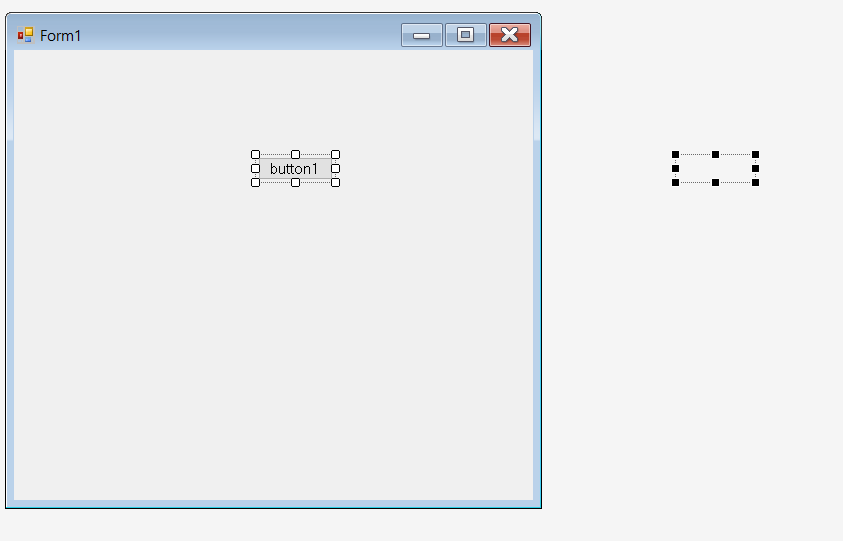
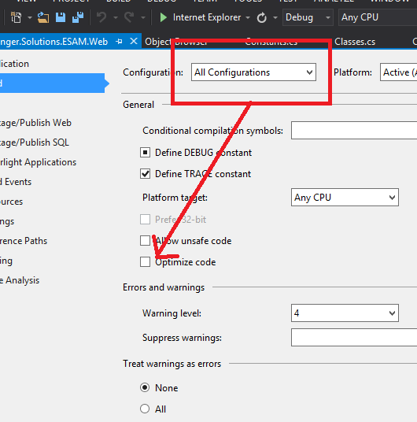

> This post was translated from Korean into English by AI.

> I would like to make it clear that I did not write the following post; I have reproduced it exactly as written by my senior colleague (who wrote Part 2).


# 0. My x-company

After publishing Part 1 and basking in the fervent cheers of my fangirls, I ~~rushed to~~ produce Part 2. About a week after the semester ended, I opened my laptop to start writing it. I had forgotten that I had already written a tiny bit during exam season and almost started over. I had planned to ramble about whatever I wanted in addition to the topics previewed at the end of Part 1, so that was a shame.

Right after I quit, my bag was bursting with stories, and I had written down a whole bunch of titles summarizing them in the preview for the next installment. But over the course of a semester, even more infuriating assignments pushed all my company stories out of memory. I triggered a page fault trying to recall them, but perhaps the disk has developed bad sectors, because I simply cannot remember. To prevent this situation and preserve data integrity, you need to dump it to magnetic tape periodically. What I mean is, if you do not write things down right away, you end up rambling like this.

This may seem out of the blue, but I want to use an analogy to compare Baekjoon algorithm problems with the problems I encountered at work.

* Baekjoon problem: Cheolsu is running an errand to buy something. Cheolsu is bad at arithmetic, and last time he brought back the wrong change and had to reimburse his big brother for the difference. So that Cheolsu can receive the correct change, **calculate his change for him.**

I do not know whether Cheolsu really brought back the wrong change or his brother is the bad guy here, but you can infer almost entirely from the prompt what needs to be done to solve the problem.

* Real-world problem: Cheolsu had been coding hard until the morning, but in the afternoon he suddenly split into two, and one of them jumped out the window. Something seemed wrong, but nobody who had missed Cheolsu splitting noticed the problem. Yeonghui tried talking to Cheolsu to find out what was wrong, but then she suddenly changed her attitude and threw Cheolsu out the window.

It is all rather confusing. In reality, quite a lot of problems arise outside the algorithms themselves—environment configuration, semantic errors, and so on. ~~I searched for “semantic error” and panicked when all I got was a BL novel... Just like that, baffling situations can crop up every time.~~


# 1. git

They did not use version control. Of course, at every important(?) update, they zipped up the project folder and organized the archives by date. It is a safe method, but when I took a peek, the backup folder contained dozens of archive files. The thought of every developer having one of those folders on their computer makes my head spin. Later, while I was puzzling over a problem, someone said it was an issue they had fixed before. At times like that, I do not know what they expect me to do when they fixed it but never gave me the changes. I am sure they did not withhold them because they did not want me to have them, but even with communication failures like this, they still refused to use git. I did suggest it, of course, only to get answers like, “Do we really need something like that?” Experience at a place like this does not seem very useful. (Though you do pick up some bizarre tricks.) If you have to do a long-term internship—four months or more—somewhere like this, run.


# 2. The stupid low-pass filter

If your data contains noise, how would you deal with it?

* You f*** with the hardware.
* You f*** with the software.

Either way, you cannot eliminate noise completely. The data we handled at the company was large both spatially and temporally. Long stretches of data came in all at once, in real time or at regular intervals. We could have removed noise through temporal accumulation, but that would slow response times and make development difficult, so they simply crushed the resolution. Roughly speaking, they blurred the data before processing it. The problem was that this blurring algorithm was profoundly wrong.

```c
for(int i=1; i<N; i++)
    arr[i] = (arr[i]+arr[i-1])/2;
```

It was roughly like this. The actual code was more complicated, but when expanded, this was what it boiled down to. Writing development code like garbage while also making it impossible to decipher at a glance can only be described as a truly innate talent. Even someone who has just begun studying C would know what is wrong with the code above. It repeatedly takes the average of `arr[i-1]` and `arr[i]` and overwrites `arr[i]` with it. As a result, the information at index 0 affects everything all the way through index N-1. I saw all kinds of bad code at that company, but I had never seen code this stupid...!

# 3. Loops upon loops

Loops serve many purposes, but personally, I think their two biggest effects are reducing long stretches of code and letting a program operate dynamically at runtime(?). They also provide clues about the data handled by the program. For example, the code below tells you that the `operation(...)` operation is performed on an array of length len.

```c
for(int i=0; i<len; i++)
	arr[i] = operation(...);
```

If all you care about is making the program work, it does not matter how you write the code. But for peaceful collaboration and easy maintenance, it is better to write it cleanly.

* Loops that can be combined

In the code I saw, loops were used only for array indexing. Every single array was processed with its own for loop, no exceptions. In simplified form, it looked like this:

```c
for(int i=0; i<N; i++)
	A[i] = op1(...);
for(int i=0; i<N; i++)
	A[i] = op2(...);
(...)

for(int i=0; i<N; i++)
	B[i] = op1(...);
for(int i=0; i<N; i++)
	B[i] = op2(...);
```

The operations on A are not affected by the operations on B, and vice versa. If I wanted to modify a single operation, I had to change the section related to A, scroll down about 500 lines, and then change the section related to B. There were so many similar sections in the code that even finding the parts to edit took about a minute. Would it not be better to write it like this?

```c
for(int i=0; i<N; i++){ // op1
	A[i] = op1(...);
	B[i] = op1(...);
}
for(int i=0; i<N; i++){ // op2
	A[i] = op2(...);
	B[i] = op2(...);
}
(...)
```

This makes it easy to see which operations are performed in sequence and which operations A and B must both undergo.


* Loops that should be combined by finding the pattern

When coding in a programming language, programmers must always look for patterns and examine the problem carefully so they can express those patterns in simple code. Accessing array indices is one of the simplest applications of a for loop. But for loops can be used in other ways too.

```c
for(int i=0; i<N; i++){
	if(i<4000){
		arr[i] = arr[i]+10;
	}else if(i<8000){
		arr[i] = arr[i]+20;
	}else if(i<12000){
		arr[i] = arr[i]+30;
	} (...)
}
```

This problem adds a different offset to each interval. The code above can be changed to the code below. The offsets are arbitrary values that may be changed later, so I pulled them out into a separate array. In truth, code like this still contains a lot of hard-coded elements—the index 4000 and the offset array—so it is not good for maintaining the program.

```c
int[] offset = {10,20,30,...};
for(int i=0; i<N; i++){
	arr[i] += offset[i/4000];
}
```

Changing the code structure like this has so little effect on the program's input and output that it hardly feels like doing any work. At first, my goal was simply to find a few logical errors, fix the communication issue, and perhaps improve performance if time allowed. But once I started cleaning things up, I discovered there were far more than one or two places in need of repair. The chaotic code contained a great many problems, such as mixing up the i and j indices and abusing global variables. Once I turned it inside out and inspected it, I could only marvel that it had ever worked at all. The data was large and there was no predefined correct answer, so nobody readily noticed that the internal computations were wrong.

I have more to say about loops, but venting even this much has made me feel a little better. Mix all the things I have mentioned together, and you end up facing code like this:

```c
for(int i=0; i<N; i++){
	if(i<4000){
		A[i] = A[i]+10;
	}else if(i<8000){
		A[i] = A[i]+20;
	}else if(i<12000){
		A[i] = A[i]+30;
	} (...)
}
for(int i=0; i<N; i++){
	A[i] = (A[i]+A[i-1])/2;
}
for(int i=0; i<N; i++)
	A[i] = op1(...);
for(int i=0; i<N; i++)
	A[i] = op2(...);

(...)

for(int i=0; i<N; i++){
	if(i<4000){
		B[i] = B[i]+10;
	}else if(i<8000){
		B[i] = B[i]+20;
	}else if(i<12000){
		B[i] = B[i]+30;
	} (...)
}
for(int i=0; i<N; i++){
	B[i] = (B[i]+B[i-1])/2;
}
for(int i=0; i<N; i++)
	B[i] = op1(...);
for(int i=0; i<N; i++)
	B[i] = op2(...);
(...)
```

If you feel dizzy too, then I am satisfied~


# 5. Saving settings like a Baekjoon problem?

You need to configure many parameters for a device to operate, and you also need many parameters to process its data. There are default values, of course, but testers need to find suitable constants and apply them easily, so you should create a configuration file and have the app load the previous settings every time it starts.

The old settings were saved like the input to an algorithm problem. The configuration file contained a long sequence of numbers with no indication of what they represented. When the program ran, it read those numbers line by line and assigned them to the appropriate values: current on line 1, frequency on line 2, temperature on line 3, and so on... There were about twenty lines like that.

So I used a JSON library to read and write the configuration parameters. I struggled with this too. At first, I structured the JSON to include everything in the existing configuration file. As time passed and we added various features, the number of fields that had to be saved in the configuration file grew. Updating the software made the old configuration files unusable. I always kept the device I tested fully up to date, but there were several other devices, and I did not always have access to them, so conflicts occurred from time to time. I need to study compatibility more. And exception handling is always extremely important.

It would be good to define the parameters required by the device in advance and minimize changes to the JSON schema.

# 6. Harry Potter and the Secret Controls

I mainly built GUIs using C# .NET Framework WinForms. With Visual Studio alone, you get a layout editor, text editor, build tools, and debugger, and it is simple to use, so I used it a lot. Anyway, here was the problem: the window size would be (800x600), while the coordinates of a control—a button or label, for example—would be something like (1200,400). There were controls outside the area displayed by the window. I discovered these secret controls only later. Controls outside the configured window area are invisible in the layout editor. If you press `ctrl+A` to select all the controls, dotted outlines appear around them, and that was when I noticed dotted outlines outside the window. At first, I thought it was a mistake. But when I asked the assistant manager, he said, “Oh~ those? We used to use them, but the board changed, so I hid them because that feature isn't used anymore.” At that moment, I heard the New Year's bell go `daeng~` inside my head. It was the moment I understood why sloth is one of the seven deadly sins.



# 7. The assistant manager is sleepy again today!

Why is he late so often? He also snores sometimes while taking a nap during lunch... And every so often, you catch him sleeping during work hours.... People at this company occasionally argue about tardiness. One day, the deputy general manager and the assistant manager were arguing, and their voices got a little louder than usual. The deputy general manager said, “Can't unavoidable things happen sometimes? Isn't that why you are late every day too, because it is beyond your control?” I snorted to myself when I heard that. The dispute was about this: “To prevent this in advance, we need to do oooo and obtain the xxxx paperwork, so please cooperate.” Imagine being a grown adult and getting roasted by another employee for being late... I should try to become a good adult.

# 8. My boss doesn't know what I do (:

When I had nothing to do or did not feel like working, I exchanged emails on a pen-pal site. The biggest downside to talking with friends on the other side of the world was that our time zones did not line up. Anyway, I signed up for a pen-pal site and wrote a short introduction page. The line I put in my profile was `My boss doesn't know what I do (:`. My desk was not far from the boss's, but the partition was fairly high, so I often felt free to slack off.

# 9. Radioactivity GUI

The job was to add a monitoring system to a radiation-related device built by a PhD researcher in the office next door. It was nearly finished, and my task was to improve it. I somehow ended up with the job because I said I had used openCV before. It was using openCV 2.0. Version 4 was already out, and the packages for version 2.0 were almost entirely legacy, so I began by upgrading it to version 4. Since the class and method names had changed as the package was updated, I updated all of those references too. The parameters had changed along with the method names, which made it quite an annoying task. Still, I felt good after solving it. Anyone can use it easily by downloading the NuGet package called `OpenCVSharp4`. It is maintained on gitHub by someone named `@shimat`, so if you run into problems, I recommend asking them or digging through the Q&A. I also strongly recommend always downloading the latest version. Like the code for the other devices, the radioactivity GUI code was filthy. I cleaned it up as much as possible, but the portion that communicated with the hardware was written at a very, very low level, so I could not touch it. The PhD researcher who made this device seemed to know almost no application programming languages and mainly worked with HDL (Hardware Discription Language). I had no choice but to leave the core code for device communication alone and clean up the surrounding code as much as possible. I neatly aligned the screen design too.

## memory violation

This occurs when you access memory that has been deallocated. What is truly ironic is that C# has a garbage collector, so it guarantees a certain degree of safety around dynamic allocation and deallocation. Code in this C# world is called `managed code`. When you use an external library, on the other hand, you call a function from C#, but its core is C/C++, so it can attempt arbitrary memory access. Code in those parts is called `unmanaged code`. This project built the GUI in C# and used the OpenCVSharp4 package along with a DLL library created by an assistant manager—a different assistant manager from the one mentioned earlier. I debugged diligently to find where the memory violation originated. But this type of memory error might occur, or it might not. You could encounter it ten seconds after launching the program, or the program could remain perfectly fine after several hours. The multithreaded environment also made debugging difficult. In a single-threaded environment, the location where the program breaks would be the problem point. But because this was a probabilistic issue in a multithreaded environment, the place where the error stopped the program differed from the place where the actual problem lay.

I ran so many experiments that I no longer remember exactly what the problem was. Perhaps everything was wrong. The three possibilities I suspect are listed below. Every time I fixed one of them, the error became less frequent. ~~Maybe everything really was broken after all.~~

* Use the latest version of OpenCVSharp4: You absolutely must use the latest version. I had been using a slightly older version because of a .NET Framework dependency issue, but `@shimat` told me to update because bug fixes are incorporated into the latest release, so I did. (e.g. 4.08 -> 4.11) Updates are fairly frequent—roughly every few weeks to a few months.
* Do not optimize the code: I think this has to do with the managed code mentioned earlier. If everything happens within the C# world, checking this option is probably fine. But if not, and you use several libraries, disabling the code optimization option seems safer when it comes to memory.
  
* Suspect your own code (DLL): The assistant manager created a function for Gaussian fitting, put it in a DLL, and gave it to me. Problems continued even after I completed the two steps above, and I confirmed that they arose when calling the DLL function. I told him several times that there seemed to be a problem with the code. The assistant manager seemed good at his job, but he spoke in an irritated tone, so I was a little afraid to talk to him. There were two problems related to the DLL, but I cannot remember the first. The fact that I cannot remember it probably means it was minor and unimportant. The second problem involved the length of an array. If you look at various libraries, they generally pass the length along with the array (pointer): `(int arr[], int len)` or `(int * arr, int len)`. But the assistant manager's function did not accept the length as an argument. It called memcpy within the function and specified the array size using `sizeof(arr)/4`. You can use `sizeof` to find the length of a local array, but you cannot do so once it has been passed in as an argument. For this reason, the code determined the array length incorrectly, causing the error. (A quick tip! `sizeof` is an operator, not a function.)

Problems like these occur when you access unallocated memory or deallocate memory that was never allocated—or has already been deallocated. Thinking about the days I lost to that thing is making my head hurt again.

# 10. How to Stay Up All Night Winding Fiber

The company had a whole lot of optical fiber, which we wound up and used for testing. For a section test, we wound N meters of fiber. Usually we wound around 10 m, but making a hundred 10 m fibers... or winding 1 km of fiber is a pretty tedious job. When I first started working there, I told them to buy a reel, but when I came back in the winter, there still was not one. So I tried using all sorts of tools to wind fiber more comfortably. The easiest way was to put it on a rod and use it like a roll of toilet paper. If you wind fiber by rotating it in the same direction, like a cassette tape, it twists less and will not snap halfway through from the tension. But they insist on turning their wrists as they wind. That makes the fiber twist round and round. If fiber were shaped like knife-cut noodles, the twisting would be obvious, but because it is a thin, translucent thread, you cannot see it. (Illustration below—left: wound neatly like a cassette tape; right: wound by turning the wrist, twisting the fiber.)


That is why winding fiber takes quite a long time. Of course, fiber work is nice when you want to clear your head after coding, but it is still an extraordinarily inefficient task.

You have to treat the fiber you worked so hard to wind with care. Otherwise, the strands tangle together and become harder to unravel than a bundle of 500 tangled earphones. It really takes hours of wrestling with them to get them loose. And you cannot just cut through them like Napoleon, because cutting and reconnecting them causes signal loss. It drives me insaaaaane~~~~

Even though I said it several times, I was utterly sick of them repeating the same cycle: 1. not buying a reel, 2. twisting the fiber as they wound it, and 3. struggling to untangle it later because the tester kept stuffing it away in a heap when simply keeping the fibers in order would have prevented all that tangling.

# 11. There Is No Way My Assistant Manager Doesn't Know About Lists

The title says it all. It was the era when I was cleaning up a 1,600-line function. Everything mentioned earlier, from the bizarre low-pass filter to the material about loops, was contained in this single function. Anyway, it contained suspicious index variables named k, m, and n. They were not even automatic variables within the function, but fields on the class. On top of that, if you searched their references, they would be initialized to 0 in the middle of the code despite never being used, or pop up out of nowhere in utterly incomprehensible code. They were remnants of data-processing algorithms shoved in haphazardly, and it was obvious that someone had reused them because another data-processing algorithm happened to use the same variable names. The laziness was truly beyond belief.

Since cleaning up the shit they left behind was my job, I spent some time examining the code to figure out what they had intended. The variables were used to inspect the data in an array and record the indices of points with particular features. The data used by the device had a fixed length, but only this strange array had a length of 1000. LOL. They had simply picked 1000 as a vaguely large-enough number and used it. Let me say this again: this was not C code. It was C# code. I asked the assistant manager to confirm my understanding. When I said it seemed like we could just use a List from collections, he told me he did not know how to use things like that.

(Insert dumbfounded reaction image here.)

+) Another episode: While explaining the code, I used the term “context switching.” The assistant manager told me, “Don't use words only you know.” So damn annoying.


# 12. To My Beloved Readers

I have run out of material now. I could write more if asked, but my memory is a little hazy, and it does not seem that entertaining. I also feel that my desire to land jokes is making the writing too aggressive. Again, this is closer to a collection of anecdotes than a substantive story. I therefore tried to leave out the details wherever possible and tell it concisely. Writing again after so long was tremendous fun. It reminded me of high school, when we agonized over every single word and held heated discussions to complete a single article. If you read many people's writing over and over, you begin to see each author's individual personality and try to understand their world. Through that experience, I realized that understanding another person requires deep love over a long period of time. Several years have passed since then, and I now often fail to practice that lesson and jump to conclusions about others.

Learning about another world is difficult. Conveying my own world is difficult too. Writing well is difficult. Reading is difficult, whether the writing is good or bad. People place their philosophy into their writing and send it out into the world. Writing crafted with care rather than tossed off carelessly has a corresponding value. The same is true of good code. Good code becomes a good channel of communication between others and me.

So what I really want to say is: let's not write filthy code!
