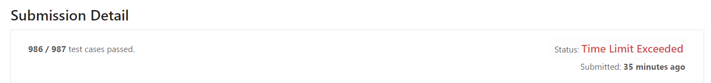
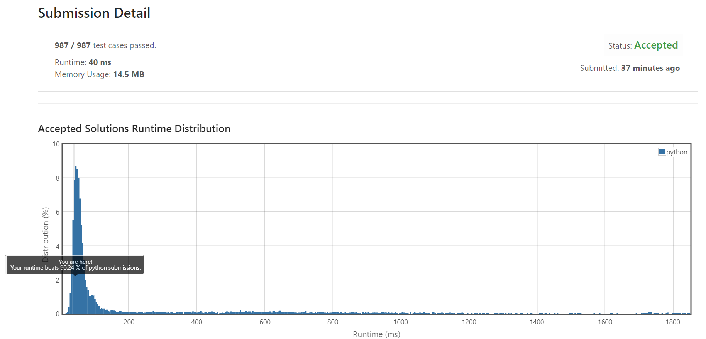
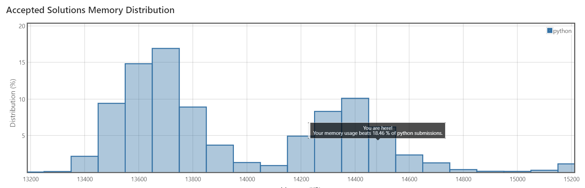

> This post was translated from Korean into English by AI.

While wondering what problem to solve next, I shamelessly decided to take a look at one of the `LeetCode` problems being covered by our algorithm study group. The problem I worked on today was called `Longest Substring Without Repeating Characters`. Just as the name suggests, it asks:

1. Among all contiguous substrings of a given string,
2. considering only those with no repeated characters,
3. what is the length of the longest one?

# The $O(n^2)$ Approach

At first, I assumed this had to be a dynamic programming problem requiring $O(n^2)$ time and space. So I created a two-dimensional array called `dp` and filled in `dp[s][e]`. The value of `dp[s][e]` is defined as follows:

- If the substring of the given string that starts at position `s` and ends at position `e` has no repeated characters,
  - its value is that substring.
- If it does have a repeated character,
  - its value is False.

With this setup, determining the value of `dp[s][e]` requires only the values of `dp[s+1][e]` and `dp[s][e-1]`. Therefore, we can initialize `dp[x][x]=str[x]`, gradually fill in the array, and find the maximum value of `substring length = e-s+1`.

(In fact, `dp[s][e]` only needs to store the first and last characters rather than the entire string. But since this algorithm ultimately failed, I will just explain the idea and move on.)

The only slightly complicated part of this algorithm is designing and filling in the `dp` array; once you have the idea, it is not particularly difficult. So I quickly coded it in Python and submitted it. Here is the source code.

```python
class Solution(object):
    def lengthOfLongestSubstring(self, st):
        """
        :type s: str
        :rtype: int
        """
        l = len(st)
        if l==0:
            return 0
        dp = [[False]*l for _ in range(l)]
        '''
        dp[s][e] = substr[s][e] including s,e
        '''
        for i in range(l):
            dp[i][i] = st[i]
        ml = 1
        for i in range(1,l):
#           i = string length - 1
            trueFlag = False
            for j in range(l-i):
                s = j
                e = s+i
                a = dp[s+1][e]
                b = dp[s][e-1]
                if (a is not False) and (b is not False) and (b[0] is not a[-1]):
                    ml = i+1
                    dp[s][e] = st[s]+st[e]
                    trueFlag = True
                else:
                    dp[s][e] = False
            if not trueFlag:
                return ml
        return ml
```


The result was...



One test case timed out. After asking myself “Why is my correct answer wrong?” a few times, I took a closer look at the input and found that the following string was repeated over and over. (`LeetCode` was kind enough to show me the input that caused the failure.)

```
abcdefghijklmnopqrstuvwxyzABCDEFGHIJKLMNOPQRSTUVWXYZ0123456789!\"#$%&'()*+,-./:;<=>?@[\\]^_`{|}~
```

Suppose the length of the entire string is $m$, and the length of this repeated string is $k$. Repetition can never occur in a substring shorter than $k$. In this case, the time complexity of my algorithm becomes $O(2mk-k^2)$. This increases monotonically with both $m$ and $k$. From a quick look, $m$ seemed to be around the maximum allowed by the problem, and since $k$ used every possible character, it was also at its maximum. So this was the worst possible input case.

# The $O(n)$ Approach

After thinking about it for quite a while, though, a simple solution occurred to me. Instead of structuring the `dp` array that way, what if I defined it like this?

```
dp[i]=the starting position of the longest substring with no repeated characters that ends at the i-th character
```

Then create a dictionary called `la`, defined as follows:

```
la[x]=the last position before the current position where character x appeared. 0 if x has never appeared.
```

This lets us use the following algorithm:

- Set the maximum substring length to `maxLength=0`.
- Suppose the character at position `i` is `x`.
- If the position where `x` last appeared is less than `dp[i-1]`, this means there are no duplicate characters between `dp[i-1]` and `i`.
  - Therefore, `dp[i]=dp[i-1]`.
- If the position where `x` last appeared (`la[x]`) is greater than `dp[i-1]`, this means there are no duplicate characters between `la[x]+1` and `i`.
  - Therefore, `dp[i]=la[x]+1`.
- If `i-dp[i]+1` is greater than `maxLength`, set `maxLength=i-dp[i]+1`.

In fact, if we take another look at this algorithm, we can see that it accesses only the `i-1` index of the `dp` array. Therefore, `dp` does not need to be an array at all; a single variable will do.

So I wrote the code as follows. In the code below, `av` serves the same purpose as `dp`.

```python
class Solution(object):
    def lengthOfLongestSubstring(self, st):
        l = len(st)
        if l<2:
            return l
        la = {st[0]:0}
        av = 0
        ml = 0
        for i in range(1,l):
            if st[i] in la:
                av = max(av,la[st[i]]+1)
            la[st[i]]=i
            if (i-av)>ml:
                ml = i-av
        return ml+1
```

The code is much shorter and cleaner.



The submission passed every test case, and apparently its runtime was around the top 10%. Haha.

The section below shows roughly where it ranks in terms of memory usage.



Hmm... It looks like there must be some way to use less memory that I do not know about. Still, it passed... and as long as it is fast, that is what matters, right? Haha.

The graph makes the memory difference look dramatic, but it is only about 5%. Looking at that, I suppose it may be no more than the difference made by using one extra variable or so.
