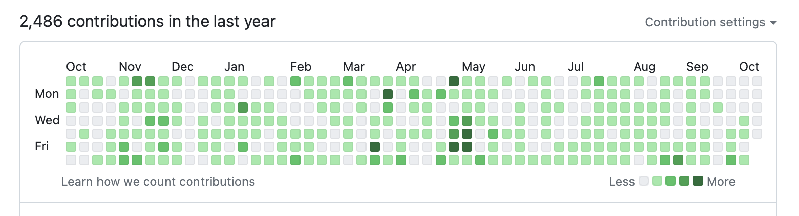

> This post was translated from Korean into English by AI.

The year and a half I had to spend on military service felt like such a waste. I felt that my growth had come to a halt because of military service at a time when I needed to be constantly learning and improving.
Perhaps I felt this even more strongly because I enlisted fairly late, and many of my friends had already finished their service and were working hard to grow.
So I resolved not to waste my year and a half in the military under any circumstances. I did a great deal of preparation before enlisting, and after I enlisted, I tried a variety of things as planned.

This post is a summary of my experience studying over those eighteen months. I want to use it both to record what I studied and, hopefully, to offer at least a little help to friends who will enter the military after me.

# Setting Up a Server

I believe that studying any field requires actually doing the work. Just as someone learning the piano will not improve by reading only sheet music and textbooks without ever playing the instrument, programmers will not improve unless they build things for themselves, whether applications or infrastructure. I therefore made it a major goal to establish an environment in which I could actually develop and deploy services while in the military.

With that in mind, I set up a server at home before enlisting. There is a major difference between having a server available around the clock and not having one—for example, having to use something like goorm IDE instead.
As mentioned above, setting up a development environment on a server allows you to connect and develop from anywhere. I also did most of my development by connecting to the server through VSCode's SSH extension. Beyond that, a server can provide developers with a reliable place to store files and a test bed where they can deploy the services they have built without worrying about cost.

- The hardware can be found in [this post](https://unknownpgr.com/posts/unboxing-pc).
- A domain is connected through AWS Route 53.
- [A DDNS system I implemented myself](https://github.com/unknownpgr/route53-ddns) is installed for this domain so that it can handle IP address changes.
- K3S is installed so that I can deploy a variety of services.
- I deployed Guacamole on this server so that I could connect to other machines.
- As a precaution, I deployed [Code Server](https://code.visualstudio.com/docs/remote/vscode-server) on Kubernetes.

In particular, the computers in the military's Cyber Knowledge Information Room do not let you install programs at will, and most ports other than 80 and 443 are blocked as well. It is therefore important to prepare a solid development environment in advance that remains accessible even under those conditions.

# Setting Up a Development Environment

After enlisting, I chose an EC2 Windows Server instance as my primary development environment. Before enlisting, I had planned either to use the server described above or to leave my MacBook at home and connect to it through VNC. However, I added a new environment for the following reasons.

- I needed a GUI for general-purpose use. There were many situations that required one, including GUI-based programs (e.g. MATLAB) and video processing.
- Comparing VNC with RDP, which is available on Windows, RDP is much faster.
- I specifically chose Windows Server because it was the only Windows image that provided a desktop environment.
- I built an [EC2 Controller](https://github.com/unknownpgr/ec2-webui) so that I could turn this server on only when I needed it.

# What I Actually Did

In the military, I mainly worked on tasks that could take a long time. For example, I comprehensively refactored the products I had built.
In civilian life, it can be difficult to undertake this kind of refactoring because it takes so much time.
But since military life feels as though it will never end, I could take my time refactoring without worry.

Once I arrived in the military, I also realized that there was a tremendous amount of time spent sitting around doing nothing.
So I chose ways of studying that would let me use those periods efficiently.
In particular, I read whenever I had a spare moment.

- Below are the computer-related books I read in the military that had a major influence on me.
  - Understanding the Linux Kernel (3rd)
  - TCP/IP Illustrated Volume 1
  - Clean Architecture
  - How Data Scientists Think
  - Fundamentals of Electromagnetics (textbook)
- I also read a variety of general-interest books unrelated to computers.
  - The Hundred-Year-Old Man Who Climbed Out the Window and Disappeared
  - A Citizen's Education
  - The New Poverty Is Coming
  - To Kill a Mockingbird
  - Sapiens
  - Mankiw's Principles of Economics
  - Management Concert

Whenever I was bored, I also revisited various concepts in mathematics and engineering.

- I restudied impedance-based circuit analysis in electronic circuits.
- I worked through proofs for various concepts in linear algebra again.
- By reflecting on statistics and probability, I was able to gain a variety of insights into statistics.
  - Developing the sensor algorithm based on Bayes' theorem that I wrote about previously was also an extension of this study.

I also worked on a variety of projects.

- I built a tunneling server that could access an HTTP server inside a private network.
- While participating in the Army Startup Competition, I also developed a service that automatically analyzes real estate registrations to help prevent jeonse deposit fraud.

# Conclusion

When I retrieved and checked the computer usage logs from the Cyber Knowledge Information Room, they totaled more than 950 hours. That is what the 950 hours in this post's title refers to.
At first, I borrowed someone else's account and only created my own partway through, so the time I actually spent using the computers must have exceeded 1,000 hours.

Thanks to this, I believe I was able to keep improving without wasting those eighteen months.
I hope others can also make efficient use of their time in the military rather than letting it go to waste.

# TMI

I wanted to retrieve my computer usage logs from the Cyber Knowledge Information Room. However, the management program would not let me copy the text and had no separate export feature. After struggling with it for quite a while, I eventually used Wireshark to capture the TCP stream. Fortunately or unfortunately, the data was transmitted as plain text, so after saving it and writing a suitable parsing script, I was able to calculate my total usage time.
