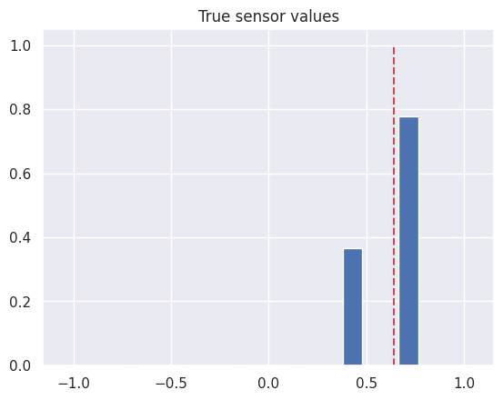
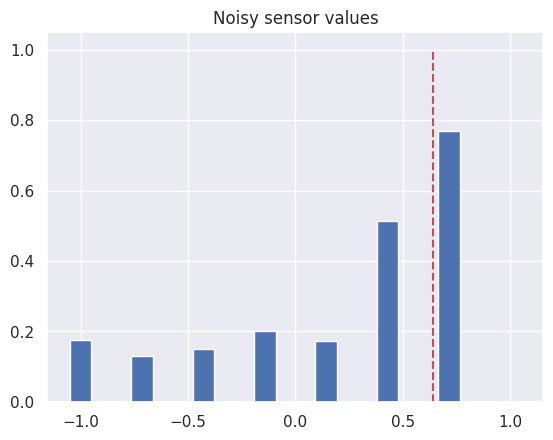
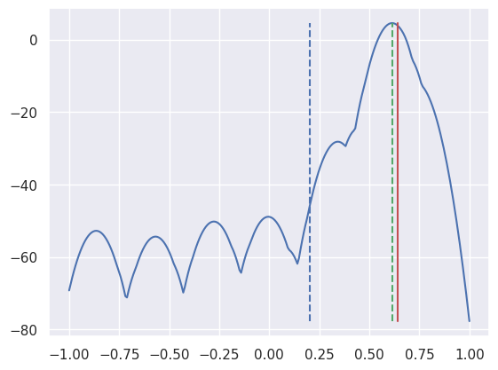
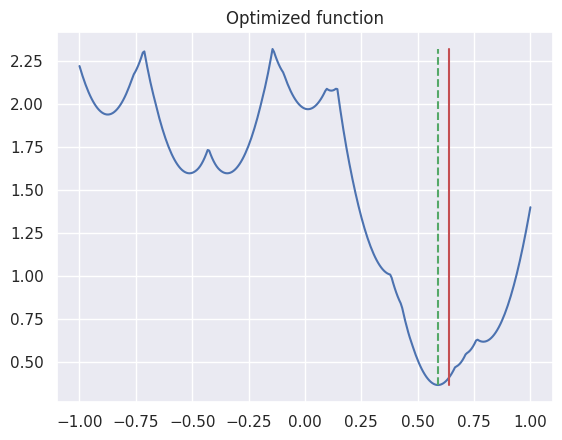

> This post was translated from Korean into English by AI.

A line sensor is a sensor used in line-following robots to estimate the position of a line relative to the center of the sensor, allowing the robot to follow the line.

Line sensors can be implemented in various ways. Here, I will discuss an algorithm for estimating the position of a line when several Infrared (IR) sensors are arranged in a row, as in the example below.

```
IR0---IR1---IR2---IR3---IR4---IR5---IR6---IR7
```

Before we begin, let us define the position of IR0 as -1 and that of IR7 as 1 for the position $x_n$ of each IR sensor. In other words, let $x_n=2n/7-1$.

## Existing Algorithm

At [ZETIN](https://zetin.uos.ac.kr), the robotics club I belong to, we estimated the position of the line using a weighted average as follows.

For a sensor reading $v_n$, let the reading be 0 when the sensor detects an empty black background, and 1 when the sensor is positioned directly over the white line. A sensor located at the edge of the line will have a reading between 0 and 1.

The existing method weighted each position by its sensor reading and estimated the line's position as follows.

$$
\hat{x} = \frac{\sum_{n=0}^7 x_nv_n}{\sum_{n=0}^7 v_n}
$$

This method is extremely simple, but when noise is present, it can produce a large error in the estimated line position. To improve upon it, I implemented an algorithm that estimates the line position using Bayes' theorem.

## Bayes' Theorem

Bayes' theorem is as follows.

$$
P(A|B) = \frac{P(B|A)P(A)}{P(B)}
$$

In this equation,

- $P(A)$ is called the prior probability,
- $P(A|B)$ the posterior probability,
- $P(B|A)$ the likelihood,
- and $P(B)$ the evidence.

If $B$ depends on $A$, the law of total probability allows us to rewrite the equation as follows.

$$
P(A|B) = \frac{P(B|A)P(A)}{\sum_{A}P(B|A)P(A)}
$$

For a continuous probability distribution, it can be expressed as follows.

$$
P(A|B) = \frac{P(B|A)P(A)}{\int_{A}P(B|A)P(A)dA}
$$

## Estimating the Line Using Bayes' Theorem

What we want to determine is the line position $p$ given the readings of eight sensors, $\vec v= (v_0, v_1, \cdots, v_7)$. To do so, we will find the probability density function for the line position $p$ and choose the value of $p$ with the highest density. Because this probability density estimates the distribution of the position given the sensor readings, it can be written as the conditional probability $P(p|\vec v)$. Since we do not know this conditional probability, we will obtain its distribution by applying Bayes' theorem for continuous probability distributions, as derived above.

$$
P(p|\vec v) = \frac{P(\vec v|p)P(p)}{\int_{p}P(\vec v|p)P(p)dp}
$$

To determine the prior probability $P(p)$ in this equation, we would need to measure the distribution of the sensor readings. Because a line-following robot follows the line in such a way that the line position remains at 0, its actual sensor readings would be distributed around 0. For generality, however, instead of making this assumption, let us assume that the line position follows a uniform distribution over a suitable range. This range may be slightly wider than $[-1,1]$, because a sensor can still detect the line when it lies just outside the outermost sensor. (This is another difference from the existing algorithm, in which the line position must always lie within $[-1,1]$.)

In other words, $P(p)=k$ within this range. The equation can therefore be transformed as follows.

$$
P(p|\vec v) = \frac{P(\vec v|p)}{\int_{p}P(\vec v|p)dp}
$$

Thus, once we determine $P(\vec v|p)$, we can immediately estimate the probability distribution. Moreover, because the denominator of the equation above is constant, finding the $p$ that maximizes this equation is equivalent to finding the $p$ that maximizes $P(\vec v|p)$.

As mentioned above, $P(\vec v|p)$ is called the likelihood in Bayes' theorem. This approach is therefore called **Maximum Likelihood Estimation (MLE)**.

> Maximum likelihood estimation generally assumes that random variables are sampled from the same probability distribution. In this case, however, the probability distribution of the reading differs with each sensor's position, so it differs from ordinary maximum likelihood estimation. Fundamentally, however, the parameter—in this case, the line position—is still estimated by maximizing the likelihood, so it is reasonable to call this approach maximum likelihood estimation.

To calculate it, we will first find the probability distribution of a single sensor's reading as a function of the distance between the sensor and the line, and then extend it to a probability distribution over the vector of sensor readings.

First, let $f_d(v)$ denote the probability distribution—that is, the probability density function—for obtaining sensor reading $v$ from a sensor at distance $d$. It is represented as a probability distribution rather than a single value because of noise. Let us assume that the noise affecting each sensor is independent. (In reality, it is probably not independent because some noise sources, such as ambient light, affect all the sensors similarly, but assuming independence should be acceptable.) The probability distribution $P(\vec v|p)$ over the vector of sensor readings can then be expressed as follows.

$$
P(\vec v|p) = \prod_{n} f_{|x_n-p|}(v_n)\\
$$

In other words,

1. given the position of the line,
2. take the probability density function for each sensor reading expected from that position,
3. evaluate each density at the actual sensor reading,
4. and multiply the resulting probability densities together.

We can verify that this is a valid probability distribution by checking whether its integral equals 1. By Fubini's theorem, we can show that it does, as follows.

$$
\begin{align}
\int_v P(\vec v|p)dv
&=\int_{v_1}\int_{v_2}\cdots\int_{v_n}\prod_{n} f_{|x_n-p|}(v_n)dv_1dv_2\cdots dv_n \\
&= \prod_{n} \int_{v_n} f_{|x_n-p|}(v_n)dv_n\\
&= \prod_{n} 1\\
&=1
\end{align}
$$

> Fubini's theorem states that, for Riemann integrals, if $f(x,y)$ is continuous over a rectangular region $R$, then the following equality holds.
>
> $$
> \int_R f(x,y)dA = \int_a^b\int_c^d f(x,y)dxdy
> $$
>
> It follows that if $f(x,y)$ can be expressed as the product of two functions, $f_1(x)f_2(y)$, then the following equality holds.
> $$\int_R f(x,y)dA = \int_a^b\int_c^d f_1(x)f_2(y)dxdy = \int_a^b f_1(x)dx\int_c^d f_2(y)dy$$
> This can easily be extended to higher dimensions.

Substituting the resulting $P(\vec v|p)$ into the equation above gives the following.

$$
P(p|\vec v) = \frac{\prod_{n} f(v_n, |x_n-p|)}{\int_{p}\prod_{n} f(v_n, |x_n-p|)dp}
$$

What we want to find is the $p$ that maximizes this value. Since the denominator of this expression is constant, maximizing it is equivalent to maximizing its numerator. We can therefore write the following.

$$
\hat{p} = \arg\max_p \prod_{n} f(v_n, |x_n-p|)
$$

Because the expression above is obtained by multiplying probability density functions many times, the resulting number may become extremely large or small. We therefore apply a logarithmic transformation and rewrite it as follows.

$$
\hat{p} = \arg\max_p \sum_{n} \log f(v_n, |x_n-p|)
$$

## Experiment

I implemented this in Python and ran an experiment. For the experiment, I defined the probability density function of the sensor reading as a function of distance as follows.

$$
v\sim\mathcal{N}(\mu, 0.1)\\
\mu=\max(1-3|d|,0)
$$

With the actual line position set to 0.64, the sensor readings are measured as shown below.


Because real sensors inevitably contain noise, I added normally distributed noise.


The line position estimated from these readings is shown below.


- The solid red line represents the actual line position.
- The blue curve represents the log-likelihood of the expected line position.
- The dashed green line represents the line position estimated from it.
- The dashed blue line represents the line position estimated using the old algorithm.

This shows that the new algorithm estimates the line position more accurately than the existing algorithm.

## Optimization

Because this method performs numerous exponential and logarithmic operations, it may require too much computation for an embedded system. Furthermore, the values can become extremely small, potentially causing floating-point errors.

We can optimize it by making the following assumptions.

1. The probability density function of a sensor reading is a normal distribution.
1. The mean of the distribution is a function of the line position.
1. The standard deviation of the distribution is constant.
1. The sensor readings are independent across sensors.

Under these assumptions, let $\mu(x)$ be the mean of the sensor-reading distribution for distance $x$ between the sensor and the line, and let $\sigma$ be its standard deviation. The probability density function of the sensor reading can then be written as follows.

$$
f(v,x) = \frac{1}{\sqrt{2\pi}\sigma}\exp\left(-\frac{(v-\mu(x))^2}{2\sigma^2}\right)
$$

Next, let $p_n$ be the position of each sensor and $v_n$ its measured reading. Then $p(v|x)$ can be written as follows.

$$
\begin{align}
p(v|x) &= \prod_{n} f(v_n, |x-p_n|)\\
&= \prod_{n} \frac{1}{\sqrt{2\pi}\sigma}\exp\left(-\frac{(v_n-\mu(|x-p_n|))^2}{2\sigma^2}\right)
\end{align}
$$

Therefore, the log-likelihood obtained by taking the logarithm of this expression can be written as follows.

$$
\begin{align}
\log p(v|x) &= \sum_{n} \log \frac{1}{\sqrt{2\pi}\sigma}\exp\left(-\frac{(v_n-\mu(|x-p_n|))^2}{2\sigma^2}\right)\\
&= \sum_{n} \left(\log \frac{1}{\sqrt{2\pi}\sigma}-\frac{(v_n-\mu(|x-p_n|))^2}{2\sigma^2}\right)\\
&= -\sum_{n} \left(\log \sqrt{2\pi}\sigma+\frac{(v_n-\mu(|x-p_n|))^2}{2\sigma^2}\right)\\
&= -n\log \sqrt{2\pi}\sigma-\frac{1}{2\sigma^2}\sum_{n} (v_n-\mu(|x-p_n|))^2
\end{align}
$$

What we want, however, is the $x$ that maximizes this expression. We can therefore ignore constant terms and constant factors and rewrite it as follows. (Note that changing the sign turns `argmax` into `argmin`.)

$$
\begin{align}
\hat{x} &= \arg\min_x \sum_{n} (v_n-\mu(|x-p_n|))^2\\
\end{align}
$$

From this, we can see that the expression does not depend on the standard deviation of the sensors.

In summary, it can be applied to a real robot as follows. First, during the tuning stage, perform the following steps.

1. Measure the sensor reading $v$ while varying the distance $d$ between the sensor and the line. At each position, take measurements while introducing various kinds of noise, such as shining ambient light on the sensor or slightly changing the angle of the line.
2. Find the function $\mu(d)$ that represents the mean of $v$ as a function of $d$. Ideally, one should derive a physical model relating the distance between the sensor and the line, then tune its parameters using measured values. However, simply applying linear interpolation to the measured values or curve fitting them to an appropriate curve should also work.

Then, during the inference stage, perform the following steps.

1. Obtain the measured sensor readings $v_n$.
2. Iterate over the possible values of $x$ and calculate the $x$ that maximizes $\sum_{n} (v_n-\mu(|x-p_n|))^2$. ($p_n$ is the position of the sensor.)

- This is simple enough to implement in C or a similar language.
- This optimization also reduced a computation that previously took about 1.14 seconds to 0.0004 seconds.
- Because the calculation uses no logarithms or exponentials, it can use arithmetic with less precision than floating point. With appropriate range adjustments, it should be entirely feasible to implement using integer arithmetic.

Below is a Python implementation.

```python
import numpy as np

def mu(ds):
    ds = 1-np.abs(ds)*3
    ds = np.maximum(ds,0)
    return ds

def optimized(values,positions,mu,xs):
    n = len(values)
    result = np.zeros(len(xs))
    for i in range(n):
        result += (values[i]-mu(xs-positions[i]))**2
    return result

vs = [ ... ] # measured sensor values
ps = np.linspace(-1,1,8) # sensor positions
xs = np.linspace(-1,1,300) # candidate positions
ys = optimized(vs,ps,mu,xs) # log likelihood
x_hat = xs[np.argmin(ys)] # estimated position
```

The result of the code above is visualized below. As before, the solid red line represents the actual line position, and the dashed green line represents the line position estimated from it. (The sensor readings used here differ from those above.)


## Conclusion

- I implemented an algorithm that estimates the line position using Bayes' theorem.
- It estimated the line position more accurately than the existing algorithm.
- I also optimized it to reduce the amount of computation required.
