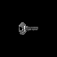
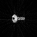

> This post was translated from Korean into English by AI.

Today, I suddenly became curious about how CT images are reconstructed. So I came up with a simple hypothesis about CT image reconstruction and tested it myself.

# Hypothesis

I know the following facts about CT.

- A CT scanner has a doughnut-shaped structure that rotates as it images an object inside the opening.
- CT captures only one cross-section at a time.
- CT uses X-rays.
- When a ray passes through an object, its intensity decreases exponentially.

From these facts, we can make the following additional inferences.

- A CT scanner emits beams from one side and detects them on the other.
- If there were only a single beam, it would be impossible to distinguish a solid cylinder from a hollow cylinder. Therefore, there must be multiple beams.

# Modeling

Based on this, I first modeled X-ray attenuation in a homogeneous object as follows.
$$ I = I_0 e^{-\mu x} $$
Here, $I_0$ is the intensity of the light before it passes through the object, $I$ is its intensity after it passes through the object, $\mu$ is the object's attenuation coefficient, and $x$ is the thickness of the object.

For convenience, if we set $I_0$ to 1, the equation can be rewritten as follows.

$$ I = e^{-\mu x} $$

From this, as an X-ray passes through an object,

- when it passes through infinitesimal areas (which can therefore be assumed to be homogeneous) $\Delta S_0$, $\Delta S_1$, $\Delta S_2$, ...,
- if the attenuation coefficients of the respective infinitesimal areas are $\mu_0$, $\mu_1$, $\mu_2$, ..., and
- if the distances the ray travels through the respective infinitesimal areas are $\Delta x_0$, $\Delta x_1$, $\Delta x_2$, ...,

then the intensity $I$ of the light after it passes through the object can be expressed as follows.

$$
I = e^{-\mu_0 \Delta x_0} e^{-\mu_1 \Delta x_1} e^{-\mu_2 \Delta x_2} ... \\
= e^{-\sum_{i=0}^n \mu_i \Delta x_i}
$$

Because this is difficult to calculate, we can take the logarithm of both sides and rewrite it as follows.
$$ \ln I =- \sum\_{i=0}^n \mu_i \Delta x_i$$

Here, $n$ and $\mu_i$ have different values for each ray, so multiple rays cannot be represented in a single matrix. To solve this problem, we use the following method.

- Divide the cross-section to be measured into infinitesimal areas. (Any suitable tessellation will work. Dividing it into a square grid will probably make the calculations easier.)
- Assign an index to each infinitesimal area. (The order in which the indices are assigned does not matter.)
- Define a selection matrix $W$. $W_{i,j}$ is the distance that the $i$th ray travels through the $j$th infinitesimal area. For example, for a square grid in which every side has length $d$, this value can be $0 \leq W_{i,j} \leq \sqrt{2}d$.

The equation above can then be expressed in the following form.
$$ \ln I*i = - \sum*{j=0}^n \mu*j W*{i,j}$$
This can be expressed as a matrix operation as follows.
$$ \ln I = -W\mu$$
Here, $\mu$ is a vector whose elements are the attenuation coefficients of the infinitesimal cross-sectional areas, and $W$ is the selection matrix. $I$ is a vector whose elements are the measured light intensities of the respective rays.

- $I$ is a known value obtained through actual measurement.
- $W$ is a known value obtained through calculation.
- $\mu$ is the value we want to determine.

If the number of infinitesimal areas into which the cross-section is divided is n and the number of rays is m, the matrices have the following dimensions.

$$
\mu = (n, 1) \\
W = (m, n) \\
I = (m, 1)
$$

In general, $n \neq m$, so $W$ is not a square matrix. Therefore, this matrix operation does not have an exact solution, and the solution must be found using the pseudo-inverse. It can then be expressed in the following form.
$$ \mu = -W^+ \ln I$$
For convenience, if we let $D = -\ln I$,
$$ W^+ D= \mu\\(W^+ = (W^T W)^{-1} W^T)$$

# Implementation

- The infinitesimal areas are treated as a 64x64 square grid in which every side has length 1.
- For computational convenience, if the distance between the $i$th ray and the $j$th infinitesimal area is $d_{i,j}$, I approximated it as $W_{i,j} = max(0, 1 - \frac{d_{i,j}}{d})$. Since the grid length was set to 1, this becomes $W_{i,j} = max(0, 1 - d_{i,j})$.
- To model a CT scanner, I assumed that m parallel rays capture images while rotating through 180 degrees. Each step is $\pi/256$ rad.
- Because solving the matrix equation $W^+ D= \mu$ directly without explicitly calculating $W^+$ is slightly faster, I implemented it that way.
- The $\mu$ matrix should originally contain values in $[0,1]$, but errors produce values outside this range. To prevent this, I clip the elements of the $\mu$ matrix so that their values remain in $[0,1]$.

The code was implemented using Python, NumPy, and OpenCV, and is available in the repository below.

[https://github.com/unknownpgr/ct-reconstruction](https://github.com/unknownpgr/ct-reconstruction)

- `config.py` contains resolution-related settings.
- `calculate.py` performs the matrix operations described above.
- `visualize.py` visualizes the results.

# Result

- Original image
  
- Reconstructed image
  

We can see that the resulting image is very similar to the original.

# Discussion

The most time-consuming task in the process above is finding the pseudo-inverse. The computational time complexity of the pseudo-inverse operation is $O(m^2n)$ (where $m$ is the number of rays and $n$ is the number of infinitesimal areas), and the $W$ matrix is extremely large, with dimensions of approximately $(23000, 4096)$. However, once the ray emission pattern has been determined, the $W$ matrix does not change. Therefore, by deciding on the ray emission pattern in advance and precomputing the $W$ matrix and its pseudo-inverse, it should be possible to save a great deal of time later.
