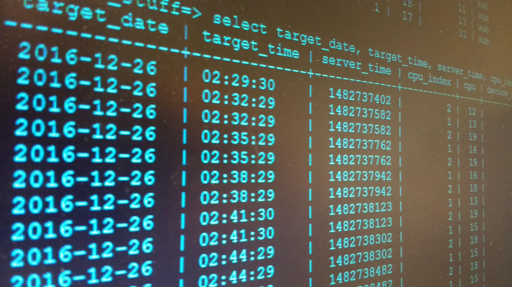

> This post was translated from Korean into English by AI.

While working on a project in the lab, I recently had to deal with a very large database. More specifically, it is about 80GB~100GB in size and contains roughly 900 million rows. Since this database is used for research, neither inserts nor selects happen very often. (Even at their most frequent, they occur only once or twice a day.) **However**, every select must retrieve a very large amount of data at once, and it must do so by joining multiple tables. In other words, I found myself in a situation where I had to structure the database as efficiently as possible.

# What Is a Database Index?

This is where a database index comes in. As the name suggests, an index is a data structure that stores the ordering of database rows based on a particular column or set of columns, improving search speed. An index makes binary search or random access possible instead of sequential search, greatly improving lookup speed. Indexes are also used to implement various constraints such as UNIQUE.

## How Are Indexes Implemented?

I use a MySQL database. In MySQL, indexes are implemented using B-trees. A B-tree is a nicely balanced N-ary tree in which every terminal node has the same depth. Thanks to this property, searching, insertion, and deletion all have a time complexity of $\log n$.

## How Should Indexes Be Configured?

Index configuration can be approached from several perspectives.

### Number of Indexes

First, let us consider the number of indexes. In general, indexes are set on about three to five columns. If you create too few indexes, searches will take longer; if you create too many, manipulating the table (inserting, deleting, and so on) will take too long.

### Multi-Column Index VS Multiple Indexes

Next, when creating indexes for multiple columns, you need to consider whether to create a single index that references multiple columns or several indexes that each reference one column.

If you create a single index that references multiple columns, you gain a speed advantage only when those indexed columns are referenced in order. For example, if you create an index on columns (A, B, C), every part of the index is used only when clauses that reference it, such as Order By or Where, refer to A, B, and C in that order. If you use only B, or only B and C, the index is not used.

On the other hand, if you create multiple indexes that each reference one column, you gain a speed advantage no matter which column you reference. In this case, however, only one index is used when there are multiple search conditions.

In other words, if the columns used as search conditions and their order are always the same, it is better to configure a single index that references multiple columns. Conversely, if the columns used as conditions—or their order—change from one search to another, using multiple indexes is more advantageous.

### Choosing the Column Order

If a single index is configured to reference multiple columns, you must also decide which column should come first. For example, suppose there is a database that stores the students at a school, and you want to query it by year and department. Would it be better to configure the index in the order (year, department), or in the order (department, year)?

In this case, you need to consider the cardinality of the columns. Cardinality means the number of elements in a set. **It is best to specify index columns in descending order of cardinality.** This is because the higher the cardinality, the fewer duplicate rows there are, allowing the search range to shrink more quickly.

For example, students are generally in their first, second, third, or fourth year, so the cardinality of the year column is four. On the other hand, there are usually dozens of departments. Therefore, in this case it is better to specify the index in the order (department, year).

For instance, consider a school with 1,000 students, four years, and 20 departments. (We will assume that the students are distributed evenly across all years and departments.) If the index starts with department, a single index lookup reduces the search range to 50 records. If it starts with year, a single index lookup reduces the search range to 250 records.

### Covering Index

A covering index is **an index that includes every column required for a search**. In other words, when searching a table with a covering index, the query can be performed by accessing only the index, without needing to access the actual table contents. If a query accesses the table itself rather than just the index, it becomes slower because both the index and the table contents must be accessed, and the amount of data processed also increases because entire data blocks must be read. With a covering index, columns can first be selected efficiently using only the index, and the actual table contents can then be accessed later when the data is fetched. To use a covering index, retrieve the primary keys using only the columns included in the index, then use that result as a subquery to retrieve the actual data.

### Configuring Before Insertion VS After Insertion

It is also worth considering whether it is more efficient to configure indexes from the outset and then insert data into the table, or instead insert all the data first and configure the indexes afterward. If data is read and written frequently and uniqueness or similar constraints must be strictly guaranteed, you have no choice but to configure indexes before inserting the data. Otherwise, however, **it is more efficient to configure indexes after inserting all the data**. In my case, too, I was inserting a large dataset once and then only querying it afterward, so I inserted all the data in advance without indexes and configured the indexes later.

# Efficient Select Queries

Simply configuring indexes does not automatically make every select operation faster. You must design select statements carefully to write efficient queries.

## Equality (=), Range (<, >), IN, and Function Operations

First, the extent to which an index can be used depends on the operations used in a select.

- When the equality operator `=` is used, the index is always used. If the index spans multiple columns, it can also be used for the next column.
- The membership operator `IN` is equivalent to applying the equality operator multiple times, so it behaves in the same way as equality.
- When the range operators `>` and `<` are used, **the index applies only to that column, and the next part of the index cannot be used.**
  - Therefore, if the range operation is simple (e.g. `0 < x AND x < 3`), it is better to rewrite it using `IN` (e.g. `x IN (1,2)`).
- **An index cannot be used if a function is applied to the column.** Therefore, you should not apply functions to a column for which you want to use an index.
  - For example, an index is not used for `x*10<100`, but it is used for `x<100/10`.

## Subquery VS Join

**In most cases, a join is better than a subquery.** This is because most DBMSs do not optimize subqueries, including their use of indexes, very well, whereas they optimize joins effectively. A join is also more efficient when you consider how an RDB works and the fact that SQL is a declarative language: joins are declarative, whereas subqueries are procedural.

# References

- [https://d2.naver.com/helloworld/1155](https://d2.naver.com/helloworld/1155)
- [https://ko.wikipedia.org/wiki/%EC%9D%B8%EB%8D%B1%EC%8A%A4_(%EB%8D%B0%EC%9D%B4%ED%84%B0%EB%B2%A0%EC%9D%B4%EC%8A%A4)](https://ko.wikipedia.org/wiki/%EC%9D%B8%EB%8D%B1%EC%8A%A4_(%EB%8D%B0%EC%9D%B4%ED%84%B0%EB%B2%A0%EC%9D%B4%EC%8A%A4))
- [https://jojoldu.tistory.com/243](https://jojoldu.tistory.com/243)
