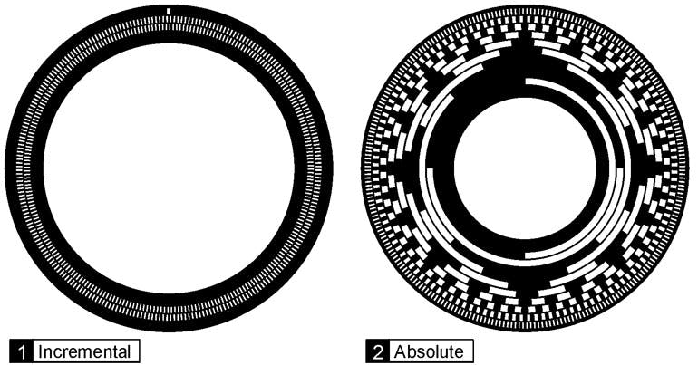

> This post was translated from Korean into English by AI.

In robotics engineering, positioning is extremely important for controlling a robot. While thinking about this, I found myself wondering whether, for a robot that follows a topologically one-dimensional path, there might be a pattern that would allow its absolute position to be determined using only a simple pattern. This post summarizes what I found while investigating the question.

# Background

Many robots simply follow a predetermined path without requiring complex position control. In other words, their position can be represented by a single scalar. A train that travels only along rails is a representative example. More abstractly, a rotating motor can also be considered such an example in the sense that its position can be represented by a single scalar, since its position can be expressed as a single angle. There are various ways to determine the position of such robots: some methods, such as GPS, provide the absolute position immediately, while motors may use encoders.

Encoders can be divided into absolute rotary encoders and incremental rotary encoders. An incremental encoder uses a repeating simple pattern and accumulates its ticks to determine a relative position from an arbitrary starting point. It is mainly used when absolute position is unimportant or when the zero point can be calibrated. An absolute encoder, by contrast, has a binary pattern engraved on it that encodes the absolute position, allowing the position to be determined without separate calibration.



# Development

While thinking about this, however, I realized that if reading $n$ consecutive symbols rather than just one symbol is allowed, absolute position can easily be measured with nothing more than a simple binary pattern, provided that the pattern is constructed carefully. Consider, for example, the following pattern.

```
0 0 1 1 0
```

Reading only one symbol from this pattern does not uniquely identify the position. If two consecutive symbols are read, however, the resulting pairs are `00`, `01`, `11`, and `10`, all of which are distinct, so the exact position can be identified. I therefore looked into sequences with this property.

## De Brujin Sequence

My investigation showed that such a sequence is a special case of a De Brujin sequence. In combinatorics, a De Brujin sequence of order $n$ over a set of symbols $S$ of size $k$ is a cyclic sequence in which every possible consecutive substring of length $n$ appears exactly once. It is denoted by $B(k, n)$.

The way such a sequence is constructed is interesting. Take every substring of length $n$ as a node, and use the operation “remove the first symbol and append a symbol $x \in S$” as an edge. (Because there are $k$ symbols, there will likewise be $k$ such operations.) The resulting graph is called a De Brujin graph. A Hamiltonian circuit in this graph is a $B(k, n)$ sequence. Since this graph has $k^n$ nodes, the maximum length of the sequence when cut open so that it is no longer cyclic is $k^n+n-1$.


## Proof of the existence of Hamiltonian circuits

The existence of a Hamiltonian circuit in a De Brujin graph can be shown as follows.

1. An edge in $B(k, n-1)$ corresponds to a node in $B(k, n)$. If two edges in $B(k, n-1)$ are connected, their corresponding nodes in $B(k, n)$ are also connected.
2. $B(k, n-1)$ satisfies the following conditions.
   - A. It is strongly connected. There is always a directed path from any node to any other node.
   - B. Every node has the same in-degree and out-degree, both equal to $k$.
3. By Euler's theorem, a strongly connected directed graph in which every node has equal in-degree and out-degree has an Eulerian circuit. Therefore, $B(k, n-1)$ contains a path that traverses every edge exactly once.
4. By step 1 above, an Eulerian path in $B(k,n-1)$ corresponds to a Hamiltonian path in $B(k, n)$.
5. Since an Eulerian circuit exists in $B(k,n-1)$, a Hamiltonian circuit exists in $B(k, n)$.

## Application

This is extremely useful because the sequence can be made very long simply by choosing appropriate values for $k$ and $n$. For example, imagine representing 0 and 1 by punching holes in a tape, with each symbol occupying a width of 1 cm. In this case, if $n=25$, it is possible to create a pattern that does not repeat even once over 335 km—a distance greater than that from Seoul to Busan.

Of course, in practice, creating a pattern that never repeats over such a long distance is not only technically difficult but also of little practical value. However, if the pattern is made several to several tens of meters long and then repeated, its cycles can be counted or GPS can be used to estimate the approximate position, while the pattern itself can be used to measure the precise position. This makes accurate positioning possible over a very wide range.

With sufficiently precise counting, it would of course also be possible to use a simple alternating pattern of 0s and 1s, as in an incremental rotary encoder. (This would be the special case $B(2,1)$.) With that approach, however, missing the pattern even once makes it impossible to determine the position. A sufficiently long De Brujin sequence, on the other hand, provides an absolute position—at least within one repetition period—and therefore remains usable even if the pattern is missed several times or the system restarts and loses its state.

# Conclusion

This post summarized what I learned from investigating De Brujin sequences.

# References

- [De Bruijn sequence - Wikipedia](https://en.wikipedia.org/wiki/De_Bruijn_sequence)
- [De Bruijn graph - Wikipedia](https://en.wikipedia.org/wiki/De_Bruijn_graph)
- [Eulerian path - Wikipedia](https://en.wikipedia.org/wiki/Eulerian_path)
