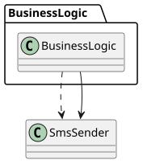
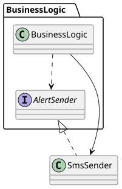
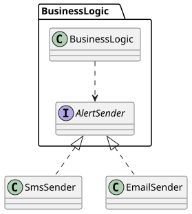
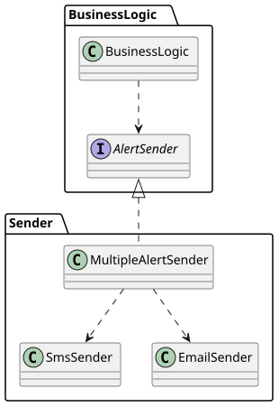
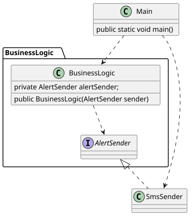

> This post was translated from Korean into English by AI.

I recently read the book *Clean Architecture*. In doing so, I came to understand why dependency inversion is important and what purpose it serves. So I would like to briefly summarize it here.

## What Is Dependency Inversion?

Dependency inversion is one of the principles of software design, and it is defined as follows.

> High-level components must not depend on low-level components.

First, in this post, the word component refers to a collection of classes or functions that perform a single function. In other words, I will use it in a sense similar to a module or package.

High-level components are components close to pure logic or business logic, while low-level components refer to specific technologies such as databases, file systems, and web servers. A dependency simply means referencing that component in code.

This principle is called “dependency inversion” because a high-level component normally uses a low-level component, so _control flows from the high-level component to the low-level component_, while the dependency points in the opposite direction, from the low-level component to the high-level component.

The important point here is that although it seems natural for “control flow” and “dependency” to point in the same direction, the dependency should instead point in the opposite direction from the control flow.

## The Purpose of Dependency Inversion

The most important reason dependency inversion is necessary is to improve code maintainability.

The reason dependency inversion improves code maintainability is simple.

1. When a component that is difficult to change depends on a component that is easy or frequently changed,
2. modifying the component that is easy to change entails modifying the component that is difficult to change,
3. resulting in an enormous amount of work.

In particular, the reason a component is difficult to change is usually that many other components depend on it. As a result, you may end up modifying the entire codebase for a small update.

For example, suppose that sending notifications to users is a highly central feature of a system and is used frequently throughout it. Because this system uses text messages, a developer implemented the feature by creating a class called `SmsSender`. This feature was used in hundreds of places.

Then, all of a sudden, the head of the company decides to add email to the notification system.

> Developer: Uh...

This problem arose because the logical, high-level feature of “sending notifications,” which is difficult to change because it is used in many places, depended on the low-level feature of “sending text messages,” which is easy to change.

If the notification-sending feature had existed completely independently of text messages, and the feature for sending text messages had instead depended on the notification feature, we would only have needed to add the ability to send email or update the text-message feature to send email as well.

## Implementing Dependency Inversion

There are various ways to implement dependency inversion. In object-oriented programming, it can be implemented using an interface. Before doing so, let us first analyze the existing structure.

> In the diagrams below, dependencies are shown as dashed lines and control flow as solid lines.

</img>

In the example above, the component responsible for business logic directly references `SmsSender`. Therefore, control flow and dependency point in the same direction. Once dependency inversion is applied, however, `SmsSender` should instead reference the business logic component.

To accomplish this:

- Add an interface or abstract class called `AlertSender` to the business logic component.
- In the notification-sending logic, use `AlertSender` to send notifications.
- Make `SmsSender` inherit from `AlertSender`.

</img>

This leaves the business logic component with no external dependencies because it references only `AlertSender`, which is contained within the component itself. Conversely, `SmsSender` now has a dependency on the business logic component.
Thus, control flows from the business logic component toward `SmsSender`, while the dependency points in the opposite direction, from `SmsSender` to the business logic component.

In this case, a new notification method that uses email can be implemented as shown below. Regardless of which of these methods is chosen, the business logic does not change at all.

</img>

Of course, the component that sends notifications can also be modified to apply both methods, as shown below. Either way, the modification has no effect whatsoever on the business logic.

</img>

This naturally achieves the Open–Closed Principle as well.

## Dependency Injection (DI)

This introduces one problem. The business logic component must somehow receive an `SmsSender` object. But because the business logic component has no dependency on `SmsSender` whatsoever, it cannot create one.
Therefore, an `SmsSender` object must be created externally and then injected into the business logic component. This is called dependency injection.

</img>

The simplest way to perform dependency injection is simply to instantiate an `SmsSender` object in the main method and inject it into the business logic component. The BusinessLogic component can receive it through a setter function or constructor parameter.

> Consequently, the main method becomes the “dirtiest” method, with dependencies on every class. However, because no method or class depends on the main method, the main method is very easy to modify. Therefore, concentrating all dependencies in the main method does not cause a problem.

As the number of components grows, however, doing this manually can become cumbersome. Frameworks such as `Spring Framework` and `TypeDi` automate this work.

> Using the Autowired annotation in Spring Framework tightly couples the code to the Spring Framework itself (the injector), making it impossible to use the class without Spring Framework. This should be avoided because it makes tasks such as running independent tests more difficult. In particular, using the Autowired annotation on a private field makes the class impossible to use without Spring Framework and creates a hidden dependency that is not outwardly visible.

## Dependencies That Do Not Require DI

Naturally, control flow and dependency do not need to point in opposite directions in every dependency relationship. There are cases where it causes no problem for control flow and dependency to point in the same direction: namely, when a low-level component already depends on a high-level component. This applies to components between control entry points—including interrupt handlers, main functions, and web service entry points—and the main service logic. Because control itself flows from the low-level component to the high-level component in these components, that direction must not be reversed.

## Conclusion

- Dependency Inversion is required to construct an easily maintainable software architecture in accordance with the Open–Closed Principle.
- Control flows from high-level, abstract components to low-level, detailed components. High-level components are difficult to modify, whereas low-level components are easy to modify. If dependency and control flow point in the same direction, modifying a low-level component entails modifying a high-level component, making maintenance difficult.
- Therefore, Dependency Inversion is implemented through interfaces and similar mechanisms, preventing high-level components from being affected by low-level components.
- At this point, the high-level component has no way to create an object of the low-level component, so Dependency Injection means creating the object externally and passing it in.
- Frameworks such as Spring and TypeDi automate this process.
