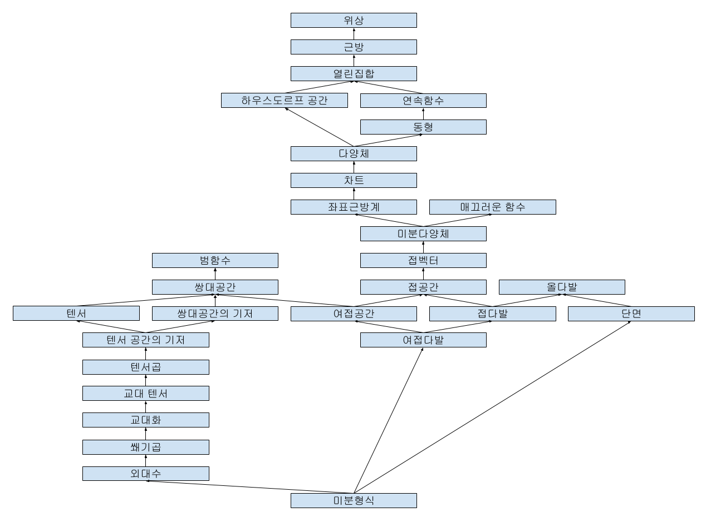

> This post was translated from Korean into English by AI.

In mathematics, differentiation is expressed as follows.

$$
\frac{df}{dx} = \lim_{h\to 0} \frac{f(x+h) - f(x)}{h}
$$

From this perspective, $d/dx$ appears to act as a single operator, and it makes no sense to separate it into $dx$ and $dy$. Yet notation like the following sometimes appears.

$$
df=\frac{\partial f}{\partial x}dx + \frac{\partial f}{\partial y}dy
$$

Or, when solving differential equations, one might use the following method.

$$
\frac{dy}{dx} = f(x)\\
\therefore dy = f(x)dx\\
\therefore y = \int f(x)dx
$$

Seen this way, $dx$ and $dy$ appear to be used as variables that have some real-number value and can be manipulated using ordinary arithmetic operations.

This made me wonder what exactly $dx$ and $dy$ are, so I looked into them.

## Structure

This article is organized as follows.

#### Functional

The definition of a functional varies somewhat by field, but in general it means a function from a space $X$ to that space's field $F$. That is, $f: X \to F$. Therefore, when dealing with the vector space $\mathbb{R}^n$, a functional is a function that maps vectors to real numbers. For example, the function $f(v)=|v|$ is a functional.

As a special case, a functional can be defined on a set of functions. In this case, the functional maps a function to a single real number. For example, for functions $f: \mathbb{R} \to \mathbb{R}$, the mapping $f \mapsto f(0)$ is a functional.

#### Dual Space

The dual space $V^*$ of a vector space $V$ is defined as the set of linear functionals on $V$. A linear function on a vector space—that is, a linear transformation—is a matrix. And since a functional maps vectors to scalars, it can be regarded as an $n\times1$ matrix, or in other words, a vector of the same size as the original vector. Therefore, the dual space of a vector space is itself a vector space consisting of vectors of the same size as those in the original vector space.

#### Dual Basis

Given a basis $\{v_1, v_2, \cdots, v_n\}$ of a vector space $V$, let us define the set $\{u_1, u_2, \cdots, u_n\}$ as follows.

$$u_i(v_j) = \delta_{ij}$$

That is, $u_i$ is the linear functional that maps $v_i$ to 1 and every other basis vector to 0. Put differently, it is the function that maps a vector to its component along the basis vector $v_i$. This can be shown as follows.

$$
\begin{align*}
v &= \sum_{i=1}^n v_i c_i\\
\therefore u_i(v) &= u_i\left(\sum_{j=1}^n v_j c_j\right) = \sum_{j=1}^n c_j u_i(v_j) = c_i\\
\therefore v &= \sum_{i=1}^n v_i u_i(v)
\end{align*}
$$

Therefore, for any linear functional $f$,

$$
f(v) = f\left(\sum_{i=1}^n v_i u_i(v)\right) = \sum_{i=1}^nf(v_iu_i(v)) = \sum_{i=1}^nf(v_i)u_i(v)
$$

so $f$ can be expressed as a linear combination of the $u_i$. It also follows that when

$$
f(v) = \sum_{i=1}^nc_iu_i(v)
$$

we have

$$
f(v_i) = \sum_{j=1}^n c_j u_j(v_i) = c_i
$$

and hence

$$
f = 0 \iff f(v_i) = 0 \iff c_i = 0
$$

Thus, the $u_i$ are linearly independent and form a basis of $V^*$.

> This holds only when the basis is finite. It does not hold in the infinite-dimensional case.

#### Tensor

Tensors generalize dual spaces. Whereas an element of a dual space, a linear functional, is a function that maps one vector to a scalar, a tensor is a multilinear map that maps several vectors to a scalar. In other words, a tensor is defined as follows.

$$
T: V_1 \times V_2 \times \cdots \times V_n \to F
$$

Here, $n$ is called the degree, or rank, of the tensor.

More rigorously, a tensor on a vector space is defined as a multilinear map on $l$ dual vectors and $m$ vectors, and is called an $(l, k)$-tensor.

$$
T: \underbrace{V^* \times V^* \times \cdots \times V^*}_{l} \times \underbrace{V \times V \times \cdots \times V}_{m} \to F
$$

#### Basis of a Tensor Space

The set of tensors forms a vector space. Therefore, a tensor space can be given a basis.

#### Tensor Product

Given two tensors $T_1: V_1 \times V_2 \times \cdots \times V_n \to F$ and $T_2: W_1 \times W_2 \times \cdots \times W_m \to F$, their tensor product is the tensor of degree $n+m$ defined as follows.

$$
T_1 \otimes T_2(v_1, v_2, \cdots, v_n, w_1, w_2, \cdots, w_m) = T_1(v_1, v_2, \cdots, v_n)T_2(w_1, w_2, \cdots, w_m)
$$

#### Alternating Tensor

An alternating tensor is a tensor whose sign changes when the order of its vectors is swapped. In other words, a tensor $T$ of degree $k$ is alternating if the following holds for any $i, j$ (where $i \neq j, 1 \leq i, j \leq k$).

$$
T(\cdots, v_i, \cdots, v_j, \cdots) = -T(\cdots, v_j, \cdots, v_i, \cdots)
$$

#### Alternation

For any tensor $T$ of degree $k$, the operation that turns $T$ into an alternating tensor is called alternation. Alternation is defined as follows.

$$
Alt(T)(v_1,\cdots,v_k) = \frac{1}{k!}\sum_{\sigma \in S_k} \text{sgn}(\sigma)T(v_{\sigma(1)}, v_{\sigma(2)}, \cdots, v_{\sigma(k)})
$$

> Here, $S_k$ is the symmetric group on $k$ elements. The symmetric group of a set is the set of its bijections. Put differently, $S_k$ is the set of all permutations of $k$ elements. Therefore, the size of the symmetric group is $k!$. Swapping the order of two elements in a permutation is called a transposition. If an even number of transpositions is required to transform a permutation into the original ordering, the sign of the permutation is positive; if an odd number is required, it is negative. In mathematical notation, this is expressed as follows.
>
> $$
> \text{sgn}(\sigma) = (-1)^{\text{number of transpositions in }\sigma}
> $$

#### Wedge Product

The tensor product of alternating tensors is not itself an alternating tensor. Thus, alternating tensors are not closed under the tensor product, so a space of alternating tensors cannot be defined. We therefore need to define an operation under which alternating tensors are closed, which leads to the following definition of the wedge product.

$$
T_1 \wedge T_2 = \frac{(n+m)!}{n!m!}Alt(T_1 \otimes T_2)
$$

The wedge product has the following properties.

- $T_1 \wedge T_2 = (-1)^{nm}T_2 \wedge T_1$
- $T_1 \wedge T_2 = 0 \iff T_1 \otimes T_2 = 0$

#### Exterior Algebra

An exterior algebra is an algebraic structure consisting of antisymmetric combinations of vectors in a vector space, together with a binary operation defined on them. Alternating tensors and the wedge product are an example of an exterior algebra.

#### Topology

A topology gives a set a structure containing information about points and their neighborhoods. A topology can be defined in various ways. The definition in terms of open sets is as follows.

- The empty set and the entire set are open sets.
- The intersection of finitely many open sets is an open set.
- The union of any collection of open sets is an open set.

Since the topology itself is defined through open sets, “open set” is an undefined term. Put differently, whether a set is open or closed may vary depending on the topology. For example, in the usual topology on the real numbers, an open set is defined as follows.

- $\forall x \in A, \exists \epsilon > 0 \text{ s.t. } (x-\epsilon, x+\epsilon) \subset A$

In this case, the set of integers $\mathbb{Z}$ is not open. This is because, for an integer $x$, the interval $(x-\epsilon, x+\epsilon)$ is not a subset of the integers for any $\epsilon>0$.

However, if we define a topology in which the set of integers is open—for example, the discrete topology—then the set of integers is open.

#### Neighborhood

In a topological space, a neighborhood of a point $x$ is a set that contains, as a subset, an open set containing $x$. An open neighborhood of $x$ is an open set containing $x$. In the real space $\mathbb{R}$, an open neighborhood of $x$ is an interval such as $(x-\epsilon, x+\epsilon)$.

#### Hausdorff Space

A Hausdorff space is a space in which any two distinct points can be enclosed by disjoint open neighborhoods. More specifically, a space is Hausdorff if, for any two distinct points $x, y$, there exist open sets $U, V$ such that $x\in U, y\in V, U\cap V = \emptyset$.

For example, the real space $\mathbb{R}$ is Hausdorff. This is because, for any two distinct real numbers $x, y$, if we set $\epsilon = |x-y|/2$, then $x\in(x-\epsilon, x+\epsilon), y\in(y-\epsilon, y+\epsilon)$ and $(x-\epsilon, x+\epsilon) \cap (y-\epsilon, y+\epsilon) = \empty$.

#### Continuous Function

In topology, a continuous function between topological spaces $X, Y$ is a function for which the preimage of every open set in $Y$ is an open set in $X$.

#### Homeomorphism

Topological spaces $X, Y$ are homeomorphic if there exists a function $f: X \to Y$ between them that satisfies the following conditions.

- $f$ is a bijection.
- $f$ is continuous.
- The inverse function $f^{-1}$ is also continuous.

The function $f$ is then called a homeomorphism.

Earlier, we defined a topological space by defining its open sets. A homeomorphism and its inverse both preserve open sets. We can therefore see that homeomorphic spaces literally have the same topology.

If two sets are homeomorphic, we write $X \cong Y$.

#### Manifold

A space satisfying the following conditions is called an $n$-dimensional manifold.

1. $M$ is a Hausdorff space of one or more dimensions.
2. Every point in $M$ has a neighborhood homeomorphic to $\mathbb{R}^n$.

#### Chart

A chart on a manifold $M$ is a pair $(U, \phi)$ consisting of an open subset $U$ of $M$ and a homeomorphism $\phi: U \to \mathbb{R}^n$. A function $x^i$ that maps points on a differentiable manifold to the respective components of $\mathbb{R}^n$ is called a coordinate function of the chart. That is,

$$
\phi(p) = (x^1(p), x^2(p), \cdots, x^n(p))
$$

#### Atlas

An atlas on a manifold $M$ is a collection of charts on $M$ that satisfies the following condition.

- The union of the domains ($U$) of the charts is $M$. That is, the domains of the charts form an open cover of $M$.

#### Smooth Function

A function $f$ on $\mathbb{R}^n$ is smooth if $f$ is infinitely differentiable.

#### Differentiable Manifold

A differentiable manifold is a manifold equipped with a differentiable structure. More specifically, a manifold $M$ is a differentiable manifold if it is given an atlas and, for any two charts $(U, \phi), (V, \psi)$ in that atlas with $U \cap V \neq \emptyset$, the function $\phi \circ \psi^{-1}$ is smooth on $\mathbb{R}^n$.

Such a function $\phi \circ \psi^{-1}$ is called a transition function. When the distinct charts $U$ and $V$ are mapped to their images in $R^n$, the transition function defines the map between those images.

Unlike a manifold, a differentiable manifold allows us to define differentiation and smooth functions. Differentiability, or smoothness, is a local property: a curve $f: \mathbb{R} \to M$ on a differentiable manifold is smooth if, for every $t$, there exists a chart $(U, \phi)$ containing $f(t)$ such that $\phi \circ f$ is smooth.

#### Tangent Vector

Tangent vectors can be defined in various ways. One method uses a curve, as follows.

$$
v = \frac{d \gamma(t)}{dt}\Bigg|_{t=0}
$$

Here, $\gamma: \mathbb{R} \to M$ is a curve on $M$ such that $\gamma(0) = p$. An important point is that $v$ itself is not an element of Euclidean space unless the differentiable manifold is defined as Euclidean space or a subset of it. Of course, by the definition of a differentiable manifold, we can use a chart containing this point to map $v$ to an element of Euclidean space. But $v$ itself is a vector defined on the differentiable manifold, not an element of Euclidean space. This is important to understand because it shows that a tangent vector is an intrinsic property of the differentiable manifold and does not depend on a chart. Tangent vectors allow various properties of a differentiable manifold, including differentiation, to be defined independently of the choice of chart.

Following this definition of tangent vectors, for curves $f$ and $g$ satisfying $f(0) = g(0) = p$, the equivalence relation defined by $f\equiv g := f'(0) = g'(0)$ forms equivalence classes, and these equivalence classes are in one-to-one correspondence with tangent vectors. Therefore, one may also call an equivalence class—that is, a set of functions—a tangent vector.

Another method uses a derivation (I do not know how this should be translated). A derivation $D$ at a point $p$ on a manifold $M$ is defined as a linear map $D: (M\to \mathbb{R}) \to \mathbb{R}$ satisfying the Leibniz rule

$$
D(fg) = f(p)D(g) + g(p)D(f)
$$

The tangent space is then defined as the set of all such derivations. Equipped with the following rules, this set becomes a vector space.

$$
\begin{align*}
(D_1+D_2)(f) &= D_1(f) + D_2(f)\\
(\lambda D_2)(f) &= \lambda D_2(f)
\end{align*}
$$

> Strictly speaking, this is not a linear map on $(M \to \mathbb{R})\to \mathbb{R}$, but a linear map on the associative algebra given on $M$. Going into that would make things too complicated, however, so we will keep it simple here.

#### Tangent Space

The tangent space of a manifold $M$ at a point $p$ is the set of tangent vectors at $p$ and is denoted by $T_pM$.

#### Fiber Bundle

A fiber bundle is a space that is locally homeomorphic to the product of two spaces. A fiber bundle $E$ is defined by the following four elements.

- Base space: $B$
- Fiber: $F$
- Projection map: $\pi: E \to B$
- Local structure of the fiber bundle: $\pi^{-1}(U) \cong U \times F$

More specifically, for a set to be a fiber bundle, for every point $x$ in the fiber bundle there must exist a neighborhood $U$ in the base space containing $\pi(x)$ such that $\pi^{-1}(U) \cong U \times F$.

Roughly speaking, then, a fiber bundle $E$ is not only locally homeomorphic to $B \times F$, but is a space in which, for any point in the base space $B$, one can always find a neighborhood $U$ containing that point for which $\pi^{-1}(U) \cong U \times F$.

#### Tangent Bundle

The tangent bundle of a manifold $M$ is the fiber bundle consisting of every point $p$ of $M$ and its tangent space $T_pM$, and is denoted by $TM$.

#### Section

A section of a fiber bundle $E$ is a function $s: B \to E$ satisfying the following equation. In other words, a section is a function that maps each point $b$ of the base space to a point $s(b)$ of the fiber bundle $E$.

$$
\pi \circ s = \text{id}_B
$$

A section of the tangent bundle of a manifold is a special kind of section that maps a point on the manifold to that point together with an element of its corresponding tangent space—that is, a tangent vector. Therefore, a section of the tangent bundle of a manifold is a vector field on the manifold.

#### Cotangent Space

The cotangent space is the dual space of the tangent space and is denoted by $T_p^*M$. Thus, an element of the cotangent space consists of a point $p$ of $M$ and a linear function defined on the tangent space corresponding to that point. Therefore, an element of the cotangent space is a $(0, 1)$-tensor on the tangent space.

#### Cotangent Bundle

The cotangent bundle, or covariant tangent bundle, of a manifold $M$ is the fiber bundle consisting of every point $p$ of $M$ and its cotangent space $T_p^*M$, and is denoted by $T^*M$. In other words, each point of the cotangent bundle consists of a point $p$ of $M$ and a linear function on its tangent space.

#### Action

In differential geometry, “action” is an abstract expression used when one object maps another object to yet another object. Its meaning therefore varies by context; in general, one says that when A acts on B, it returns (or yields) C. For example, if a function takes a real number and returns another real number, we can say that “the function acts on a real number to yield a real number.” Or, in the case of a norm operator that returns the length of a vector, we can say that the norm operator acts on the vector to return a scalar. Conversely, we could also say that the vector acts on the norm operator to return a scalar.

Of course, this means that any correspondence can be described as an action, as in “2 acts on 3 to return 5” (where the correspondence is addition, $\mathbb{R}\times \mathbb{R}\to \mathbb{R}$). In differential geometry, however, the term “action” seems to be used mainly when one object serves as a tool for measuring a property of another, as in the earlier norm-operator example. (I am not certain.)

#### Differential Form

A $k$-differential form, or simply a $k$-form, $\omega$ defined on a differentiable manifold $M$ is a collection of smoothly varying $(0,k)$-alternating tensors $\omega_p:(T_pM)^k \to \mathbb{R}$, one for each point $p$ of $M$.

This is easier to understand by considering a 1-form. First, by definition, every $(0, 1)$-tensor is an alternating tensor, so alternation is not something we need to worry about. A 1-differential form is therefore a collection of linear functions defined on $T_pM$ for each point $p$, varying smoothly with $p$. Put differently, it can also be viewed as a function that maps each point $p$ to an element of its cotangent space $T_p^*M$. Thus, a 1-differential form is a section of the cotangent bundle.

Accordingly, by the definition of an exterior algebra, the collection of alternating tensors of degree $k$ defined on $(T_pM)^k$ is the set of degree-$k$ tensors in the exterior algebra on $T_p^*M$. Therefore, when the cotangent bundle $T^*M$ of $M$ is equipped with an exterior algebra, differential forms are sections—or, more precisely, the set of sections—of the elements in the degree-$k$ part of that exterior algebra space.

#### Tangent Vectors and Differential Operators

Although this is rigorously defined, it does not connect easily with the usual intuition about differentiation. For example, let the differentiable manifold be $\mathbb{R}^2$ and consider a 1-form on it. For a differentiable manifold defined as an open subset of $\mathbb{R}^n$, its tangent space is also $\mathbb{R}^n$, and consequently its cotangent space is also $\mathbb{R}^n$. Therefore, a differential form on $\mathbb{R}^2$ is simply a smooth vector field mapping $\mathbb{R}^2$ to $\mathbb{R}^2$. This seems to have no connection at all to differentiation as it is usually understood, in relation to a function's gradient or rate of change.

The key idea here is to regard a tangent vector not merely as a vector, but as the directional derivative operator in that direction. Earlier, a tangent vector was defined as follows.

$$
v = \frac{d \gamma(t)}{dt}\Bigg|_{t=0}
$$

We can regard this tangent vector as a differential operator that acts on a function $f:M\to \mathbb{R}$ defined on the differentiable manifold and returns a rate of change, as follows. Put differently, it computes the rate of change of $f$ at $p$ in that direction—that is, the directional derivative.

$$
v(f) = \frac{d f(\gamma(t))}{dt}\Bigg|_{t=0}
$$

As mentioned earlier, a tangent vector is a property of the differentiable manifold itself, independent of a chart—that is, of the corresponding Euclidean space. This definition therefore provides a chart-independent definition of the rate of change of a function on a differentiable manifold.

#### Basis of the Tangent Space

Given a chart $\phi$, its coordinate function $x^i$ can be viewed as a function defined on the differentiable manifold. Let us define the partial derivative operator with respect to it as follows.

$$
\frac{\partial f}{\partial x^i}(p) = \frac{\partial (f\circ \phi^{-1})}{\partial x^i}\Bigg|_{\phi(p)}\\
=\frac{\partial (f\circ \phi^{-1}(x^1, x^2, \cdots, x^n))}{\partial x^i}\Bigg|_{\phi(p)}
$$

The partial derivative operators $\frac{\partial}{\partial x^i}$ with respect to these coordinate functions form a basis of the tangent vector space, and the set of differential operators can be defined as linear combinations of these differential operators.

Of course, differential operators—that is, tangent vectors—can also be defined as equivalence classes of curves. From this perspective, taking the partial derivative of a function $f$ with respect to $x_i$ can be interpreted as defining the following curve $\gamma_i(t)$ and measuring the rate of change of $f$ along it.

$$
\gamma_i(t) = \phi^{-1}(\phi(p) + t e_i)=\phi^{-1}(x^1(p), x^2(p), \cdots, x^i(p)+t, \cdots, x^n(p))
$$

In other words, saying that the basis of the tangent space is $\frac{\partial}{\partial x^i}$ is equivalent to saying that the equivalence classes of curves $\gamma_i(t)=\phi^{-1}(\phi(p) + t e_i)$ form a basis of the space defined by that equivalence relation.

#### Differential Forms

Earlier, we said that a differential form is a smooth section of the cotangent bundle. To understand this, we therefore need to examine the basis of the space of differential forms—that is, of the cotangent space.

When defining the dual space earlier, we defined its basis as follows.

$$
u_i(v^j) = \delta_{ij}
$$

Thus, if we denote the basis of the cotangent space by $u^i$, it can be defined as follows.

$$
u^i\left(\frac{\partial}{\partial x^j}\right) = \delta_{ij}
$$

This also shows that when a derivative is expressed as a combination of partial derivative operators with respect to coordinate functions as follows, the basis of the cotangent space consists of the functions that return the component of each partial derivative operator.

$$
u^i\left(v^1\frac{\partial}{\partial x^1} + v^2\frac{\partial}{\partial x^2} + \cdots + v^n\frac{\partial}{\partial x^n}\right) = v^i
$$

A cotangent vector can therefore be expressed as a linear combination of the basis vectors as follows.

$$
\omega = \sum_i \omega_i u^i
$$

We said that a differential form is not merely a cotangent vector at a single point, but a smooth section of the cotangent bundle. Therefore, each $\omega_i$ must be a smooth function defined on the differentiable manifold. It can thus be expressed as follows.

$$
\omega_p = \sum_i \omega_i(p) u^i
$$

This differential form therefore acts on a differential operator as follows.

$$
\omega_p\left(v^1\frac{\partial}{\partial x^1} + v^2\frac{\partial}{\partial x^2} + \cdots + v^n\frac{\partial}{\partial x^n}\right) = \sum_i \omega_i(p) v^i
$$

The basis of the cotangent space is generally denoted by $dx^i$, and a differential form is expressed as follows.

$$
\omega = \sum_i \omega_i dx^i
$$

Thus, things like $dx$ and $dy$ are, by definition, vectors; they are basis elements of the cotangent space and operators that map tangent vectors to real numbers.

## Examples

#### Total Differential

The total differential of a function $f:\mathbb{R}^n \to \mathbb{R}$ is defined as follows.

$$
df = \sum_i \frac{\partial f}{\partial x^i}dx^i
$$

This is a differential form defined by $w_i = \frac{\partial f}{\partial x^i}$. Therefore, $df$ acts on a differential operator $v=\sum_i v^i\frac{\partial}{\partial x^i}$ as follows.

$$
df(v) = \sum_i \frac{\partial f}{\partial x^i}dx^i\left(\sum_j v^j\frac{\partial}{\partial x^j}\right)
$$

Since $dx^i\left(\frac{\partial}{\partial x^j}\right) = \delta_{ij}$, this simplifies to the following.

$$
df(v) = \sum_i \frac{\partial f}{\partial x^i}v^i
$$

In other words, the total differential is an operator that, given a tangent vector, returns the rate of change in the direction of that tangent vector.

#### Differential Equation

Suppose we have the following differential equation.

$$
\frac{dy}{dx} = f(x, y)
$$

If $\frac{d}{dx}$ is regarded as a single operator, it is impossible to rewrite it as follows.

$$
\frac{dy}{dx} = f(x, y) \iff dy = f(x, y)dx
$$

But according to the rigorous definition of differential forms, we know that $dx$ and $dy$ are themselves a kind of operator, so writing the equation in this form is not strange. Specifically, when some differential operator $v=v_x\partial/\partial x + v_y\partial/\partial y$ is given, the equation acts as follows.

$$
\begin{align*}
dy(v) = f(x, y)dx(v) &\iff dy(v_x\partial/\partial x + v_y\partial/\partial y) = f(x, y)dx(v_x\partial/\partial x + v_y\partial/\partial y)\\
&\iff v_y = f(x, y)v_x
\end{align*}
$$

Therefore, this equation becomes a constraint on the differential operator, or direction vector.

To make practical use of this—not merely to understand the notation—we need to understand the relationship between differential forms and integration, as well as the exterior derivative. But those topics lie outside the present discussion, so I will cover them later.

#### Curve

Suppose we have the following curve.

$$
x^2 + y^2 -1 = 0
$$

Because this is an implicit equation rather than a function in the usual form, we cannot find $dy/dx$ in the usual way. But let us consider it from the perspective of differential forms.

From the perspective of differential forms, a differential form like the one above is a function that maps a tangent vector on the differentiable manifold to a real number. Since tangent vectors were earlier defined as equivalence classes of curves, we need to find a curve on this differentiable manifold. This can easily be done as follows.

$$
\gamma_p(t) = (\cos (t+\theta), \sin (t+\theta))
$$

Here, $\theta$ is a value such that $p=(\cos \theta, \sin \theta)$.

Now, the tangent vector to this curve is as follows.

$$
\frac{d\gamma(t)}{dt} = (-\sin (t+\theta), \cos (t+\theta))
$$

The differential forms $dx$ and $dy$ act on this tangent vector as follows.

$$
\begin{align*}
dx\left(\frac{d\gamma(t)}{dt}\right) &= -\sin (t+\theta)\\
dy\left(\frac{d\gamma(t)}{dt}\right) &= \cos (t+\theta)
\end{align*}
$$

Therefore, $dy/dx$ is calculated as follows.

$$
\frac{dy}{dx}(\frac{d\gamma(t)}{dt}) = \frac{\cos (t+\theta)}{-\sin (t+\theta)} = -\frac{p_x}{p_y}
$$

Since this is constant (at a given point), independently of the choice of tangent vector, it can be expressed simply as follows.

$$
\frac{dy}{dx} = -\frac{p_x}{p_y} \Bigg|_p
$$

## Conclusion

We have examined how abstract symbols such as $dx$ and $dy$ are rigorously defined in mathematics. They are called differential forms: a kind of operator defined as a smooth section of the cotangent bundle over a differentiable manifold. Given a tangent vector at a point on a differentiable manifold, such an operator returns from that tangent vector the rate of change along a particular coordinate direction.

For an ordinary curve, $dy/dx$ returns the same value no matter which tangent vector is chosen at a point, which is why it can be treated like a real number. By contrast, the value of the total differential $df=\sum_i \frac{\partial f}{\partial x^i}dx^i$ varies with the choice of tangent vector, so it cannot be fixed as a single number and is instead expressed in the form above.
