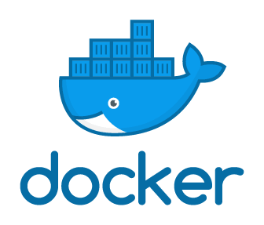

> This post was translated from Korean into English by AI.

Docker seems to be used a great deal these days, regardless of the field of development. However, because I had only worked on small-scale development up to that point, I had never had occasion to use Docker directly. Then, while planning a project, I thought it might be a good idea to introduce Docker. So I studied Docker and decided to summarize what I learned in this blog post.



# What Is Docker?

Docker is, fundamentally, a <u>virtualization platform</u>. In other words, it is a platform that, much like a virtual machine, allows you to run another independent computer inside a computer.

## Containers and Images

The most important concepts in Docker are containers and images.

### Container

As mentioned above, Docker allows another computer (B) to run inside a computer (A). The computer corresponding to A is called the host computer, while the one corresponding to B is called a container. In other words, a container can be thought of as something similar to <u>a virtual machine instance created through Docker</u>. In reality, it is different from a virtual machine, and I describe that difference below.

A container is created from an image, which I will explain next, and terminates after completing a particular task. If you delete a container, everything that happened inside it disappears. Therefore, when using Docker for development, you should mount an external directory and use Docker only for the build; when running a service with Docker, anything that needs persistent storage, such as a database, should be kept outside Docker.

### Image

An image in Docker is the same kind of image meant when talking about an OS image. An image is like a file containing all the information about a container, and when you run an image, it becomes a container. Just as we can install Windows on several computers using a single Windows image, we can run several containers at the same time from a single Docker image. To use a programming analogy, an image corresponds to a class, while a container corresponds to an instance.

I said that an image contains all the information about a container. For example, you can specify that certain programs are installed, configure environment variables and files, and even set the terminal text color if you want. (...) Images are created in a very simple way. You choose a base image for the OS you want to use, then add whatever you want on top of it.

To create an image, you use a file called `Dockerfile`. It is simply named `Dockerfile`; in reality, it is an ordinary text file. Let us take a look at how it works using the Dockerfile I created this time. In the file below, lines beginning with `#` are comments and do not affect the image.

```dockerfile
# Dockerfile

# This file is an example for running the code-server program on Docker.
# code-server is a program that lets you use VS Code in a web browser.

# The FROM keyword specifies which image to use as the base.
# It can be specified in the form image:tag.
# A tag identifies a particular version when an image has multiple versions.
# For example, the ubuntu image can have versions such as 18.04, 20.04, and latest,
# and a tag allows you to specify a particular version.
FROM 	ubuntu:latest

# Apply the desired configuration on top of the base image.
# You can think of this as exactly the same as executing commands in bash.
RUN 	apt-get -y update
RUN 	apt-get install -y curl
RUN	curl -fsSL https://code-server.dev/install.sh | sh

# EXPOSE is a keyword that specifies which port to use.
# Apparently it works fine even if you do not set this, but I am not certain.
EXPOSE 	8080 

# CMD specifies what to execute when the container is created.
CMD 	code-server --host 0.0.0.0 --port 8080 /src
```

The example above uses only a small subset of Docker commands, and many more are available. You can consult the Docker documentation, and [Subicura's Docker Guide for Beginners series](https://subicura.com/2017/02/10/docker-guide-for-beginners-create-image-and-deploy.html) also provides an excellent overview.

Building the Dockerfile above creates a Docker image. Docker images are created using a very efficient yet simple method that follows this process:

1. Create a temporary container
2. Execute one command from the `Dockerfile` in the temporary container
3. Save the entire state of the temporary container as an image
4. Return to step 1.

Therefore, building the file above results in the following process:

1. Download the `ububtu:latest` image and run a temporary container (let us call it a)
2. Save a as an image
3. Run a again to create a container, then execute `apt-get -y update`
4. Save this as b
5. Run b again to create a container, then execute `apt-get install -y curl`
6. Save this as c
7. Run c again to ....
8. Save this as d...
9. ...

Thus, when creating a Docker image, an image corresponding to each line of the `Dockerfile` is created. Of course, Docker does not save every image in full each time; it saves only the differences from the previous image. These are called layers, and a Docker image can be thought of as being created by stacking multiple layers on top of a base image. Therefore, if a line in the `Dockerfile` is modified, all the preceding steps remain as layers, so only the steps after that line are performed again. For this reason, when writing a `Dockerfile`, it is best to put the parts that change least often near the top and the parts likely to change frequently near the bottom.

## Differences from Virtual Machines

The most fundamental difference between Docker and virtual machines can be understood as the scope of virtualization. Conventional virtual machines virtualize both the kernel and processes. In Docker containers, by contrast, the host computer's kernel is used as-is, and only the part where processes run is virtualized. In other words, Docker can be thought of as a thin virtualization layer that wraps a process, and a container can be thought of as a single process surrounded by a very thin virtualization layer.

Because Docker does not virtualize the OS, it starts up extremely quickly and is very useful not only for long-term use but also when you need an isolated execution environment for a lightweight purpose. For example, suppose you need to test built source code. A consistent execution environment is important for testing, and because Docker creates a new environment each time, it allows you to test in a consistently identical environment. In particular, Docker starts so quickly that even frequent testing presents no burden at all.

# References

- *Docker: Up & Running*, by Karl Matthias and Sean P. Kane, translated by Park Jong-young
- [Docker Guide for Beginners](https://subicura.com/2017/01/19/docker-guide-for-beginners-1.html) series, Subicura
- [Official Docker Documentation](https://docs.docker.com/)
