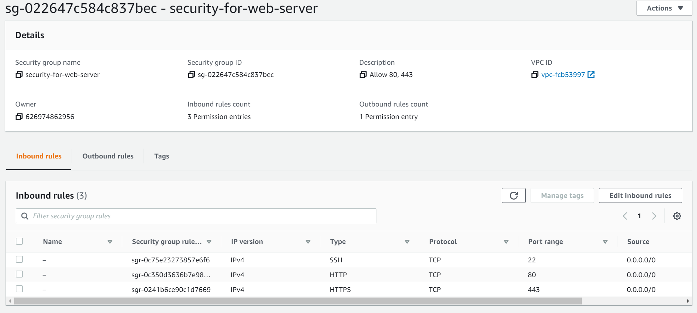
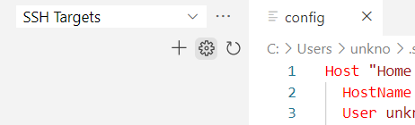
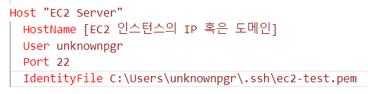
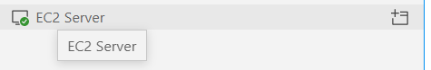

> This post was translated from Korean into English by AI.

This post explains how to securely connect VSCode to an EC2 instance via SSH.

# 1. Create a Security Group



Create a Security Group that allows SSH access, as shown above, and assign it to the EC2 instance.

# 2. Create a User

After connecting to the EC2 instance through the AWS web console, create an appropriate user with the following commands. The reason for not using the default `ubuntu` user is to help prevent potential hacking attempts.

```bash
sudo useradd -m [username]
sudo usermod -aG sudo [username]
```

Next, set a password with the following command. Be sure to make the password very long and secure.

```bash
sudo passwd [username]
```

# 3. Generate an SSH Key

Log in as the user created in step 2, then generate an SSH key with the commands below. Run these commands after moving to the home directory (`cd ~`). If you have not changed directories since logging in, you are probably already there.

```bash
mkdir .ssh
chmod 700 .ssh
touch .ssh/authorized_keys
chmod 600 .ssh/authorized_keys
ssh-keygen -m PEM
cat .ssh/id_rsa.pub >> .ssh/authorized_keys
```

One tutorial I came across omitted the final `-m PEM` option, but without it, the SSH client does not seem to recognize the private key. This may be specific to my server or local environment, so if you cannot connect after following the commands above, try again without the `-m PEM` option.

The `authorized_keys` file is a configuration file that allows someone to log in as the current user with a key whose `id_rsa.pub` contents have been added to it. You could create it directly with `.ssh/id_rsa.pub>.ssh/authorized_keys` instead of first creating it with the `touch` command, but doing so could overwrite an existing file, which is why I used the commands above.

# 4. Download the Private Key

```bash
cat .ssh/id_rsa
```

Use this command to print the private key to the console, then copy it. On your local machine, create a key file with a suitable name in the `C:\Users\[User name]\.ssh` folder. I created the following file:

```
C:\Users\unknownpgr\.ssh\ec2-test.pem
```

# 5. Configure VSCode

Open the `config` file in VSCode. To open it, click the settings button in the Remote Explorer extension.



Several options will appear; select the first one. When the file opens, add the SSH client configuration as shown below.



# 6. Connect

A new target will now appear in the SSH Targets section.



Click the button on the right to connect in a new window, and you will be connected immediately.
