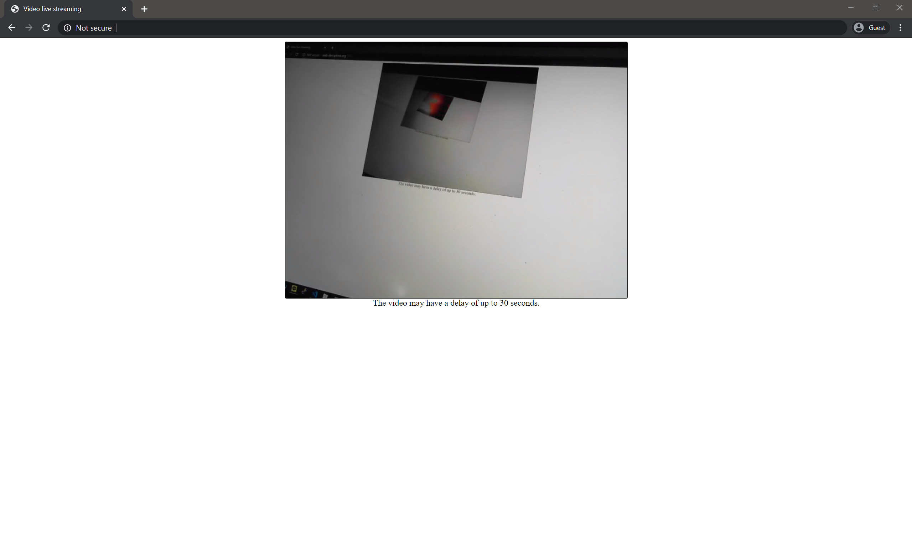

> This post was translated from Korean into English by AI.

While participating in a project recently, I needed to implement live streaming. The goal was to receive video from a camera and make it viewable in a web browser. After searching around on Google, I found that there was no suitable solution that implemented this cleanly. So I decided to build it myself.

- [GitHub repository](https://github.com/unknownpgr/node-webcam-streaming)

The biggest problem with video, especially live streaming, is figuring out how to receive the video in the first place and how to stream it. Fortunately, I had done something similar a few times before, so I knew of two solutions.

1. Use OpenCV or a similar tool to <u>convert the camera feed into images and send them to the client</u>. The client displays the images by continuously updating them. In reality, then, it is not a video but merely a series of rapidly changing images.
2. Use <u>[FFmpeg](https://ffmpeg.org/)</u>.

At first glance, solution 1 may seem rather crude. In practice, however, it provides quite decent video quality and FPS, is easy to implement (there is no need to struggle with encoding), and is particularly useful when the video needs to be processed before it is sent. Its drawback is that it cannot transmit audio. So this time, I decided to implement solution 2.

# What I Did Before

When I used FFmpeg in the past, I did not know much about protocols capable of transmitting video in real time. As a result, I had to take a fairly low-level approach, using the following method.

1. Use FFmpeg to convert the webcam feed to WebM, pipe the output stream to `stdout`, and receive it in the Node.js server.
2. The Node.js server stores the received stream in a buffer.
3. Once the buffer is full, it is placed in a queue.
4. If a client requests the video, the server takes a buffer from the queue and sends it to the client.
5. The client uses the HTML5 [Media Source API](https://developer.mozilla.org/en-US/docs/Web/API/MediaSource) to append the buffer to a video tag.

According to the commit history, I implemented this in February 2019, so it was just before I graduated from high school. Looking back now, it is a rather inefficient implementation. The architecture cannot even serve a stream to two people at the same time.

# What I Did This Time

This time, instead of doing it that way, I decided to make full use of FFmpeg's features. The code is so simple that you may understand it more easily by looking directly at the [source code](https://github.com/unknownpgr/node-webcam-streaming/blob/master/index.js).

- FFmpeg can output HTTP Live Streaming (HLS). Doing so produces a `.m3u8` file and several `.ts` files. The `.ts` files are segment files containing pieces of the video, while the `.m3u8` file is a metadata file containing information about the `.ts` files.
- The Node.js server simply serves those files statically.
- The client uses the [hls.js](https://github.com/video-dev/hls.js#getting-started) library to play the video in a `video` tag. Some browsers can, of course, play the stream correctly without an external library when the `.m3u8` file is passed to the `src` of the `video` tag. However, this does not work in Chrome on desktop, the most widely used browser, so I decided simply to use the library.

Below is the exact FFmpeg command run by Node.js. If FFmpeg is installed, you can enter it directly in a terminal and it will work.

```bash
ffmpeg -f v4l2 -i /dev/video0 -c:v libx264 -crf 23 -pix_fmt yuv420p -hls_time 2 -hls_list_size 5 -hls_delete_threshold 1 -hls_flags delete_segments -f hls public/video.m3u8
```

Let us go through the arguments one by one. They are also explained in the source code.

- `-f v4l2`: Set the input format to v4l2 (webcam).
- `-i /dev/video0`: Read the video from `/dev/video0` (webcam).
- `-c:v libx264`: Set the output video format to `libx264`.
- `-crf 23`: Set the Constant Rate Factor (CRF) to 23. CRF is a parameter related to video quality: lower values produce better quality, and the default is 23.
- `-pix_fmt yuv420p`: Set the pixel format to Y:U:V = 4:2:0. This is necessary because some players support only this format; in fact, without this setting, the video is corrupted in Chrome. [See the explanation](https://trac.ffmpeg.org/wiki/Encode/H.264).
- `-hls_time 2`: Set the length of each ts file to 2 seconds. (For reasons I do not know, this option did not work correctly on my computer, and the files were about 8 seconds long.)
- `-hls_list_size 5`: Set the maximum length of the `.ts` file list included in the `.m3u8` file to 5. This option is necessary for live streaming. Including every segment in the `.m3u8` file, even those created long ago, would be inefficient, so only the five most recent segments are included.
- `-hls_delete_threshold 1`: Allow up to one segment that is not included in the `.m3u8` file. Explained later.
- `-hls_flags delete_segments`: Delete old segments.
- `-f hls public/video.m3u8`: The output file name. With this setting, the `.ts` files are created with names such as `video.ts`.

Of the options above, `-hls_list_size`, `-hls_delete_threshold`, and `-hls_flags delete_segments` form a set. The explanation is a little complicated: as mentioned above, `-hls_flags delete_segments` deletes old segments, while `-hls_delete_threshold` specifies how many segments not included in the `.m3u8` file should still be considered not old.

For example, suppose that `hls_list_size` is 7 and `hls_delete_threshold` is 3. The `.m3u8` file would then contain information about seven segments in total, from n through n+6: n, n+1, n+2...n+6. Because `hls_delete_threshold` is 3, segments n-1, n-2, and n-3 are not considered old; segments starting with n-4 are. Consequently, there will always be ten `.ts` files.

The `hls_delete_threshold` option is necessary because, even though a particular segment has been removed from the segment list in the `.m3u8` file, a client may still be downloading that segment because of its internet speed or some other issue.

With these options, the files are updated in real time, and the client can play the live video just as it would play a regular HLS file. Below is a screenshot.



You can stream and watch video captured by a webcam in HTML. (I removed the URL because it was using my personal server.)

# References

- [How to Convert RTMP Streaming to HLS with FFmpeg](https://superuser.com/questions/714974/convert-rtmp-streaming-to-hls-streaming-using-ffmpeg)

  - The first answer was very helpful. However, the `-hls_wrap` option below has been deprecated. Instead, use `-hls_delete_threshold 1 -hls_flags delete_segments`, as I did.

    ```bash
    ffmpeg -v verbose -i rtmp://host:port/stream -c:v libx264 -c:a aac -ac 1 -strict -2 -crf
    18 -profile:v baseline -maxrate 400k -bufsize 1835k -pix_fmt yuv420p -flags -global_header -hls_time
    10 -hls_list_size 6 -hls_wrap 10 -start_number 1 pathToFolderYouWantTo/streamName.m3u8
    ```

- [Explanation of CRF](https://superuser.com/questions/677576/what-is-crf-used-for-in-ffmpeg)

- [How to Capture Webcam Input with FFmpeg](https://trac.ffmpeg.org/wiki/Capture/Webcam)

- [How to Install FFmpeg on CentOS](https://linuxize.com/post/how-to-install-ffmpeg-on-centos-8/)
