> This post was translated from Korean into English by AI.

Git and GitHub are tools that almost everyone who programs uses. These days, people often submit their GitHub accounts as portfolios when applying for jobs, so I recommend that my friends and juniors use Git and GitHub.

 However, when I searched online, it was difficult to find websites that explained Git and GitHub in an approachable way. So, to make it easier when I introduce Git to other people, I decided to organize what I know in a blog post.

# 🐙🧾Why Do We Need Git?

To give you the conclusion first, <u>Git is a program that manages versions of a project (and the files in it)</u>.

When working on a project, there are often times when you want to save a particular version of its files. For example:

- You create a program, and it works properly.
- Now you want to add a new feature, but you might break the existing program while doing so.
- So you save this version somewhere else, and if the attempt fails, you bring it back and restore the project.

Or you might have a situation like this:

- You want to keep a record of the project's progress.
- So, for example, you make and save a copy once a week.

People often manage their files by renaming them as shown below.

(If you look at [where this image came from](https://bbs.ruliweb.com/community/board/300712/read/19635391), you can see all sorts of struggles related to working this way...)

This is exactly when you need Git. Git helps you manage this kind of versioning very easily.

# 🖨Can't I Just Copy the Files?

There are a few problems with simply copying files.

- Most files consist of thousands of lines of text, and several files are modified at the same time, so <u>it is very difficult to tell what changed just by looking.</u> In design, a change might not cause much trouble if there is no major visual difference, but in programming, changing even a single character can stop the entire project from working. (e.g. forgetting a semicolon...)

- The more versions you create, the <u>faster the amount of storage they require grows.</u> For example, backing up a 200 MB project just five times already takes up nearly 1 GB.

- Unlike design work, where one person may take complete ownership of a single file, programmers often <u>work collaboratively</u>. In that case, things become quite complicated.

  - Starting from the original version, `Developer A` modifies files `a,b,c` and creates version `A1`.
  - `Developer B` modifies files `b,c,d` and creates version `B1`. To make matters worse, `Developers A and B` both modified `b` and `c` at the same time.
  - Now these have to be combined into one final version... hmm...

  In a case like this, `Developers A and B` could simply get together, set aside a day, and merge their work.

  - But what if there are 30 developers and around 20,000 files?
  - What if not every developer started from the original, but instead `Developer B` created version `B1` from `A1`, which `Developer A` had created, then `Developer C` created `C1` from `B1`, then after `A1` and `C1` were merged, `Developer B` created `B2` again, which was then merged back into `A1`, and so on...?
  - And what if the entire project is 10 GB in size? What if even copying the project to someone else's computer takes a long time?

As a project grows, problems like these arise, until managing versions becomes harder than development itself. I listed the problems with existing approaches because <u>Git exists precisely to solve them</u>. Git has many complex features, such as branches. If you first understand why those features are needed, they will be easier to learn.

# ⚙ How Does Git Work?

I will explain it with a practical example, assuming that Git is already installed. [This Coding Factory blog post](https://coding-factory.tistory.com/245) explains the installation process well.

## Creating a Repository

Earlier, I explained that Git is a program that manages project versions. For that to work, those versions need to be stored somewhere. <u>The place where versions are stored is called a `Repository`.</u> Now, let's create a project folder as shown below and create a repository for the project.

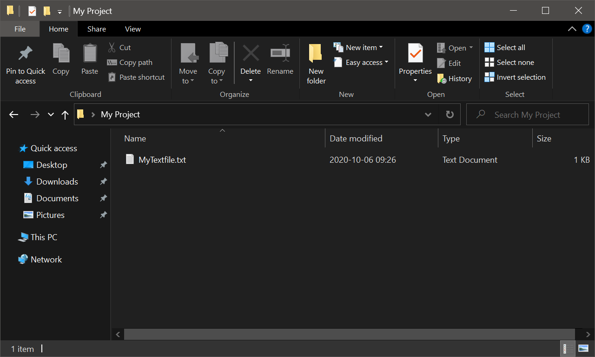

Open a command-line window in the project folder. PowerShell is fine too. To open PowerShell, hold down the `Shift` key and right-click; you should see an option to open PowerShell in the menu.

In the command line that opens, enter the `git init` command. A message will appear saying that an empty Git repository has been initialized, as shown below.

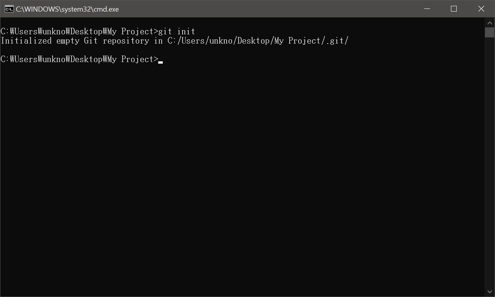

Git is now ready to use.

But if you look at the project folder, nothing has changed. We definitely created a repository, so what happened?

You can find out by making hidden files visible.

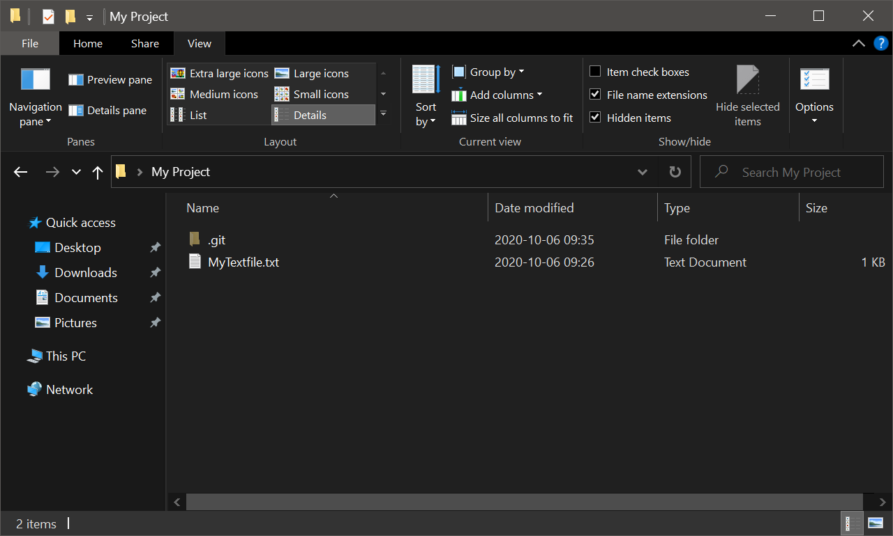

As shown above, there is a hidden directory called `.git`. This hidden directory contains various kinds of data, including Git configuration information and the different versions. Of course, it does not simply contain complete copies of the project organized by date. I will explain this in the Git Workflow section below.

## File States

Git manages files through the three stages shown in the image below. (Strictly speaking, Git does not manage `files`, but `changes`. However, since this post introduces the basic concepts, I will leave that distinction aside.)

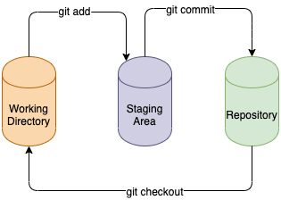

The `Working Directory` is the directory we are working in. It is simply the project folder.

The `Repository`, as we saw earlier, is where versions are stored.

The `Staging Area` is a somewhat confusing concept. Put simply, you can think of it as temporary storage between the `Working Directory` and the `Repository`. Although there are some differences, when writing a blog post, there is a draft-saving stage before you finish and publish it. You can think of it like that.

(In fact, a `Staging Area` is not strictly necessary for version control, so some version control systems other than Git do not have this feature.)

The difference between saving a blog post as a draft and the `Staging Area` is that you can publish a post without saving it as a draft first, but in Git you must stage your work, and <u>only staged content can be made into a new version.</u>

### Working Directory

Now let's check which stage the files in the project are in. If you enter `git status` on the command line, the file states will appear as follows.

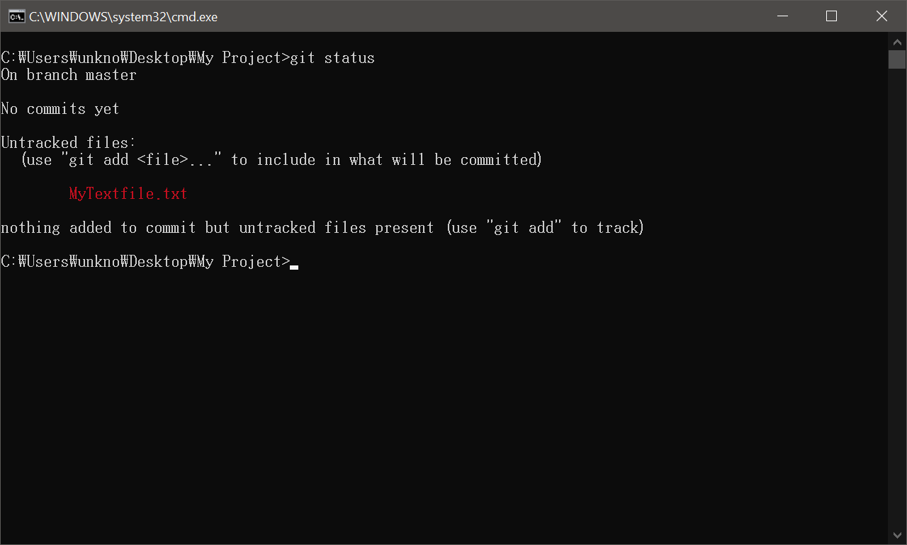

The file is listed under `Untracked files`. The labels `Untracked`, `Modified`, and `Deleted` indicate that the contents of the `Staging Area`, where changes are temporarily stored, differ from those of the `Working Directory`.

- Since we have not saved anything to the `Staging Area` yet, `MyTextFile.txt` itself does not exist in the staging area. In that case, it is shown as `untracked`.
- If the file exists in the `Staging Area` but its contents are different, it is shown as `modified`.
- If a file exists in the `Staging Area` but not in the `Working Directory`, it is shown as `deleted`.

### Staging Area

To stage `MyTextFile.txt`, enter the desired file name after `git add`, as in `git add MyTextfile.txt`. If you want to stage every file in the project folder, use a period instead of a file name, as in `git add .`. Since staging files individually is usually very tedious, most people use the latter unless there is a particular reason not to.

If you then enter `git status` to check the file's state, it will have moved to the `Changes to be committed` section. This means that the file has been staged in the `Staging Area`. Here, the file is labeled `new file`. Like the labels above, this tells you that the contents of the `Repository` and the `Staging Area` differ.

- Since we only staged the file and have not created any version yet, `MyTextFile.txt` does not exist in the `Repository`. In that case, it is shown as `new file`.
- Similarly to before, if the file exists in the `Repository` but its contents differ from those in the `Staging Area`, it is shown as `modified`.
- If a file exists in the `Repository` but not in the `Staging Area`, it is shown as `deleted`.

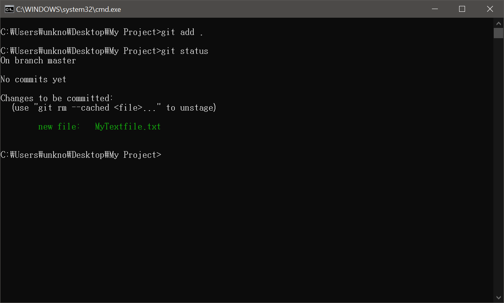

Now that the files have been staged, we can finally create a new version.

### Repository

Until now, the repository we created has been empty. Let's add a new version to it. The act of creating a version is called a `Commit`.

Enter the command `git commit -m "Initial commit"`. The `Initial commit` part at the end is a description attached to the version, called a commit message. It usually explains what this version changed from the previous one. Since we are creating the very first version and there is no previous version, we wrote it that way. For example, if you added a new feature, you could write a commit message such as `Add new feature ~~`.

You will then see a log describing what happened in this version, as shown below.

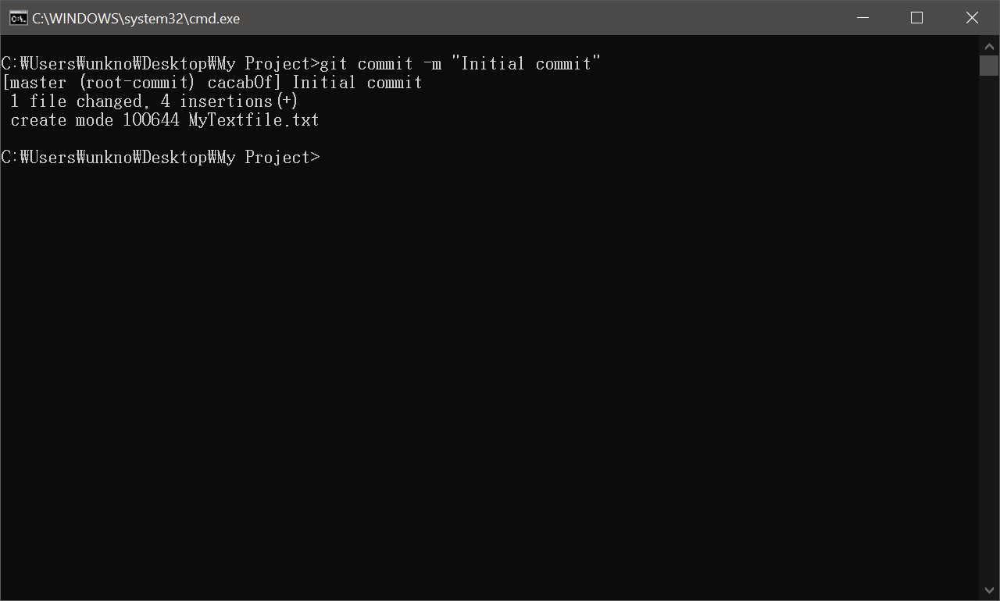

You can simply glance over the message and move on. We have not covered `branches` or `changes` yet.

In any case, now that we have created a new version, we can return to it at any time or compare it with another version. To add a new version, repeat the following process.

1. Perform various tasks, such as adding files or changing their contents
2. Stage the changes in the `Staging Area` with the `git add . ` command
3. Create a new commit (version) with the `git commit -m "Some message"` command

This is why, when working with Git, people usually use the word `commit` more often than `version`. It can be used as a verb meaning to create a new version, as in *commit the changes...*, or as a noun meaning a version, as in *if you look at the previous commit...*. From this point on, I will use the word commit instead of version.

## Example

Let's go through the following process.

1. Add a new file
2. Run git add . / git commit to create a new commit
3. Modify the contents of the file
4. Run git add .
5. Delete the file
6. Run git status

It will then appear as shown below.

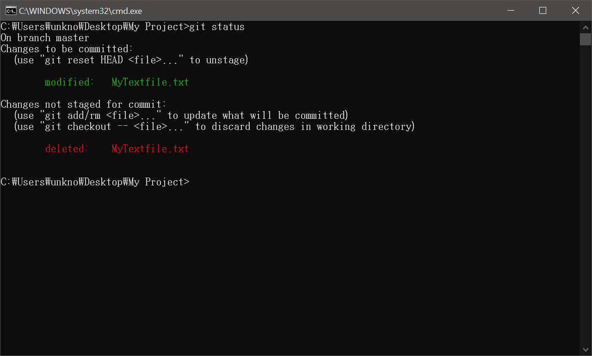

- In step 3, we modified the file and then ran `git add` to stage it. Therefore, the `Changes to be committed` section shows `modified`, because the file's contents differ between the `Repository` and the `Staging Area`.
- In step 5, we deleted the file but did not run `git add`. Therefore, the file still exists in the `Staging Area` but not in the `Working Directory`. As a result, `deleted` appears in the lower section.

## Git Workflow

At the beginning, I explained that one disadvantage of making copies is that they take up a great deal of storage. I also mentioned that Git solves this problem, but how can it make many copies while using so little storage?

This is because, internally, when Git creates a `commit`, it does not store everything in full; it <u>stores only what changed</u>.

- Suppose there is a very large text file that is 100 MB in size.
- Line 123 of the file contains `ASDF`, and you change it to `QWER`.
- When Git creates a new commit, it stores only the information that `line 123 changed from ASDF to QWER`.

In this way, each Git commit stores only how it differs from the immediately preceding commit. In the Creating a Repository section above, I said that the `.git` folder does not contain copies of the project. This is why.

Of course, this does not mean that you have to undo each commit one by one to return to an old version. When using Git, you can work as though the entire project had been backed up.

### Git Diff

In addition, I will show you how to check what changed between two commits.

First, if you use `git log`, you can see a list of the commits that have been made, as shown below.

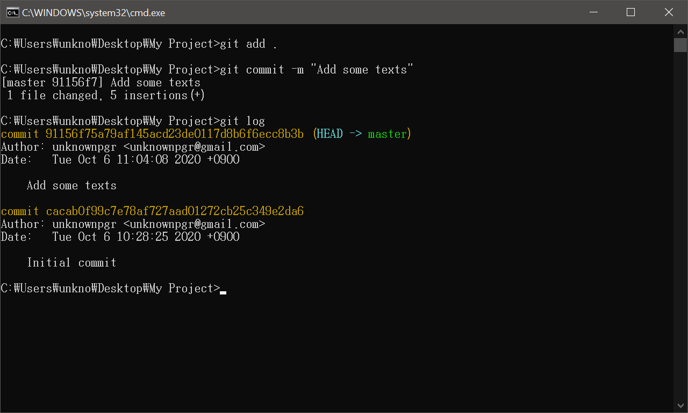

Each commit has a unique ID like `91156f75...`, shown above.

Now, if you enter `git diff unique-ID-of-commit-1 unique-ID-of-commit-2`, you can see the differences between the two commits. Of course, you do not need to enter all of those long strings; entering just the first four or five characters is enough.

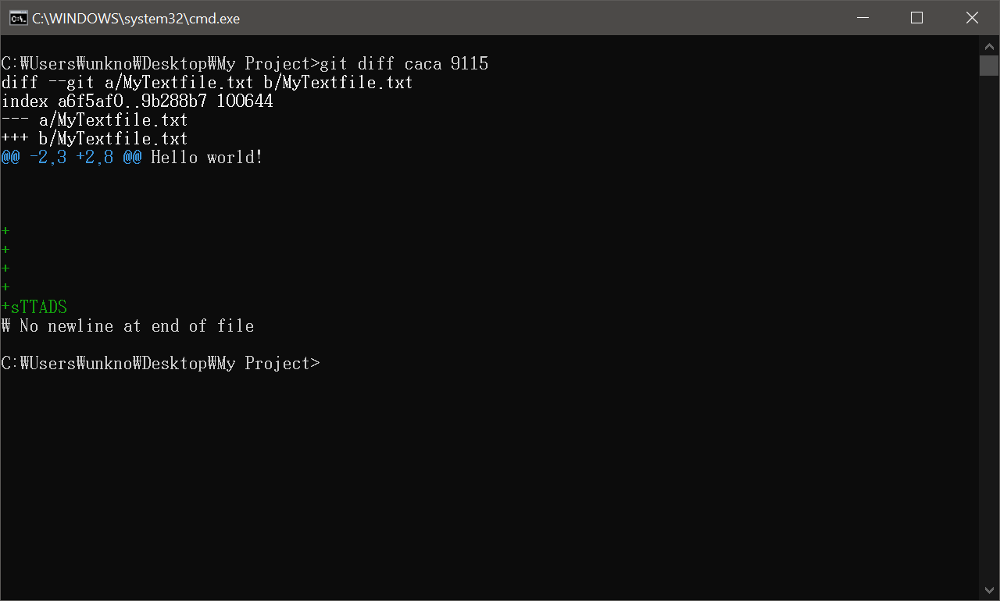

If you simply enter `git diff`, it compares the contents of the current `Working Directory` with the most recent commit and shows you the differences.

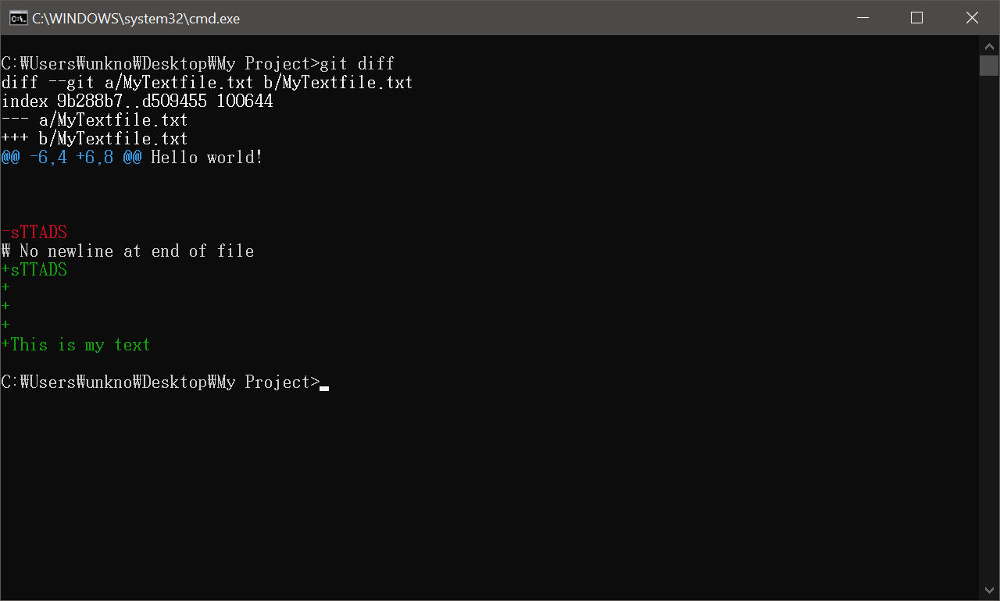

# What's Next?

The order may change a little, but I plan to write posts on the following topics.

- What is GitHub?
- What is a Branch?
- Collaborating with Others

Of course, I have not covered important Git features such as Revert and Checkout at all. However, once you understand Git's fundamental principles, you can easily understand other people's explanations of those features. Conversely, if you use Git knowing only its features without understanding its principles, you will not only use Git inefficiently but also run into frequent errors (usually described as commits becoming tangled). (Speaking from experience.)

Personally, I think the [Korean edition of the Pro Git book](https://git-scm.com/book/ko/v2) is a good resource because it is well organized by topic in its table of contents.

# Summary

## How to Create a New Version (Commit) with Git

1. Enter `git init` on the command line to initialize the repository
2. Perform the desired work
3. Enter `git add .` to stage the changes
4. Enter `git commit -m "commit message"` to create a commit.

## Understanding Git / Commits

- Git is a version control system.
- The process of creating a version, as well as each version created that way, is called a commit.
- A commit does not contain all of the project's information; it contains only the differences from the previous commit.
- The place where these commits are stored is called a Repository. Although this is not entirely precise, you can think of it as being roughly inside the `.git` directory.

# Learn More

The following are useful things to know if you want to use Git efficiently. For specific instructions, it is best to ask Google.

- `.gitignore` : Like a Death Note, this file makes Git treat the files and folders listed in it as though they do not exist at all. It is a good place to list files that do not need to be saved (e.g. temporary files/log files).
- `GitHub Desktop` : GitHub provides a program that lets you use Git through a GUI. It is much more convenient than the command line.
- `Using Git in VSCode` : VSCode provides a built-in GUI for managing Git. Since you can manage Git while coding, I personally use this much more often than `GitHub Desktop`.
