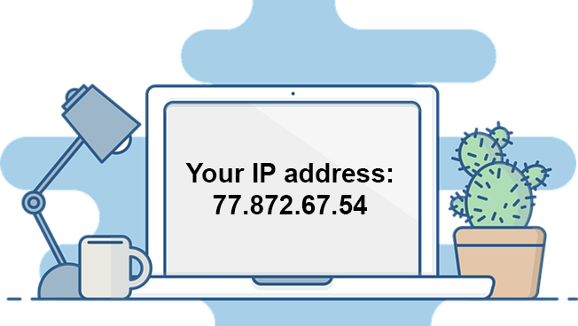

> This post was translated from Korean into English by AI.

#  What Is a Public IP Address?

Anyone interested in networking knows what public and private IP addresses are. A public IP address is a unique address that can identify a device on the Internet, while a private IP address is used on a private network rather than on the Internet.

# How Private IP Addresses Are Assigned

People who have studied networking in some depth generally know how private IP addresses are assigned. A router can assign an address to each computer through DHCP, or a computer can simply set its own IP address however it likes. Of course, it must choose an IP address that does not overlap with one used by another computer on the network. Otherwise, a conflict will occur and networking will not work properly. (Usually, when IP addresses overlap, the computer that was configured later is blocked from accessing the network.) 

# Questions About Public IP Addresses

But as I thought more carefully about IP addresses, a few questions occurred to me.

## What Mechanism Prevents Them from Overlapping?

First of all, how are public IP addresses assigned? No two computers anywhere in the world have the same public IP address. How is this possible?

## Why Is It Impossible to Steal Someone Else's IP Address?

Come to think of it, on a private network, it is possible to steal someone else's address.

1. A computer A is using address a.
2. Computer A is turned off.
3. While A is off, computer B sets its own address to a.
4. Computer A is turned back on.
   - If computer A uses DHCP, it will be assigned a different address.
   - If it was using a static IP address, computer A will be blocked from accessing the network because computer B is already using that address.

But if you think about it, the Internet is one enormous network, so shouldn't the exact same thing be possible? If I found out the public IP address of the apartment downstairs and used that address while its computer was off, couldn't I use the Internet for free and pretend to be that person without buying a public IP address?

## How Is My Home Distinguished from the One Downstairs?

Finally, Internet fees are clearly charged separately to each household. Internet service can also be activated or disconnected household by household. How is this possible? How does a telecommunications provider distinguish my home from the one directly downstairs?

Of course, you might think households are distinguished by their IP addresses, but IP addresses assigned by telecommunications providers generally change dynamically, making it impossible to identify a particular household by its IP address. Moreover, before Internet service has been activated, no IP address has been assigned in the first place, which creates the contradiction of assigning an IP address based on an IP address.

# The Answer

I found the answers to all these questions by taking a careful look at the structure through which IP addresses are assigned.

1. All IP addresses are initially owned by an organization called the Internet Assigned Numbers Authority (IANA). This organization allocates a range of available IP addresses to each continent.
2. The address management organization for each continent then allocates IP address ranges to individual countries.
3. Each country's address management organization assigns IP addresses to Internet Service Providers (ISPs). This allows ISPs to assign IP addresses on behalf of the country, which is why they are also called [management agencies](https://xn--3e0bx5euxnjje69i70af08bea817g.xn--3e0b707e/jsp/business/management/isCurrent.jsp).

Next, let us look at how these management agencies provide Internet service.

Once I thought about it, the answer was actually easy to see: every household has a one-to-one connection with its telecommunications provider. At first glance, connecting the address of every household one-to-one with a telecommunications provider may seem impossible, but in fact, such a service already exists: the telephone used in the home. (I belong to a generation born after telephone modems—dial-up MODEMs—had already disappeared, so it did not immediately occur to me to think this far back.)

If we think back to the distant past, when all communications were provided using telephone modems, it follows that communications would have been supplied on a per-telephone-line basis, and telecommunications providers would have been able to distinguish every household by its telephone number. Of course, computer communications at the time did not involve what we call the Internet or the WWW, but used the Virtual Terminal method, in which a user called a server and connected directly to it one-to-one. Accordingly, there was no such thing as an IP address. (After all, the term IP itself stands for Internet Protocol.)

Later, after passing through technologies such as ADSL and VDSL, dedicated Internet lines began to replace telephone lines. Today, Fiber to the Home (FTTH) technology has become widespread, bringing even optical communications all the way into each household. Nevertheless, the fundamental nature of communications has not changed: each telecommunications provider is connected one-to-one with the FTTH MODEM in each household and distinguishes households using the modem's MAC address. This one-to-one method of communication is called the Point to Point Protocol (PPP).

Of course, the one-to-one connection described above is logical; in reality, tens of millions of lines cannot all be connected directly. In practice, routers capable of relaying optical communications are installed in places such as an apartment building's network equipment room. A single physical line enters from outside and is split into multiple lines by a router inside.

Although a single line is shared physically in this way, a technology called Point to Point Protocol over Ehernet (PPPoE) is used to implement PPP logically. This technology implements PPP using ordinary ethernet.

# Conclusion

- What mechanism prevents public IP addresses from overlapping?
  - Because IP addresses are allocated in a pyramid structure originating from IANA.
- Why is it impossible to steal someone else's IP address? How is my home distinguished from the one downstairs?
  - Because each household's modem is logically connected to its telecommunications provider by a one-to-one line, the provider can control Internet service for each line. Therefore, unlike on a private network, it is impossible to use an IP address already in use by another line.
- If those lines are ultimately connected through the same physical cable, how are they distinguished?
  - They are distinguished based on the modem's MAC address.
  - Therefore, if I steal the modem from the apartment downstairs, I can use that person's Internet service for free.

# References

- [https://en.wikipedia.org/wiki/Point-to-Point_Protocol_over_Ethernet](https://en.wikipedia.org/wiki/Point-to-Point_Protocol_over_Ethernet)
- [https://community.fs.com/blog/pppoe-vs-dhcp-what-is-the-difference.html](https://community.fs.com/blog/pppoe-vs-dhcp-what-is-the-difference.html)
- [https://namu.wiki/w/VT](https://namu.wiki/w/VT)
- [https://namu.wiki/w/ADSL](https://namu.wiki/w/ADSL)
- [https://namu.wiki/w/FTTH](https://namu.wiki/w/FTTH)
- [https://xn--3e0bx5euxnjje69i70af08bea817g.xn--3e0b707e/jsp/business/management/piList.jsp](https://xn--3e0bx5euxnjje69i70af08bea817g.xn--3e0b707e/jsp/business/management/piList.jsp)
