> This post was translated from Korean into English by AI.

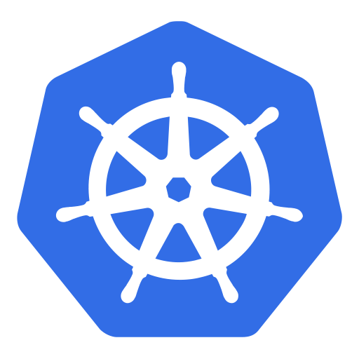 

# K8S

Kubernetes is a system for managing multiple containers across multiple machines. Kubernetes groups multiple machines into a single cluster and manages them together, and each of these machines is called a node.

Some of these nodes are master nodes, which manage the entire cluster, while others are worker nodes that perform simple tasks. Every cluster must have at least one master node.

Master and worker nodes are generally configured separately for security reasons, but if you only have a single machine like I do, one node can serve as both the master and a worker.

If the master node stops, however, the worker nodes can no longer be controlled. This means that when there is only one master node, it becomes a single point of failure (SPOF). For that reason, a High Availability (HA) configuration may use multiple master nodes.

The explanation below is based on the [official Kubernetes documentation](https://kubernetes.io/ko/docs/concepts/overview/components/).

The following components run on the master node. For simplicity, you can think of them as processes running in containers.

- kube-apiserver
- etcd
- kube-scheduler
- kube-controller-manager

## kube-apiserver

The API Server handles every Kubernetes command. When a command is sent to it in the form of a REST API request, that command is applied to the Kubernetes cluster. The API server itself also runs in a container, and you can create multiple API server instances and load-balance them.

## etcd

etcd is a highly available key-value store where all Kubernetes information is stored.

## kube-scheduler

Kubernetes uses a unit called a Pod when working with containers. A Pod is actually a group of containers, but the usual structure is to have only one container in each Pod. kube-scheduler decides which node a pod should be assigned to. A scheduler is necessary because pods cannot simply be assigned to arbitrary nodes. For example, a pod that uses a GPU must be assigned to a node with a GPU in order to operate properly. Constraints that allow a pod to be assigned to a node are called affinity, while constraints that prevent a pod from being assigned to a node are called anti-affinity. The scheduler also uses complex placement strategies, such as assigning closely related pods to nearby nodes or to the same node.

## kube-controller-manager

As its name suggests, the controller manager performs many kinds of management, such as handling nodes that go down, managing pod replicas, and managing accounts.

Logically, the controller manager consists of multiple processes, including the node controller, replication controller, and endpoint controller. To reduce complexity, however, there is only one binary, and all of them run within a single process.

There are also components such as cloud-controller-manager, which is required when using a cloud platform such as AWS, but I will skip those because I am going to configure my cluster directly on bare metal.

Next, let us look at the components that run on worker nodes. The following components run on worker nodes.

- kubelet
- kube-proxy
- dns

## kubelet

kubelet is a core Kubernetes component that manages pods. It runs on both master and worker nodes, and it is responsible for registering a node with the cluster. It also launches the kube-apiserver described earlier in a container.

When an administrator sends a command to the API server, the kube-scheduler and kube-controller-manager described earlier determine which pods should be created or deleted on which nodes. The master node then sends each worker node the desired state of the pods that should run there. This is called a PodSpec. kubelet receives these PodSpecs and creates or deletes pods accordingly.

kubelet can connect directly to the apiserver to retrieve PodSpecs, but it can also obtain PodSpecs through the filesystem or an HTTP endpoint, or kubelet itself can act as a server and receive requests containing PodSpecs.

## kube-proxy

In Kubernetes, pods that need to be exposed externally are managed through a concept called a service. Put simply, a Service can be thought of as a proxy that sends traffic arriving at a node to the appropriate related pod. kube-proxy is the component that actually implements this proxy.

## dns

Finally, dns is an internal cluster DNS server that allows dynamically changing pods within the cluster to communicate using domain names rather than IP addresses.

# K3S

K3S is a lightweight version of Kubernetes that combines the various processes required to operate Kubernetes into one, making it suitable for embedded and IoT environments. Unlike K8S, K3S bundles multiple components into a single binary, so it is very easy to install and run. It also uses sqlite instead of the aforementioned etcd to store the cluster state. I suspect this may be because etcd is too heavy.

Of course, I am using a sufficiently powerful machine, but considering the ease of installation and the electricity bill, I decided to use K3S.

> If you created the virtual machine using the `Vagrantfile` from the previous post, K3S is installed automatically through the bootstrap.sh script.

# Lens

[Lens](https://k8slens.dev/) is a program for managing Kubernetes clusters, and its official documentation calls it a Kubernetes IDE. It offers a number of genuinely convenient features. Most notably, it provides an impressive dashboard where you can view the state of your Kubernetes cluster.

> Of course, you can also manage the cluster through a command-line tool called kubectl instead of using a GUI tool such as Lens.

## kubeconfig

Whether you use Lens or kubectl, you need a `kubeconfig` file to connect to the Kubernetes apiserver and perform operations. The `kubeconfig` file contains the credentials needed to connect to a Kubernetes cluster. Of course, the actual filename does not have to be `kubeconfig`; that is simply what a YAML file used for Kubernetes authentication is called.

In K3S, the kubeconfig file is located at `/etc/rancher/k3s/k3s.yaml`, and it looks like this:

```yaml
apiVersion: v1
clusters:
- cluster:
    certificate-authority-data: omitted for security reasons
    server: https://127.0.0.1:6443
  name: default
contexts:
- context:
    cluster: default
    user: default
  name: default
current-context: default
kind: Config
preferences: {}
users:
- name: default
  user:
    client-certificate-data: omitted for security reasons
    client-key-data: omitted for security reasons
```

If you are using kubectl, you can pass this file as a command-line argument as follows:

```bash
kubectl --kubeconfig /etc/rancher/k3s/k3s.yaml get nodes
```

Passing it as an argument every time is very cumbersome, so you can also set it as an environment variable as follows:

```bash
export KUBECONFIG=/etc/rancher/k3s/k3s.yaml
```

## Connecting Lens

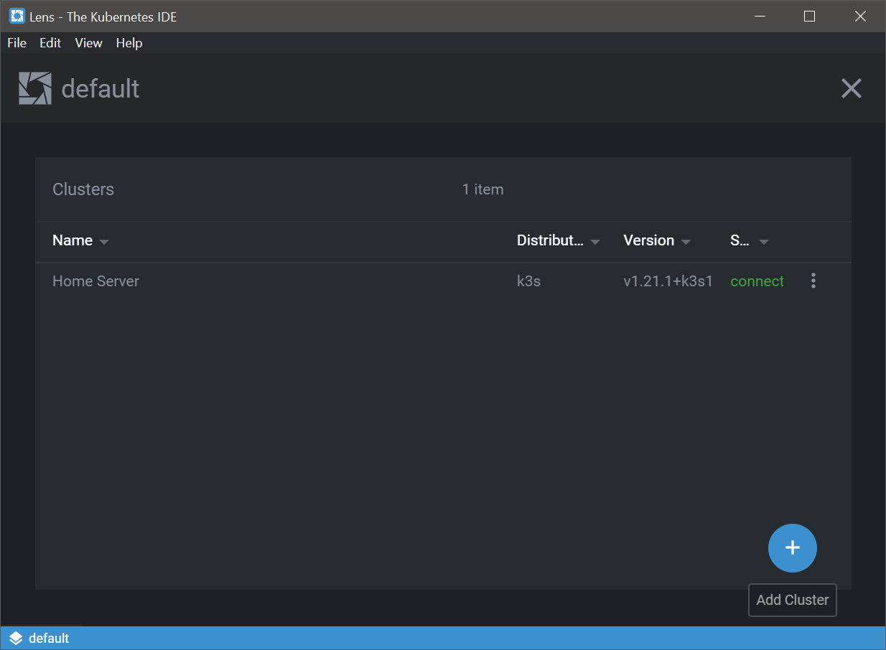

When you launch Lens, there is a button in the bottom-right corner for adding a new cluster, as shown in the image above.

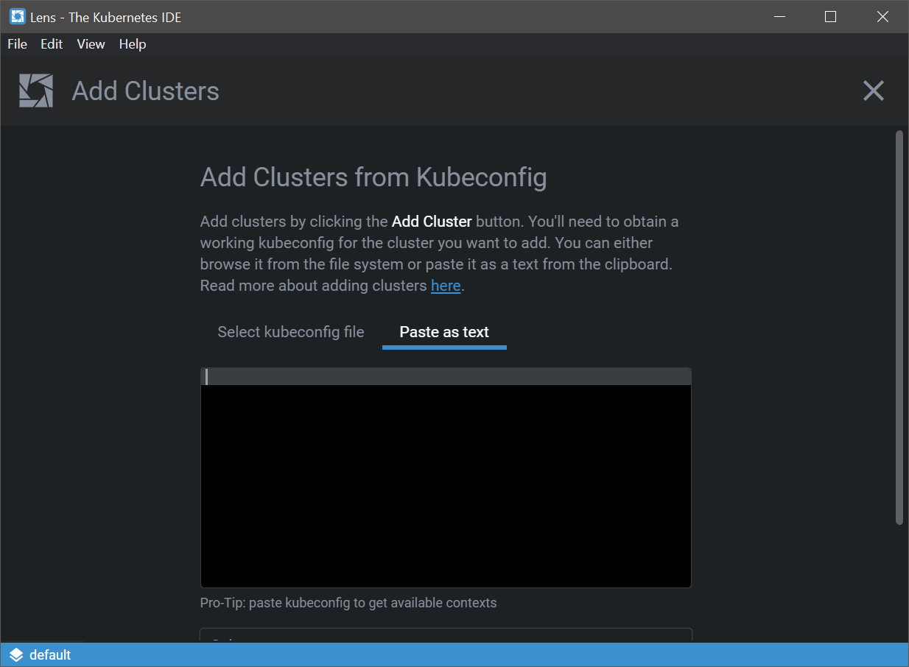

When you click the button, you are given the option to select a `kubeconfig` file or paste it as text, as shown above. Select the text option and paste in the contents of the `kubeconfig` file.

However, if you look at the `kubeconfig` file above, the `server` field is set to `127.0.0.1`. This means that **you can connect to the cluster through this `kubeconfig` file only from the master node**. Since we will run Lens on another computer that is not part of the Kubernetes cluster, **we need to change this field to the address of the master node**. Because I connected over the local network, I changed it to `172.30.1.100`, as configured in the previous post.

When I first tried to connect through Lens, I did not realize this simple fact and spent over five hours struggling with it. I thought the `kubeconfig` file was an important file containing permissions and should not be modified, so I tried everything from an SSH proxy onward, but nothing worked properly...

You can then connect to the Kubernetes cluster as shown below.

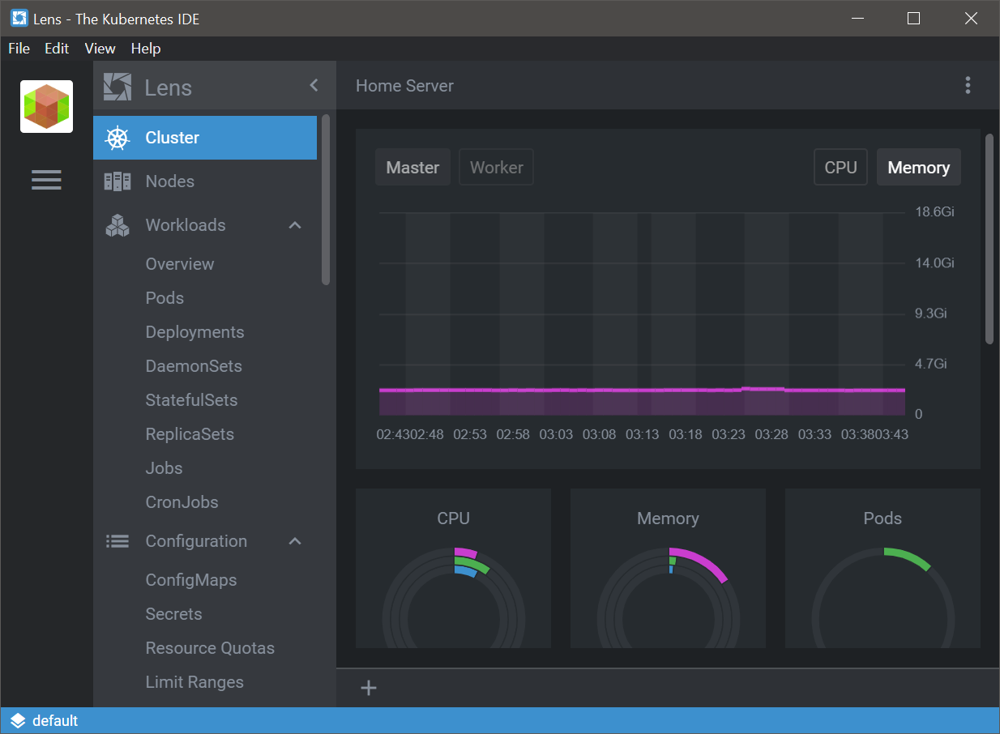

## Installing Prometheus

However, if you followed this process exactly, you will probably see an error message instead of the graphs shown in the image above. This is because those values are provided by a package called Prometheus, and since that package has not yet been installed in the cluster, the values cannot be retrieved. In that case, right-click the cluster icon to open the settings page, then click the Install button in the Metrics Stack section. The related packages will be installed automatically.

> I am not sure whether “package” is the correct term here.

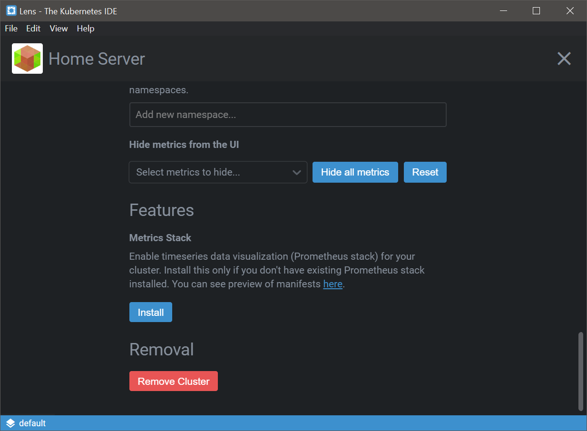

### Helm

For some unknown reason, this did not install properly for me, so I installed Prometheus manually through helm. helm is a manager that can automatically install packages and their dependencies, like npm or pip. Since helm also needs to install things inside the cluster, it uses a server-client architecture. The client-side component that users invoke from the command line is called helm, while the component inside the cluster that receives requests from the client and actually performs the work is called tiller. Tiller is already installed in K3S, so you only need to install helm. Follow the installation guide below to install helm on the master node.

[https://helm.sh/docs/intro/install/](https://helm.sh/docs/intro/install/)

### Namespace

Kubernetes provides a concept called a namespace for logically isolating multiple services. To manage monitoring-related resources separately, create a monitor namespace as follows:

```bash
kubectl create ns monitor
```

### Helm chart

Now install Prometheus using a helm chart as follows. In fact, today was my first time using helm too, so I still do not really know what a helm chart is. My current guess is that it is something like `package.json`, listing a package and all of its dependencies.

First, add the helm repository.

```bash
helm repo add stable https://charts.helm.sh/stable
```

Then install Prometheus.

```bash
helm install stable/prometheus-operator --generate-name --set prometheusOperator.createCustomResource=false --namespace monitor
```

Afterward, you can use the following command to check whether it was installed properly.

```bash
kubectl --namespace monitor get pods -l "release=prometheus-operator-1624614050"
```

If you see output like the following, everything is working correctly.

```
NAME                                                            READY   STATUS    RESTARTS   AGE
prometheus-operator-162461-operator-6664cc9bd6-trfp7            2/2     Running   0          9h
prometheus-operator-1624614050-prometheus-node-exporter-bd74t   1/1     Running   0          9h
```

> The number 1624614050 above may vary depending on the version installed. Replace it with the number corresponding to the version you installed.

Finally, you can check Prometheus by adding port forwarding as follows. This forwards a port from inside the cluster to the outside.

```bash
kubectl port-forward  --namespace monitor $(kubectl get pod --namespace monitor --selector app=prometheus --output=jsonpath="{.items..metadata.name}") 9090
```

One thing to keep in mind is that even after setting up port forwarding this way, it is accessible only through `localhost` on the master node; **it cannot be accessed through a non-localhost IP address** such as `172.30.1.100`. Therefore, after forwarding the port from inside the cluster → master node, you must use SSH to proxy it again from the master node → the computer you are using, and then connect to localhost in a browser on that computer.

If you are accessing the master node using VSCode, you can easily perform this process as shown below.

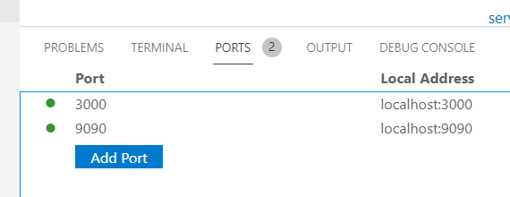

Afterward, if you open it in a browser, the connection works properly, as shown below.

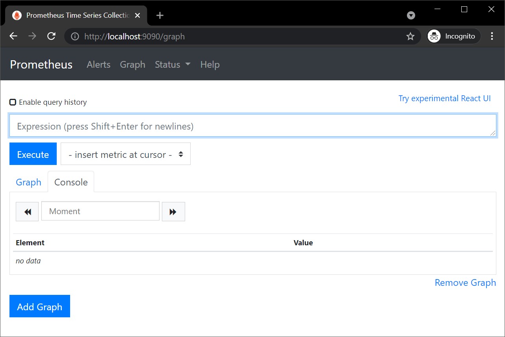

## Connecting Lens and Prometheus

Finally, configure Prometheus on the Lens settings page as shown below.

Initially, the installation method will probably be set to Autodetect and the service address will not be visible. If you set the installation method to Prometheus Operator, a field for entering the service address will appear.

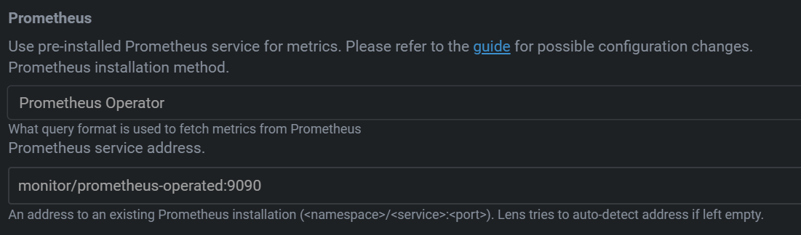

You can then view various metrics on the main screen, as shown in the **Connecting Lens** section.

# Grafana

When you install Prometheus using the method above, Grafana comes with it. Grafana is an open-source data analysis and visualization tool; in this case, it receives data from Prometheus and visualizes it nicely. Grafana also needs to be port-forwarded as follows and then proxied back to your local machine.

```bash
kubectl port-forward --namespace monitor $(kubectl get pods -n monitor --selector app.kubernetes.io/name=grafana --output=jsonpath="{.items..metadata.name}") 3000
```

Afterward, if you connect to port 3000 in your browser, you will see a login screen like the one below.

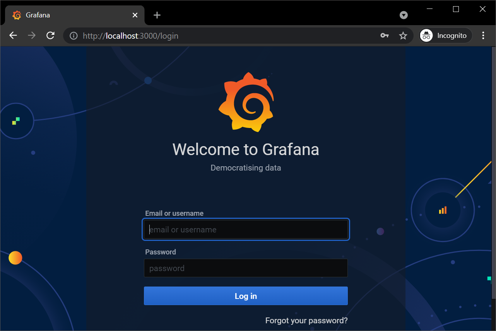

Enter `admin` and `prom-operator` as the username and password. You can then view visualizations of the various metrics collected from Prometheus, as shown below.

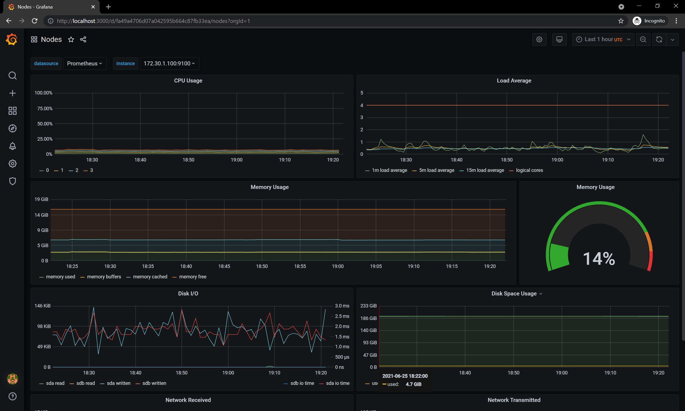

# References

- [http://www.dcasati.net/posts/installing-prometheus-on-kubernetes-v1.16.9/](http://www.dcasati.net/posts/installing-prometheus-on-kubernetes-v1.16.9/)
- [https://en.wikipedia.org/wiki/Grafana](https://en.wikipedia.org/wiki/Grafana)
- [https://kubernetes.io/docs/reference/command-line-tools-reference/kubelet/](https://kubernetes.io/docs/reference/command-line-tools-reference/kubelet/)
- [https://kubernetes.io/docs/concepts/overview/components/](https://kubernetes.io/docs/concepts/overview/components/)
- [https://stackoverflow.com/questions/50352621/where-is-kube-apiserver-located](https://stackoverflow.com/questions/50352621/where-is-kube-apiserver-located)
- [https://kubernetes.io/ko/docs/concepts/overview/components/](https://kubernetes.io/ko/docs/concepts/overview/components/)
- [https://rancher.com/docs/rke/latest/en/kubeconfig/](https://rancher.com/docs/rke/latest/en/kubeconfig/)
- [https://k3s.io/](https://k3s.io/)
- [https://docs.k8slens.dev/main/](https://docs.k8slens.dev/main/)
- [https://rancher.com/docs/k3s/latest/en/cluster-access/](https://rancher.com/docs/k3s/latest/en/cluster-access/)
- [https://bcho.tistory.com/1270?category=731548](https://bcho.tistory.com/1270?category=731548)
- [https://kubernetes.io/docs/tasks/extend-kubernetes/http-proxy-access-api/](https://kubernetes.io/docs/tasks/extend-kubernetes/http-proxy-access-api/)
- [https://kubernetes.io/ko/docs/tasks/access-application-cluster/access-cluster](https://kubernetes.io/ko/docs/tasks/access-application-cluster/access-cluster)

The following are resources I looked up for launching the Web Dashboard, although I did not cover it in this post.

- [https://jogeum.net/22](https://jogeum.net/22)
- [https://kubernetes.io/ko/docs/tasks/access-application-cluster/web-ui-dashboard/](https://kubernetes.io/ko/docs/tasks/access-application-cluster/web-ui-dashboard/)

# TMI

Traces of all the trial and error... From 2 a.m. on the 25th until 4 a.m. on the 26th (now), I visited nearly 450 sites... I do not think I have ever struggled this much while working on a project, so I am leaving this here as a memento...

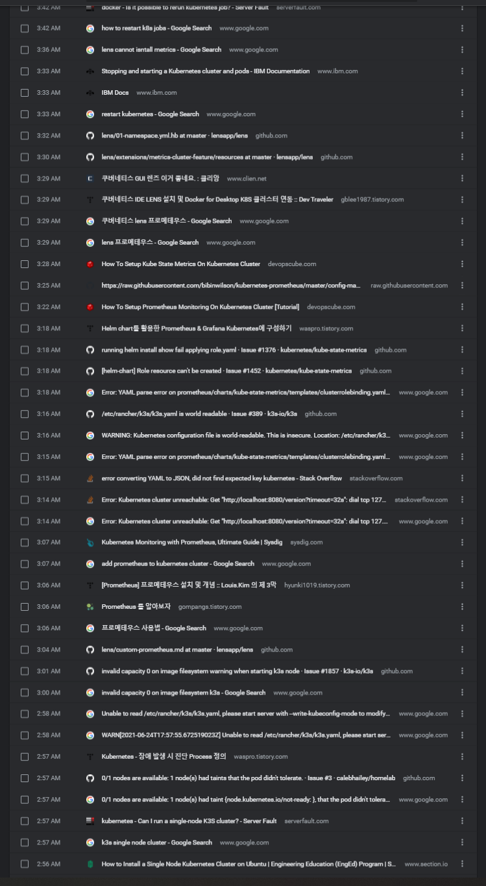
