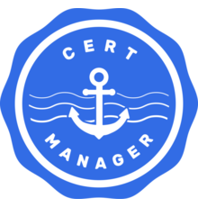

> This post was translated from Korean into English by AI.

In the previous post, I covered the process of setting up a regular (HTTP) Ingress using Traefik. In this post, I will go over how to use Cert-Manager to automatically generate a certificate for a wildcard domain.



# Cert-Manager

First, deploy Cert-Manager using the commands below.

```bash
helm repo add stable https://charts.helm.sh/stable
helm repo update
helm install cert-manager --namespace cert-manager stable/cert-manager
```

This sets up various CRDs along with the Cert-Manager Deployment. Three of these CRDs are especially important:

- Certificate
- Issuer
- ClusterIssuer

## Certificate

The word "certificate" literally means proof, or a document that verifies a fact. When setting up TLS, a Certificate is a certificate that verifies ownership of a domain. Certificates were traditionally issued by trusted authorities only after various checks, but Let's Encrypt and Certbot make it possible to obtain and renew domain certificates automatically, without such a complicated process. Let's Encrypt verifies a client's ownership of a domain by issuing a token to the client claiming ownership and checking whether that token can be accessed through the domain. I will explain this in more detail below.

In Kubernetes, a Certificate is represented by a resource like the following:

```yaml
apiVersion: cert-manager.io/v1alpha2
kind: Certificate
metadata:
  name: <CERT_NAME>
spec:
  secretName: <SECRET_NAME>
  dnsNames:
	- <DNS_NAMES_HERE>
	# The following two lines are examples of DNS names.
    - server.unknownpgr.com
    - *.server.unknownpgr.com
  issuerRef:
    name: <ISSUER_NAME>
    kind: <ISSUER_KIND>
```

When this resource is created, the certificate is issued after the Issuer described below completes the validation process. A Secret named `<SECRET_NAME>` is then created, and the certificate information is stored in it.

An important point here is how to configure a wildcard domain. In the Certificate's `dnsNames` field above, you can see `*.server.unknownpgr.com`. This is how a wildcard domain is specified: adding an asterisk at the beginning allows you to obtain a certificate that validates every subdomain, such as `asdf.server.unknownpgr.com`, at once. In other words, once you have issued this single wildcard certificate, you can manage services easily without having to create a new Certificate each time you add one.

Perhaps because it is so convenient, however, obtaining a wildcard domain certificate is not entirely straightforward. I will explain the details below.

## Issuer

An Issuer is a resource that represents a Certificate Authority (CA). The Issuer is the entity that issues a Certificate. As explained earlier, the CA we will use, Let's Encrypt, issues and validates a token in order to issue a Certificate—that is, to verify that the requester owns a particular domain. This process is called a Challenge.

There are several types of Challenge. The `http-01` Challenge and `dns-01` Challenge are the most commonly used.

> In Kubernetes, a Challenge is also represented as a resource, but I will skip it because users do not create it directly.

### http-01

This Challenge is very simple. The ACME client (= someone who wants to prove that they own the domain) receives a specific token from Let's Encrypt, then places that token in a file at the top level of the domain, at a URL such as `http://<YOUR_DOMAIN>/.well-known/acme-challenge/<TOKEN>`. Let's Encrypt then connects to the domain to check that the file actually exists and that its contents match the token it issued. If they match, the certificate can be issued.

### dns-01

This Challenge is relatively complex. If you fully own a domain, you should be able to configure various records for it. The `dns-01` Challenge takes advantage of this. As with the `http-01` method, you first receive a token, but this time you place it in a TXT record named `_acme-challenge.<YOUR_DOMAIN>`. Let's Encrypt then performs a DNS query. If it confirms that the TXT record exists and that its contents match the token it issued, the certificate can be issued.

At first glance, `dns-01` may not seem particularly complicated either. However, the procedure above is not performed manually; a program called Certbot performs it on the user's behalf. The user only needs to provide Certbot with basic information such as an email address and domain. While `http-01` is relatively easy to automate, `dns-01` can be used only when the DNS provider offers an API for modifying DNS records. This makes the setup considerably more difficult.

Wildcard domain certificates, however, can be issued only with the `dns-01` method. Therefore, despite its complexity, I chose to use `dns-01`.

> The instructions below are based on AWS Route 53 as the DNS provider. The official Cert-Manager website describes [how to configure the `dns-01` Challenge for various DNS providers](https://cert-manager.io/docs/configuration/acme/dns01/).

To use this method, you must first create an account with the DNS provider that can modify DNS records. Create an IAM account with the following permissions.

```json
{
  "Version": "2012-10-17",
  "Statement": [
    {
      "Effect": "Allow",
      "Action": "route53:GetChange",
      "Resource": "arn:aws:route53:::change/*"
    },
    {
      "Effect": "Allow",
      "Action": [
        "route53:ChangeResourceRecordSets",
        "route53:ListResourceRecordSets"
      ],
      "Resource": "arn:aws:route53:::hostedzone/*"
    },
    {
      "Effect": "Allow",
      "Action": "route53:ListHostedZonesByName",
      "Resource": "*"
    }
  ]
}
```

Next, issue an access key for this account and store it as a Secret as shown below.

```bash
# Set as an environment variable
AWS_SECRET_ACCESS_KEY=<SECRET_ACCESS_KEY>
# Save to a file
echo ${AWS_SECRET_ACCESS_KEY} > secret-access-key
# Create the Secret
kubectl create secret generic aws-route53-creds --from-file=secret-access-key --namespace cert-manager
# Delete the file
rm secret-access-key
```

Next, create the Issuer.

```yaml
apiVersion: cert-manager.io/v1
kind: Issuer
metadata:
  name: le-wildcard-issuer
spec:
  acme:
    server: https://acme-staging-v02.api.letsencrypt.org/directory
    # server: https://acme-v02.api.letsencrypt.org/directory
    email: <YOUR_EMAIL>
    privateKeySecretRef:
      name: le-wildcard-issuer
    solvers:
      - dns01:
          route53:
            region: <YOUR_REGION>
            accessKeyID: <YOUR_ACCESS_KEY_ID>
            secretAccessKeySecretRef:
              name: aws-route53-creds
              key: secret-access-key
```

When creating the Issuer, keep in mind that Let's Encrypt limits the number of validation attempts. When using Cert-Manager for the first time, it is easy to make a configuration mistake and fail validation. You should therefore practice with the staging server shown above, which has no such attempt limit. Once certificate issuance succeeds on the staging server, switch to the production server commented out below it and issue a new certificate.

After that, create a Certificate by referring to the Certificate section above. For example, you can create a Certificate that uses the Issuer above as follows:

```yaml
apiVersion: cert-manager.io/v1
kind: Certificate
metadata:
  name: wildcard-certificate
spec:
  secretName: cert-wildcard
  dnsNames:
  - server.unknownpgr.com
  - '*.server.unknownpgr.com'
  issuerRef:
    name: le-wildcard-issuer
    kind: Issuer
```

In some cases, even after changing the Issuer server from staging to production, the browser may still show the staging certificate. This happens because the existing certificate remains in place. If this occurs, delete the Secret created by the Certificate (`cert-wildcard` in the example above). Validation will soon run again, and the correct certificate will be issued.

There were also cases where the browser continued to show the staging certificate even after doing this. The browser appeared to have cached the certificate. In such cases, opening the site in a private browsing window showed that it was being served correctly. After waiting a little while, the certificate was updated in the regular browser as well.

> A certificate issued by the staging server is shown as untrusted, just like a self-signed certificate. It therefore cannot be used when deploying an actual service.

## ClusterIssuer

The Issuer described above is a namespaced resource, so it can be used only within a single namespace. Repeating the same work across multiple namespaces in a cluster is cumbersome, however, so ClusterIssuer makes the Issuer accessible and usable from every namespace.

## Traefik Integration

Now that the Certificate has been issued, it needs to be integrated with Traefik. Traefik performs HTTPS termination simply by specifying the `tls` field in an IngressRoute, as shown below.

```yaml
apiVersion: traefik.containo.us/v1alpha1
kind: IngressRoute
metadata:
  name: ingress-route-tls
spec:
  entryPoints:
    - websecure
  routes:
  - match: Host(`whoami.server.unknownpgr.com`)
    kind: Rule
    services:
    - name: whoami
      port: 80
  tls:
    secretName: cert-wildcard
```

### Default Certificate

An Issuer has the ClusterIssuer alternative, which can be created once and then used across multiple namespaces. A Certificate, however, is a namespaced resource and can be used in only one namespace. As a result, when using a wildcard domain, it is cumbersome to create the same Certificate in every namespace. In this case, create a TLSStore that stores the default certificate as shown below. Then, when creating an IngressRoute, set the `tls` option to an empty object to apply the default certificate to that IngressRoute.

> At first glance, it may appear that you can create multiple TLSStores. In fact, however, you can create only one for the default certificate configuration, and it must be named `default`. Although it is possible to create a TLSStore named `default` in multiple namespaces, doing so simply causes one of them to be selected at random.

```yaml
apiVersion: traefik.containo.us/v1alpha1
kind: TLSStore
metadata:
  name: default
  namespace: default
spec:
  defaultCertificate:
    secretName: cert-wildcard
---
apiVersion: traefik.containo.us/v1alpha1
kind: IngressRoute
metadata:
  name: ingress-whoami
spec:
  entryPoints:
    - websecure
  routes:
  - match: Host(`whoami.your.domain.com`)
    kind: Rule
    services:
    - name : whoami
      port: 80
  # Setting the tls option to an empty object applies the default certificate.
  tls: {}
```


# References

- [https://letsencrypt.org/docs/challenge-types/](https://letsencrypt.org/docs/challenge-types/)
- [https://www.scaleway.com/en/docs/tutorials/traefik-v2-cert-manager/](https://www.scaleway.com/en/docs/tutorials/traefik-v2-cert-manager/)
- [https://www.padok.fr/en/blog/traefik-kubernetes-certmanager](https://www.padok.fr/en/blog/traefik-kubernetes-certmanager)
- [https://blog.devgenius.io/quickstart-with-traefik-v2-on-kubernetes-e6dff0d65216](https://blog.devgenius.io/quickstart-with-traefik-v2-on-kubernetes-e6dff0d65216)
- [https://doc.traefik.io/traefik/https/acme/](https://doc.traefik.io/traefik/https/acme/)
- [https://doc.traefik.io/traefik/routing/providers/kubernetes-crd/#kind-serverstransport](https://doc.traefik.io/traefik/routing/providers/kubernetes-crd/#kind-serverstransport)
