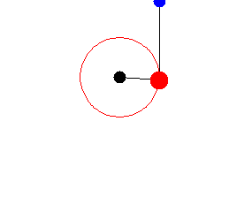

> This post was translated from Korean into English by AI.

I studied Lagrangian mechanics briefly a long time ago. I think it was probably when I was a high school senior, back when everything except studying for school exams was interesting, and I needed to do some complicated physics calculations for something. I do not remember exactly what I was trying to do, though. I think it may have been to simulate a double pendulum.

Anyway, I have occasion to use it again, so I would like to organize my notes on it this time.

# Calculus of Variations

Lagrangian mechanics uses a branch of mathematics called the <u>calculus of variations</u>, which extends ordinary calculus.

The calculus of variations deals with things called <u>functionals</u>. A functional is a function whose domain is a set of functions. Its codomain could, of course, also be any number of sets, but this post will cover only the case where the codomain is the real numbers. In other words, if the set of functions covered in this post is denoted by $\mathbb{F}$ and the set of real numbers by $\mathbb{R}$, a functional here means a function $J:\mathbb{F}\rightarrow\mathbb{R}$. The following is an example of a simple functional.

$$
J[f] = \int_0^1(f(t))^2dt
$$

The functional $J$ in the expression above takes some function $f$ as its argument (assuming that $f$ is a real-valued function) and returns a real number.

In calculus, given a function, we examine the relationship between an infinitesimal change in its argument and the corresponding infinitesimal change in the function's value. Likewise, the calculus of variations deals with the relationship between an infinitesimal change in its argument—a *function*—and the <u>infinitesimal change (variation) in the functional</u>. Cases that maximize or minimize a functional are particularly important. Such maximum or minimum values are called <u>stationary values</u>, and a function that makes a functional attain a maximum or minimum is called a <u>stationary function or stationary point</u>. For example, the functional above has the stationary value $0$ only when $f=0$, and $f=0$ is its stationary point (or stationary function).

# Euler–Lagrange Equation

There are, of course, countless important principles in the calculus of variations that I do not know, but the Lagrangian mechanics we will discuss is derived mainly from an important equation called the <u>Euler–Lagrange equation</u>.

The Euler–Lagrange equation is an equation used to find a stationary point of a functional $S$ of the following form for some function $q$.

$$
S(q)=\int_a^bL(t,q(t),q'(t))dt
$$

Here, $L$ is an arbitrary three-variable function whose partial derivatives are all continuous. (It is an ordinary function, not a functional.) And, of course, $q$ must be differentiable. For example, if we assume that $L(a,b,c)=a^2+c$, the expression above can be written as follows.

$$
S(q)=\int_a^bt^2+q'(t)dt
$$

(In this case, it is not difficult to see that $S(q)=q(b)-q(a)+(b^3-a^3)/3$.)

If some stationary point of a functional $S$ of this form is $q_0$, then $q_0$ satisfies the following equation.

$$
\frac{\partial L}{\partial q_0}-\frac{d}{dt}\frac{\partial L}{\partial q_0'}=0
$$

This equation is called the Euler–Lagrange equation.

## Fundamental Lemma of the Calculus of Variations

To prove the Euler–Lagrange equation, we first need to understand the fundamental lemma of the calculus of variations. The fundamental lemma of the calculus of variations states that if

- $f:[a,b]\rightarrow\mathbb{R}$ is a continuous function, and

- the following holds for every compactly supported smooth function $\eta$,
  $$
  \int_a^bf(x)\eta(x)dx=0
  $$
- then $f(x)=0$.

In a way, this seems quite obvious. If integrating $f$ multiplied by anything always gives zero, then $f$ is zero.

### Proof

I actually major in computer science, not mathematics, so I do not know much about the condition “compactly supported smooth.” From what I have found, however, it seems fine to regard this as meaning infinitely differentiable at every real number (continuous at every real number, with no divergent values).

Let us prove this by contradiction. That is, suppose there exists some remarkable $f$ such that $\int_a^bf(x)\eta(x)dx=0$ for every $\eta$, but for which at least one $x_0$ exists such that $f(x_0)\not=0$.

First, let us consider the case where $f(x_0)>0$.

Since $f$ is continuous, by the definition of continuity there exists some interval $[c,d]$ containing $x_0$ for which $f(x)>0$ for every $x\in[c,d]$. Of course, $[c,d]\subset[a,b]$.

Now consider the following function.

$$
\eta(x) = ((x-c)(x-d))^4 \text{ where }x\in[c,d]\\
\eta(x) = 0 \text{ else}
$$

This is a compactly supported smooth function. Then,

$$
\int_a^bf(x)\eta(x)dx\\
=\int_a^cf(x)\eta(x)dx+\int_c^df(x)\eta(x)dx+\int_d^bf(x)\eta(x)dx\\
=\int_c^df(x)\eta(x)dx
$$

When we chose the interval $[c,d]$, we chose it so that $f>0$, and $\eta>0$ as well. Therefore, $\int_c^df(x)\eta(x)dx>0$, and consequently $\int_a^bf(x)\eta(x)dx>0$. But this contradicts our initial assumption that $\int_a^bf(x)\eta(x)dx=0$. The assumption is therefore false, and no such $f$ exists.

The case where $f(x_0)<0$ can be proved in the same way.

### An Easier Proof (?)

Thinking about it, I believe that a considerable number of the functions dealt with in physics (especially mechanics) are compactly supported and smooth. So let us add one more constraint: suppose that $f$ is compactly supported and smooth.

In that case, setting $\eta=f$ gives $\eta(x)f(x)=(f(x))^2\geq0$, so $\int_a^bf(x)\eta(x)dx\geq0$, and we can intuitively see that equality holds only when $f=0$.

## Proof of the Euler–Lagrange Equation

Before looking at a functional, let us first examine an ordinary function. In calculus, saying that a function of a vector $f(\bold{x}):\mathbb{R}^n\rightarrow\mathbb{R}$ has a local minimum (or maximum) at $\bold{x}_0$ meant that, for any $\bold{x}$, if

$$
\lim_{h\rightarrow0}\frac{f(\bold{x}_0+h\bold{x})-f(\bold{x}_0)}{h}=\frac{df(\bold{x}_0+h\bold{x})}{dh}=g(h)
$$

then $g(0)=0$. (We could in fact just write $f'(\bold{x}_0)=0$, but I deliberately introduced a new function $g(h)$ to put this into exactly the same form as the functional below.) In other words, we regarded a point as an extremum if an infinitesimal change in any direction around that point produced zero change.

We can think about a functional's stationary value in a similar way.

Let us look once again at the functional described above. (**From this point on, several variables appear, including $t,h,q,$ and $\eta$. The first two are real numbers, while the latter two are functions.** To avoid confusion as much as possible, when something is a function I have tried to indicate both that it is a function and what its argument is, as in $q_0(t)$.)

$$
S(q)=\int_a^bL(t,q(t),q'(t))dt
$$

If $q_0$ is a stationary point of the functional $S$—that is, if it minimizes or maximizes $S$—then for any differentiable function $\eta$ such that $\eta(a)=\eta(b)=0$, it will satisfy the following (as in the case of a vector function).

$$
\text{Let }\lim_{h\rightarrow0}\frac{S(q_0(t)+h\eta(t))-S(q_0(t))}{h}=\frac{dS(q_0(t)+h\eta(t))}{dh}=g(h)\\
\text{Then, }g(0)=0
$$

This means that even if we change the function $q_0$ infinitesimally by adding the very small function $h\eta$, the value of $S$ will barely change.

Now let us substitute the original expression back into $S$ and simplify it.

$$
\frac{dS(q_0+h\eta)}{dh}\\
=\frac{d\left(\int_a^bL(t,q_0(t)+h\eta(t),q_0'(t)+h\eta'(t))dt\right)}{dh}\\
=\int_a^b\frac{L(t,q_0(t)+h\eta(t),q_0'(t)+h\eta'(t))}{dh}dt
$$

The integrand looks complicated, but that is only because it contains so many symbols; it is nothing more than the total derivative of a multivariable function. Let us expand it.

$$
\frac{L(t,q_0(t)+h\eta,q_0'(t)+h\eta'(t))}{dh}\\
=\frac{\partial L}{\partial t}\frac{\partial t}{\partial h}
+\frac{\partial L}{\partial (q_0(t)+h\eta(t))}\frac{\partial (q_0(t)+h\eta(t))}{\partial h}
+\frac{\partial L}{\partial (q_0'(t)+h\eta'(t))}\frac{\partial(q_0'(t)+h\eta'(t))}{\partial h}
$$

The expression has become even more complicated. There is a trick hidden here, however: when differentiating as in $df(x)/dt$, the result is zero if the variable of the function being differentiated and the variable with respect to which it is differentiated are different. For example, this applies to $\frac{\partial t}{\partial h}$ in the first term $\frac{\partial L}{\partial t}\frac{\partial t}{\partial h}$, so it becomes zero. Eliminating all the terms that become zero in this way gives the following relatively neat expression. (From this point on, there is little risk of confusing the arguments, so for readability I will omit the function argument $(t)$. However, because $L$ is an ordinary function rather than a functional, it can take only scalars as arguments. Please note, therefore, that <u>we are passing function values as arguments, not the functions themselves</u>.)

$$
\eta\frac{\partial L}{\partial (q_0+h\eta)}
+\eta'\frac{\partial L}{\partial (q_0'+h\eta')}
$$

Let us put this back inside the integral sign.

$$
\frac{dS(q_0+h\eta)}{dh}=\int_a^b\eta\frac{\partial L}{\partial (q_0+h\eta)}
+\eta'\frac{\partial L}{\partial (q_0'+h\eta')}dt=g(h)
$$

Now let us return to our initial discussion.

> If $q_0$ is a stationary point of the functional $S$—that is, if it minimizes or maximizes $S$—then for any differentiable function $\eta$ such that $\eta(a)=\eta(b)=0$, it will satisfy the following.
>
> $$
> \text{Let }\lim_{h\rightarrow0}\frac{S(q_0+h\eta)-S(q_0)}{h}=\frac{dS(q_0+h\eta)}{dh}=g(h)\\
> \text{Then, }g(0)=0
> $$

So let us set $g(0)=0$. We then obtain the following expression.

$$
\int_a^b\eta\frac{\partial L}{\partial q_0}
+\eta'\frac{\partial L}{\partial q_0'}dt=g(0)=0
$$

To eliminate $\eta'$ here, let us integrate the second term by parts. The formula for integration by parts is as follows.

$$
\int_a^b g(t)f'(t)dt=\left[g(t)f(t)\right]_a^b-\int_a^b g'(t)f(t)dt
$$

Let us integrate by parts with $\eta=f$ and $\frac{\partial L}{\partial q_0'}=g$.

$$
\int_a^b\eta(t)\frac{\partial L}{\partial q_0}+\eta'(t)\frac{\partial L}{\partial q_0'}dt\\
=\int_a^b\eta(t)\frac{\partial L}{\partial q_0}dt+\left[\eta(t)\frac{\partial L}{\partial q_0'}\right]_a^b-\int_a^b\eta(t)\frac{d}{dt}\frac{\partial L}{\partial q_0'}dt\\
=\int_a^b\eta(t)\frac{\partial L}{\partial q_0}-\eta(t)\frac{d}{dt}\frac{\partial L}{\partial q_0'}dt+\left[\eta(t)\frac{\partial L}{\partial q_0'}\right]_a^b\\
=\int_a^b\left[\frac{\partial L}{\partial q_0}-\frac{d}{dt}\frac{\partial L}{\partial q_0'}\right]\eta(t)dt+\left[\eta(t)\frac{\partial L}{\partial q_0'}\right]_a^b=0
$$

But when we first defined $\eta$, we said

> ...if it maximizes $S$, then for any differentiable function $\eta$ such that $\eta(a)=\eta(b)=0$...

Therefore, the second term becomes zero, and the expression simplifies as follows.

$$
\int_a^b\left[\frac{\partial L}{\partial q_0}-\frac{d}{dt}\frac{\partial L}{\partial q_0'}\right]\eta(t)dt=0
$$

It is now time to use the fundamental lemma of the calculus of variations that we proved earlier. $\eta$ is not a special function; it is an arbitrary differentiable function. According to the fundamental lemma of the calculus of variations, if the integral of a function multiplied by an arbitrary function is always zero, that function itself must be zero.

$$
\frac{\partial L}{\partial q_0}-\frac{d}{dt}\frac{\partial L}{\partial q_0'}=0
$$

From this, we obtain the Euler–Lagrange equation. If you scroll back to the section near the top where the Euler–Lagrange equation was introduced, you will see that it has exactly the same form.

# References

## Wikipedia

- [Lagrangian mechanics](https://ko.wikipedia.org/wiki/%EB%9D%BC%EA%B7%B8%EB%9E%91%EC%A3%BC_%EC%97%AD%ED%95%99)
- [Euler–Lagrange equation](https://ko.wikipedia.org/wiki/%EC%98%A4%EC%9D%BC%EB%9F%AC-%EB%9D%BC%EA%B7%B8%EB%9E%91%EC%A3%BC_%EB%B0%A9%EC%A0%95%EC%8B%9D)
- [Calculus of variations](https://ko.wikipedia.org/wiki/%EB%B3%80%EB%B6%84%EB%B2%95)
- [Functional](https://ko.wikipedia.org/wiki/%EB%B2%94%ED%95%A8%EC%88%98)

## NamuWiki

- [Calculus of variations](https://namu.wiki/w/%EB%B3%80%EB%B6%84%EB%B2%95#s-3)
