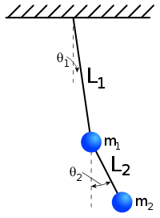

> This post was translated from Korean into English by AI.

In the previous post, we looked at the calculus of variations, the mathematical foundation needed to use Lagrangian mechanics. In this post, we will discuss generalized coordinates.

# What Are Generalized Coordinates?

So how are generalized coordinates different from ordinary coordinates?

The term <u>coordinates</u>, as we ordinarily use it, refers to a system of numbers that indicates a position. For example, South Korea is located at approximately 127 degrees east longitude and 38 degrees north latitude. Written as a tuple, that would be (127E,38N). This is a spherical coordinate system, used to specify a point on a sphere. In engineering, Cartesian coordinate systems, which use distances from the origin along each axis, are also widely used.

In physics, however, these coordinate systems can sometimes be inconvenient—namely, when there are <u>constraints</u>.

## Constraints

In physics, a <u>constraint</u> is any restriction that limits an object's motion. Here are several examples to make this easier to understand.

1. Consider a balloon floating in an infinitely vast three-dimensional space. There is nothing restricting its position, so to know its exact location, we must know all three coordinate values, $x,y,z$. We could use a spherical coordinate system based on its distance from an observer, azimuth, and elevation, but no matter what special coordinate system we use, we must know three values to specify the balloon's position.

2. Now consider a cable car suspended in three-dimensional space. It must move along a straight cable given by $x=2y=z3$ and cannot leave the cable and move freely. In this case, knowing just one of $x,y,z$ is enough to determine the cable car's exact position, because once one of the three is known, the remaining values are determined from it. Here, the `cable` is a constraint that restricts the cable car's motion. This example shows that when a constraint is introduced, fewer coordinates are needed to determine a position.

3. Of course, not all constraints work this way. Consider a car moving on a two-dimensional plane. Given enough time, the car could reach any point on the plane, but locally, it can move only forward or backward. While the car is facing forward, it cannot move directly to the right without changing direction. (Parking would be so much easier if it could.) This, too, is a type of constraint.

4. A train provides another good example of a constraint. When a train travels across terrain with changes in elevation, we need three values—latitude, longitude, and altitude—to know its exact position. But since the train can travel only along the rails, in practice, knowing only its distance from the point of departure is enough to specify its exact position. (Assume there are no junctions or similar complications.) This is also a constraint.

## Holonomic and Nonholonomic Constraints

Constraints can be divided into holonomic and nonholonomic constraints. A holonomic constraint, as in examples 2 and 4 above, is one that depends only on an object's position and time. (Neither example 2 nor example 4, however, depends on time.) In other words, a constraint is holonomic if the positional relationship among $n$ particles can be expressed as follows.

$$
f(x_0,y_0,z_0,x_1,y_1,z_1,...,x_n,y_n,z_n,t)=0
$$

The cable car in example 2 had the following two constraints (though they were expressed as a single equation in the example).

$$
x-2y=0\\
2y-3z=0
$$

By contrast, a nonholonomic constraint, like the one in example 3, depends not only on an object's position and time but also on other factors. In example 3, <u>direction</u> is part of the constraint, so it is a nonholonomic constraint.

## Degrees of Freedom

The minimum number of coordinates needed to describe an object's position is called its <u>degrees of freedom</u>. As the examples above show, holonomic constraints reduce an object's degrees of freedom. More precisely, when a $d$-dimensional system of $n$ particles has $k$ holonomic constraints, the system has $nd-k$ translational degrees of freedom. In the cable car example above, there is one particle in a three-dimensional system with two constraints, so $nd-k=1$. We can therefore confirm mathematically that the system has one degree of freedom.

In the first paragraph, I said that ordinary coordinate systems can be inconvenient in physics. This is why: constraints reduce the number of degrees of freedom, allowing us to analyze a system with far fewer variables.

## Generalized Coordinates

To analyze a constrained system efficiently, we collect only the $nd-k$ variables that are absolutely necessary to describe it. This collection is called a <u>generalized coordinate system</u>. The most intuitive example is a double pendulum.

For the two-dimensional double pendulum shown above, four coordinate values are needed in total: the $x,y$ coordinates of the first pendulum and the $x,y$ coordinates of the second. The pendulum, however, has the following two constraints.

$$
x_1^2+y_1^2=L_1^2\\
(x_1-x_2)^2+(y_1-y_2)^2=L_2^2
$$

Thus, calculating $nd-k=2\times2-2=2$ shows that the system has two degrees of freedom and can therefore be described using only two variables. In the figure above, these variables—the generalized coordinates—are chosen as $\theta_1,\theta_2$, the angles that each pendulum makes with the vertical.

Of course, a generalized coordinate system only needs two variables capable of describing the actual system, so they can be chosen however we like as long as they describe the system properly. For example, there would be no problem using the $x$ position of the first pendulum and the angle of the second pendulum, $(x_1,\theta_2)$, as the generalized coordinates.

The $y$ value of the first pendulum, however, cannot be chosen as a generalized coordinate, because a position with a given $y$ value is not unique. The $x$ value can be chosen in the figure above because the pendulum is prevented from moving above the top. If the pendulum could swing to a position higher than the origin, there could be two positions with the same $x$ value, so it could not be chosen this way.

## Generalized Velocities

Now that we understand generalized coordinates, let us finish by defining generalized velocity. In an ordinary coordinate system, velocity is defined as follows:

$$
v=\dot{x}=\frac{dx}{dt}
$$

Likewise, velocity in a generalized coordinate system can be defined as follows. (In physics, a dot above a variable denotes differentiation. It is equivalent to a prime ($'$).)

$$
\dot{q}=\frac{dq}{dt}
$$

For example, in the case of a simple pendulum whose generalized coordinate is its angle with the vertical, its generalized velocity is the angular velocity of the pendulum.

---

If this post seems to end abruptly, that is perfectly normal. I originally intended to include the post about the Lagrangian here as well, but it became too long, so I split it off.
