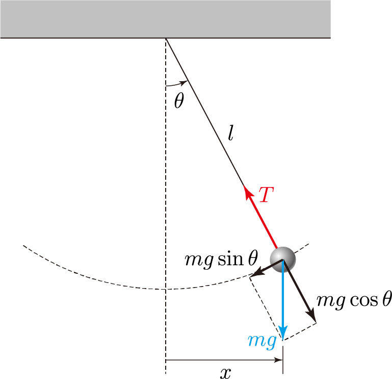

> This post was translated from Korean into English by AI.

# The Lagrangian and Action

It feels like we are almost there. In this final installment of the Lagrangian mechanics series, we will explore the Lagrangian and action. (At last, terms have appeared that actually seem directly related to Lagrangian mechanics.)

## The Lagrangian

The Lagrangian $L$ is defined as a system's potential energy $T$ minus its kinetic energy $U$. In other words,

$$
L=T-U
$$

For example, consider a two-dimensional system containing two particles. The Lagrangian of this system is as follows.

$$
T=mgy_1+mgy_2=mg(y_1+y_2)\\
U=\frac{1}{2}m(\dot{x_1}^2+\dot{y_1}^2)+\frac{1}{2}m(\dot{x_2}^2+\dot{y_2}^2)
=\frac{1}{2}m(\dot{x_1}^2+\dot{y_1}^2+\dot{x_2}^2+\dot{y_2}^2)\\
\therefore L=mg(y_1+y_2)-\frac{1}{2}m(\dot{x_1}^2+\dot{y_1}^2+\dot{x_2}^2+\dot{y_2}^2)
$$

However, this is written using Cartesian coordinates rather than generalized coordinates, whereas the Lagrangian should be expressed using generalized coordinates. Of course, when there are no constraints, generalized coordinates = Cartesian coordinates.

As a simple example involving a constraint, let us calculate the Lagrangian of a pendulum using the angle $\theta$ from the vertical as its generalized coordinate. $L$ is the length of the pendulum.

$$
T=mgy=mg\cos\theta\\
U=\frac{1}{2}mv^2=\frac{1}{2}m(L\dot\theta)^2\\
\therefore L=mg\cos\theta-\frac{1}{2}m(L\dot\theta)^2
$$

## Action

Thus, in general, the Lagrangian is a function of the generalized coordinate $q(t)$, its derivative $\dot{q(t)}$, and time $t$.

$$
L(q(t),\dot{q}(t),t)
$$

Its integral over time is called the action, and the action is a functional of the generalized coordinate function $q(t)$.

$$
S[q]=\int_{t_0}^{t_1}L(q(t),\dot{q}(t),t)dt
$$

## The Principle of Least Action

The principle of least action means that when a system goes from $q(t_1)$ to $q(t_2)$, its evolution minimizes the action $S$.

What does that mean? Suppose the state of a system changes. For example, suppose a particle moves from $(x_1,y_1)$ to $(x_2,y_2)$. Infinitely many paths connect these two points, but the path the particle actually follows must minimize the time integral $S$ of the Lagrangian along that path. Therefore, this path function is a stationary point of the functional $S[q]$. Applying the Euler–Lagrange equation covered in the previous post, we find that the evolution of a system consisting of $n$ generalized coordinates $q_1,q_2,...,q_n$ satisfies the following system of partial differential equations.

$$
\frac{\partial L}{\partial q_i}-\frac{d}{dt}\frac{\partial L}{\partial\dot{q_i}}=0
$$

Ta-da!

Now we can plug any system into that system of partial differential equations, and its path automatically pops out.

# Applications

Unlike Newtonian mechanics, Lagrangian mechanics is actually somewhat unintuitive. This is because Lagrangian mechanics regards the principle of least action described above as a fundamental principle of nature, with other physical laws such as $F=ma$ derived from it. I might have been able to explain it better if I knew why the principle of least action holds, but my knowledge is still too shallow to go that far... *sob*

Although Lagrangian mechanics is unintuitive and its calculations may look complicated, it provides an extremely powerful way to analyze complex systems, especially constrained ones. As we saw above, having constraints means that each component of position affects the others. Therefore, to analyze a constrained system using Newtonian mechanics, we must also account for the relationships among the components. In a system with multiple particles in particular, the positions of the particles may affect one another as well.

In Lagrangian mechanics, however, every equation can be analyzed <u>independently</u> because we use only generalized coordinates and generalized momenta, from which all the interacting factors have been eliminated. This makes the analysis much more convenient. Some articles say that Lagrangian mechanics is convenient because Newtonian mechanics uses vectors whereas Lagrangian mechanics uses scalars; this is another way of expressing the same idea. When constraints exist, the components of a vector are not independent, so the vector cannot simply be broken down into its components.

Another advantage is that the analysis can be mechanized. Lagrangian mechanics follows such a fixed methodology that a person does not need to analyze the system by hand. Given only the relationships between the generalized and Cartesian coordinates and the potential energy, a program can perform the analysis on its own. In fact, below we will use a MATLAB script to analyze a system automatically.

## Examples

Even if Lagrangian mechanics is difficult to grasp intuitively, looking at examples can give you some feel for it.

### Free Fall

Suppose we have a particle with no constraints whatsoever. Let us analyze its motion. Of course, from Newtonian mechanics we already know that such a particle simply falls freely.

First, for this particle we can treat the generalized coordinate system and the ordinary Cartesian coordinate system as identical. Its Lagrangian is

$$
L=T-U=mgy-m(\dot{x}^2+\dot{y}^2)/2
$$

Applying the Euler–Lagrange equation above to the generalized coordinate $x$ gives

$$
\frac{\partial L}{\partial x}-\frac{d}{dt}\frac{\partial L}{\partial\dot{x}}
=\frac{dm\dot{x}}{dt}=m\ddot{x}=0\\
\therefore\ddot{x}=0
$$

Applying the Euler–Lagrange equation to $y$ gives

$$
\frac{\partial L}{\partial y}-\frac{d}{dt}\frac{\partial L}{\partial\dot{y}}
=mg-m\ddot{y}=0\\
\therefore \ddot{y}=-g
$$

These results agree exactly with what we obtain using $F=ma$ in Newtonian mechanics. There is no acceleration in the x-direction, and the particle accelerates in the y-direction at $-g$.

### Elastic Simple Pendulum



Let us analyze the pendulum system shown above. But an ordinary pendulum would be boring, so let us imagine that the string connecting the pendulum to the wall is not rigid but is instead a spring with spring constant $k$. (We could, of course, also account for the spring's dimensions and weight, but that would make things far too complicated, so we will assume the spring has zero mass and is infinitely thin.) This pendulum will therefore undergo extraordinarily complex motion, swinging from side to side while the length of its string changes as well.

First, let us find the generalized coordinates for this pendulum. Because its string is a spring, nothing restricts its position. This is therefore an unconstrained system, so we can choose two generalized coordinates. Intuitively, I will choose the spring's length $l$ and the angle $\theta$ that it makes with the vertical. (Because the spring has zero mass, it does not bend and remains a straight line.) We could, of course, choose the pendulum's $x,y$ coordinates instead, but this choice will make the analysis much easier.

Next, we calculate the Lagrangian and solve the equations. The Lagrangian is given as follows.

$$
T = -mgl\cos\theta+\frac{1}{2}kl^2\\
U = \frac{1}{2}m(\dot{l}^2+(l\dot\theta)^2)\\
\therefore L = -mgl\cos\theta +\frac{1}{2}kl^2 - \frac{1}{2}m(\dot{l}^2+(l\dot\theta)^2)
$$

Ah... But anyone can see that differentiating this is going to be tedious. So this time, instead of differentiating it by hand, let us use a MATLAB script to do the calculation. Here is the script I wrote.

```matlab
clear;

% Define the variables to analyze
syms l(t) theta(t) m g k

% Define the system
x = l*sin(theta)
y = -l*cos(theta)
U = m*g*y + k*l.^2/2

%===========================================================
% Everything below this point can be used unchanged regardless of the system.
%===========================================================

% Find the kinetic energy T and calculate the Lagrangian
T = m*(diff(x,t).^2+diff(y,t).^2)/2
L = T - U

%===========================================================
% Expand the Euler-Lagrange equation for the generalized coordinate l
%===========================================================

% MATLAB cannot differentiate a function with respect to a function. Therefore, temporarily substitute the function with a variable.
syms lt l_t
LT = subs(L,diff(l,t),l_t);
LT = subs(LT,l,lt);

% Partially calculate the Euler-Lagrange equation
E1 = diff(LT,lt);
E2 = diff(LT,l_t);

% To differentiate the second term with respect to t, turn the function used as a variable back into a function
E1 = subs(E1,lt,l);
E1 = subs(E1,l_t,diff(l,t));
E2 = subs(E2,lt,l);
E2 = subs(E2,l_t,diff(l,t));

% Calculate the Euler-Lagrange equation
Eq = E1-diff(E2,t) == 0;

% Simplify
EqL = simplify(Eq,'Steps',100);

%===========================================================
% Expand the Euler-Lagrange equation for the generalized coordinate theta
%===========================================================

% MATLAB cannot differentiate a function with respect to a function. Therefore, temporarily substitute the function with a variable.
syms thetat theta_t
LT = subs(L,diff(theta,t),theta_t);
LT = subs(LT,theta,thetat);

% Partially calculate the Euler-Lagrange equation
E1 = diff(LT,thetat)
E2 = diff(LT,theta_t)

% To differentiate the second term with respect to t, turn the function used as a variable back into a function
E1 = subs(E1,thetat,theta);
E1 = subs(E1,theta_t,diff(theta,t));
E2 = subs(E2,thetat,theta);
E2 = subs(E2,theta_t,diff(theta,t));

% Calculate the Euler-Lagrange equation
Eq = E1-diff(E2,t) == 0;

% Simplify
EqT = simplify(Eq,'Steps',100);

%===========================================================
% Display the final results
%===========================================================

latex(EqL)
latex(EqT)
```

Unfortunately, MATLAB did not support differentiating an expression with respect to a symbolic function. I therefore had no choice but to construct the equation using a special trick that replaces the expression with a variable. As a result, our MATLAB code analyzed the complex system above beautifully and returned the following in LaTeX form. Very cool. To think that something like this can run on a personal computer. My respects to the advancement of computing.

$$
m\,\frac{\partial ^2}{\partial t^2} l\left(t\right)+k\,l\left(t\right)=m\,l\left(t\right)\,{\left(\frac{\partial }{\partial t} \theta \left(t\right)\right)}^2+g\,m\,\cos\left(\theta \left(t\right)\right)\\
l\left(t\right)\,\frac{\partial ^2}{\partial t^2} \theta \left(t\right)+2\,\frac{\partial }{\partial t} \theta \left(t\right)\,\frac{\partial }{\partial t} l\left(t\right)+g\,\sin\left(\theta \left(t\right)\right)=0\vee l\left(t\right)=0\vee m=0
$$

MATLAB is smarter than I am: in the second equation, it even presented two trivial solutions that I had failed to consider. Of course, they are not particularly useful because we do not deal with such cases...

Although these results are well organized, they are quite complex. But they really could not be anything else: ordinary pendulum motion already involves a nonlinear differential equation, and adding a spring on top of that could never produce an answer in a pretty form. I suspect it may exhibit chaotic behavior like a double pendulum. In any case, it seems impossible to solve these equations neatly in closed form to obtain $l(t)$ or $\theta(t)$.

So let us solve these equations using numerical analysis. Examining them closely, we see that they have the very convenient form of containing only one second-order derivative each. We can therefore rearrange them easily in terms of the second-order derivatives, making them very convenient to solve numerically.

Of course, I hate calculations so much that I do not even want to do this simple rearrangement myself, so I will take care of it with a MATLAB script.

```matlab
%===========================================================
% Use substitution again to transform the equations into a form in terms of second-order derivatives, then simplify
%===========================================================

syms l__t theta__t

EqL = subs(EqL,diff(l,t,t),l__t);
EqT = subs(EqT,diff(theta,t,t),theta__t);
SL = solve(EqL,l__t);
ST = solve(EqT,theta__t);
SL = simplify(SL,10)
ST = simplify(ST,10)
latex(SL)
latex(ST)
```

Adding this to the very bottom of the script above gives the following results. (The actual output consists of the expressions on the right-hand sides of the equals signs; I wrote the left-hand sides myself.)

$$
\ddot{l} = g\,\cos\left(\theta \left(t\right)\right)+l\left(t\right)\,{\left(\frac{\partial }{\partial t} \theta \left(t\right)\right)}^2-\frac{k\,l\left(t\right)}{m}\\
\ddot\theta=-\frac{2\,\frac{\partial }{\partial t} \theta \left(t\right)\,\frac{\partial }{\partial t} l\left(t\right)+g\,\sin\left(\theta \left(t\right)\right)}{l\left(t\right)}
$$

Finally, let us write an HTML + ES6 script that renders this using numerical analysis and see whether the resulting motion actually looks plausible. [Here](https://unknownpgr.github.io/lagrange-mechanics/sim.html) is a simple simulation I made.

<iframe src="https://unknownpgr.github.io/lagrangian-mechanics/sim.html" height="800px" width="100%" style="border:none;"></iframe>

> I updated the simulation code after writing this post. The post considers a case in which the pendulum's entire string is a spring, but the simulation shown above considers a case in which part of the string is rigid and part is a spring.

I was a little surprised that the result was so regular and tidy rather than chaotic, contrary to what I had expected. Then again, if you attached a ball to a rubber band in real life, it probably would move like that. I wondered whether I had made a mistake calculating the Lagrangian, so I checked some other references, but it appears that my calculation was correct. Nature is fascinating. To think that such clean behavior can emerge from equations that look so complex and unpredictable.

# Conclusion

Over the course of three posts, I have introduced Lagrangian mechanics and walked through the process of using it to analyze a complex system. Once exam season arrives, everything other than studying for exams really does become fun.
