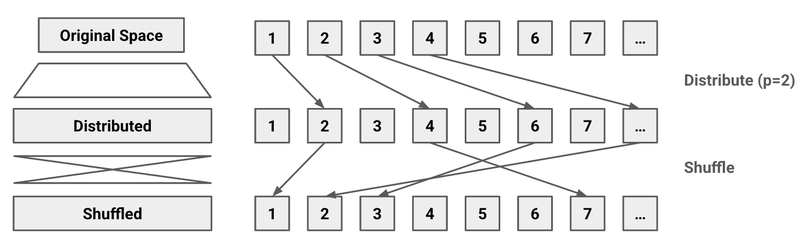

> This post was translated from Korean into English by AI.

I recently designed and implemented the link shortener for The Form. This post summarizes the algorithms and decisions involved in the process.

## Considerations

My top priorities were simplicity and scalability. The Form is a project run by a small team, so unless its architecture is kept simple, the maintenance costs become unmanageable. For a large team, managing a link shortener as a separate microservice is not particularly difficult. For a small team, however, every such component becomes a major maintenance burden. The same applies to scalability: if the system is designed without scalability in mind and the service later needs to expand, the cost will be much greater.

With that in mind, I considered the following possible changes:

- The number of users or shortened links may increase in the future.
- The servers may need to scale horizontally.
- The database may need to be sharded.
- The link shortener may be separated from the backend logic into a standalone service in an MSA.

I also considered the following functional requirements:

- Links should be shortened as much as possible.
- The same link should always return the same shortened link.
- It should not be possible to infer the sequence of shortened links from them.

## Design

Link shorteners are generally designed around hashes. In other words, the URL is hashed, and the resulting hash value is used as the shortened link. This approach, however, requires resolving hash collisions when they occur and deciding on the size of the hash space. If the hash space is too small, the probability of collisions becomes excessively high; if it is too large, shortened links become longer.

For these reasons, I tried a new approach this time: assign each URL a unique auto-incremented integer id and treat that id as the shortened URL. All that remains is to represent the integer using an appropriate base. Because uppercase letters, lowercase letters, and digits can all be used in the path portion of a URL, at least base 62 is available.

This approach has the following advantages:

- It does not produce hash collisions.
- Because it uses numbers that increase gradually rather than hashes, shortened URLs are relatively short.
  - With a fixed hash space, shortened URLs may need to be ten or more characters long even early on, when very few URLs have been shortened. With this approach, however, only a very small number of characters is needed at first. (Even three base-62 characters can represent 238,328 shortened URLs.) The number of digits will, of course, grow naturally over time.
- It is easy to accommodate both horizontal and vertical scaling.
  - When scaling to n servers, each server can generate indices of the form $kn+i (k \in \mathbb{N}, 0 \leq i < n)$, allowing shortened URLs to be generated without collisions or inter-server communication.
- The key contains no meaning.
  - If an original URL contains personal information or similar data, that information may in some cases be inferred from its hash. With a hash-based approach, even if a user recognizes the problem and deletes the shortened URL, the link merely stops working; the original information may still be inferred. This problem does not occur with auto-incremented ids.

> Of course, this approach has the drawback that the same URL may be assigned different shortened links. This can be addressed by checking the database just once before generating a URL.

The greatest drawback of this approach is that, because shortened URLs are generated sequentially, the next or previous URL is extremely easy to guess. Suppose, for example, that someone generates several shortened URLs and receives a01, a02, and a03. It is easy to predict that a04 will be generated next. In such a situation, this link-shortening service could become a valuable source of information for a hacker collecting personal information or looking for a list of active sites to attack. This is an even greater concern for The Form because it is a survey service, and surveys often include the contact details of the person conducting the survey within the survey itself.

I therefore devised the following algorithm:

1. Generate an auto-incremented integer id $x$.
2. Generate $x'=kx$ so that shortened URLs are not adjacent to one another. For example, if x is 1, 2, and 3 and k is 100, then x' is 100, 200, and 300.
3. Apply a pseudo random permutation function $f$ to x' that preserves its number of digits (when expressed in base 62).
4. Convert f(x') to its base-62 string representation and use it as the shortened URL.

The reason for defining f this way is that it is difficult to define a permutation over an infinite space. Defining a permutation over a finite space, such as a hash space, is straightforward. The integer space, however, is infinite, so a permutation over the entire space cannot be defined easily. The integer space must therefore be divided into finite spaces, with a permutation applied within each one.

Suppose the space were divided into fixed-size intervals. If the partitions were too small, the permutation would change the values so little that it would be meaningless. In the extreme case of partitions of size 1, it would be equivalent to applying no permutation at all.

Conversely, if the partitions were too large, the results would mostly be numbers with many digits. This is because there are far more numbers with more digits than numbers with fewer digits. A link shortener uses base 62 in particular, so there are 61 times as many numbers with one additional digit. That would eliminate the advantage this approach has over hashing.

By defining a permutation that preserves the number of digits, we can therefore define a permutation across the entire integer space while retaining the desired number of digits.

## Implementation

It is implemented as follows:

1. Generate an auto-incremented integer id $x$.
2. Given a pseudo random permutation function $f_n(x)$ over an arbitrary range $[0, n]$,
3. Let $d=p^{\lfloor \log_p (kx) \rfloor}$, and generate $x' = f_{(p-1)d-1}(kx - d)+d$. Here, $p$ is the base (62 in this case), and $k$ is a constant used to keep URLs from being adjacent.
4. Express $x'$ in base 62.

### The f Function

It is therefore important to design the f function well. If f can be inferred, adjacent URLs can be discovered immediately. Of course, a link shortener is not a particularly security-critical service, so the function does not need to be cryptographically secure.

> To be cryptographically secure, it would need to resist brute-force attacks. That would require a space of at least 256 bits, which is far too large for use in a link shortener.

I therefore used a simple function combining a Feistel network with an LCG.

A Feistel network is a structure used in block ciphers. It divides a block into two parts, applies different functions to each part, and then XORs the results. This has the effect of greatly increasing entropy. Mathematically, it is expressed as follows:

$$
L_{i+1} = R_i \\
R_{i+1} = L_i \oplus f(R_i, k_i)
$$

LCG stands for Linear Congruential Generator, a method that generates numbers using a linear congruence. It is expressed as follows:

$$
x_{i+1} = (ax_i + b) \mod m
$$

An LCG is generally used to generate pseudorandom numbers by repeatedly applying the equation above. Here, however, I used just one step of it as a permutation. This is because the equation defines a permutation over the range $[0, m-1]$ when $a\perp m$.

Choosing $a$ is therefore important. If $a$ and $m$ are not coprime, the result is not a permutation. Fortunately, here the range $m$ has the form $(p-1)p^n$, and the base $p$ is the number of URL-safe characters, which is unlikely to exceed 64. It is therefore clear that every prime factor of $m$ is smaller than $\sqrt {64}$. Accordingly, any prime greater than 10 can be chosen for a. Choosing a number that is too small, however, can produce an extremely regular permutation as m grows, so I used a large prime with at least eight digits.

The reason for combining these two methods is that a Feistel network can be used only when the range is $2^n$. Here, the range is $(p-1)d$, so I divided it into the widest possible ranges of size $2^n$ and applied the Feistel network only within those ranges. This leaves the final portion of the range without a permutation, so I applied a permutation using the LCG and then applied the Feistel network once more. Note that applying a Feistel network twice returns the original value, so the keys used for the first and second applications must be different.

Both methods have the additional advantage of requiring only O(1) operations and remarkably little computation compared with hash functions. (Hash functions fundamentally consist of repeating operations like these dozens of times or more.)

## Other Considerations

This implementation naturally also considered a variety of concerns such as separating the database repository, service, and controller layers based on clean architecture; dependency inversion and injection; and rigorous test code covering failure conditions and the permutation change ratio. These topics are already explained well in other similar articles, however, so I will omit them here.

## Conclusion

I designed and implemented a link shortener based on auto-incremented ids and permutations, an approach that has not traditionally been used. It avoids hash collisions, keeps shortened URLs short, and makes adjacent URLs difficult to guess. The design prioritizes scalability and simplicity.
