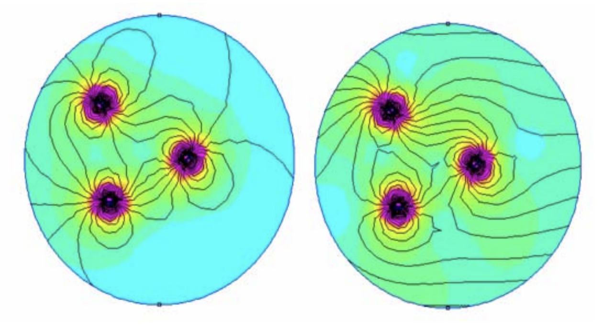

> This post was translated from Korean into English by AI.

A magnetometer measures the surrounding magnetic field. However, because the sensor is usually affected by various disturbances, its readings cannot be used as-is and must be calibrated. These disturbances in a magnetometer can be modeled as follows.

$$
\begin{align*}
y = T_\text{sf}T_\text{cc}(T_\text{si}m + b_\text{hi}) +b_\text{s} +\epsilon
\end{align*}
$$

Each variable is defined as follows.
| Variable | Description | Size |
|------|------|------|
| $y$ | Measurement | 3x1 vector |
| $m$ | Actual magnetic field | 3x1 vector |
| $T_\text{sf}$ | Scale factor for each axis | 3x3 diagonal matrix |
| $T_\text{cc}$ | Cross-coupling, the influence between axes | 3x3 matrix |
| $T_\text{si}$ | Soft iron, magnetic-field distortion in the sensor frame caused by soft iron | 3x3 matrix |
| $b_\text{hi}$ | Hard iron, magnetic-field distortion in the sensor frame caused by hard iron | 3x1 vector |
| $b_\text{s}$ | Bias inherent to the sensor | 3x1 vector |
| $\epsilon$ | Noise | 3x1 vector |

#### Magnetic Materials

Magnetic-field distortions caused by soft and hard iron can be confused with the magnetic properties of materials such as ferromagnetic and paramagnetic materials. Although this is a slight digression from the main topic, it is worth clarifying the distinction.

First, ferromagnetism, diamagnetism, and paramagnetism describe different types of magnetic materials, as follows.

- Ferromagnetic materials: Become magnetized by an external magnetic field and retain some magnetization even after the field is removed
  - Examples: iron, nickel, cobalt
- Paramagnetic materials: Become weakly magnetized by an external magnetic field and lose their magnetization when the field is removed
  - Examples: aluminum, platinum, coral
- Diamagnetic materials: Generate a magnetic field that opposes an external magnetic field
  - Examples: copper, gold, water

Next, both soft iron and hard iron are types of ferromagnetic materials.

- Soft iron refers to a material that is readily magnetized and demagnetized, and is therefore used in coils and similar applications.
- Hard iron, by contrast, is difficult to magnetize but retains its magnetization for a long time once magnetized; this is what is generally meant by a permanent magnet.



The figure above illustrates magnetic-field distortion caused by hard iron, that is, a magnetized ferromagnetic material. The image on the left shows the magnetic field lines of a ferromagnetic material in a space with no external magnetic field, while the image on the right shows the field lines when an external magnetic field is present. In this way, hard iron generates an additional (additive) magnetic field on top of the external field. In other words, it acts as a bias.


Soft iron, on the other hand, has no effect in the absence of an external magnetic field, as shown above, but changes the direction of the field when an external magnetic field is applied.

Returning to the equation above, it includes various factors, including the external magnetic materials discussed above. In general, however, it is neither necessary to determine all of these specific values nor possible to measure them using a single magnetic sensor. Therefore, the variables are usually combined into the following form.

$$
\begin{align*}
y = Tm + b + \epsilon
\end{align*}
$$

The goal of calibration is therefore to determine $T$ and $b$ in the equation above. Various methods have been proposed for this purpose; see the references at the end of this post. Here, calibration is performed using one such method: ellipsoid fitting.

## Ellipsoid Fitting

The Earth's magnetic field can be assumed to be locally constant. It follows that, ideally, geomagnetic-field vectors measured at various orientations lie on the surface of a sphere. Measurements containing various disturbances and distortions are the result of applying the equation above to that sphere, so they form an ellipsoid. Therefore, once the parameters describing this ellipsoid are found, the ellipsoid can be transformed back into a sphere.

The general form of an ellipsoid, including translation and rotation, is as follows.

$$
\begin{align*}
Ax^2 + By^2 + Cz^2 + 2Dxy + 2Exz + 2Fyz + 2Gx + 2Hy + 2Iz + J = 0
\end{align*}
$$

> Note that the form above is that of a general quadric surface. For it to be an ellipsoid, A, B, and C must all be positive. This condition must therefore be checked after fitting. The fit will generally produce an ellipsoid, but the condition may not be satisfied if there is insufficient sensor data.

The parameters above can be found by solving the following least-squares problem.

$$
\begin{align*}
\min_{A,\dots,J} \sum_{i=1}^{N} \left( Ax_i^2 + By_i^2 + Cz_i^2 + 2Dx_iy_i + 2Ex_iz_i + 2Fy_iz_i + 2Gx_i + 2Hy_i + 2Iz_i + J \right)^2
\end{align*}
$$

This can be expressed in matrix form as follows.

$$
\begin{align*}
&\min_{A,\dots,J} \left\| \begin{bmatrix} x^2 & y^2 & z^2 & 2xy & 2xz & 2yz & 2x & 2y & 2z & 1 \end{bmatrix} \begin{bmatrix} A \\ \vdots \\ J \end{bmatrix} \right\|^2\\
=&\min_{\beta} \left\| D \beta\right\|^2
\end{align*}
$$

In the equation above, $x$, $y$, and $z$ are column vectors containing the components of each measurement along the respective axes.

However, the equation has the trivial solution $\beta=0$. It is therefore underdetermined, and an additional constraint is required to obtain a solution. The following constraint is commonly imposed.

$$
\| \beta \|^2 = 1
$$

Under this constraint, the optimal solution can be found using the method of Lagrange multipliers as follows.

$$
\begin{align*}
\frac{\partial}{\partial \beta} \left( \left\| D \beta\right\|^2 + \lambda \left( \left\| \beta \right\|^2 - 1 \right) \right) = 0
\end{align*}
$$

Evaluating this expression gives the following.

$$
\begin{align*}
D^TD\beta + \lambda \beta = 0
\end{align*}
$$

From this, we can see that $\beta$ is an eigenvector of $D^TD$ and $\lambda$ is an eigenvalue. Of course, a matrix has multiple eigenvalues, so one of them must be selected. Recall that the original expression to be optimized was as follows.

$$
\begin{align*}
\min_{\beta} \left\| D \beta\right\|^2= \min_{\beta} \beta^TD^TD\beta
\end{align*}
$$

Since $\beta$ is an eigenvector, this immediately reduces to the corresponding eigenvalue, as follows.

$$
\begin{align*}
\beta^TD^TD\beta = \lambda \beta^T\beta = \lambda \|\beta\|^2= \lambda\\
\end{align*}
$$

Therefore, the parameters we seek are given by the eigenvector corresponding to the smallest eigenvalue.

## Ellipsoid Projection

The ellipsoid parameters found above merely describe an ellipsoid that fits the measurements well. To obtain calibrated values, the ellipsoid must be transformed back into a sphere.

First, express the ellipsoid equation given above in coefficient form as the following quadratic matrix form.

$$
\begin{align*}
\begin{bmatrix} x & y & z  \end{bmatrix} \begin{bmatrix} A & D & E \\ D & B & F \\ E & F & C \end{bmatrix} \begin{bmatrix} x \\ y \\ z \end{bmatrix} + 2\begin{bmatrix} G & H & I \end{bmatrix} \begin{bmatrix} x \\ y \\ z \end{bmatrix} + J = 0\\
\rightarrow x^TMx + 2b^Tx + J = 0
\end{align*}
$$

This equation includes both the rotation and translation of the ellipsoid. First, translate it to the origin. To do so, transform the variable using $x' = x - c$, where $c$ is the center of the ellipsoid. The center $c$ can be found as follows.

$$
\begin{align*}
c = -M^{-1}b
\end{align*}
$$

Substituting this into the equation transforms it into the following form.

$$
\begin{align*}
x'^TMx' + \text{const} = 0
\end{align*}
$$

The constant term simply determines the size of the ellipsoid, so it can be ignored.

Next, this must be transformed into the form of a sphere. In other words, assuming that an appropriate change of variables $Q$ exists such that $y=Qx'$, we need to find $Q$ such that $y^Ty + \text{const}=(Qx)^T(Qx)+ \text{const}=0$.
This is easy to find because the matrix $M$ is symmetric. By the spectral theorem, a symmetric matrix can be diagonalized as follows.

$$
\begin{align*}
M = VDV^T
\end{align*}
$$

> This diagonalization has the following useful properties.
>
> - $V$ is an orthogonal matrix. That is, $V^TV = I$.
> - The column vectors of $V$ are the eigenvectors of $M$.
> - $D$ is a diagonal matrix. That is, $D_{ij} = 0$ for $i \neq j$.
> - The diagonal entries of $D$ are the eigenvalues of $M$.

Using these properties, the expression can be rewritten as follows.

$$
\begin{align*}
x'^TMx' &= x'^TV^TDVx' (\because \text{spectral theorem})\\
&= x'^TV^TD^{1/2}D^{1/2}Vx' (\because D \text{ is diagonal})\\
&= (D^{1/2}Vx')^T(D^{1/2}Vx')\\
\end{align*}
$$

It follows that $Q = D^{1/2}V$.

> The $Q$ found in this way transforms the ellipsoid into a sphere without regard to its size. In general, however, only direction—not magnitude—matters when using a magnetometer, so this is not a significant issue.

## Summary

To summarize:

1. Perform ellipsoid fitting using the measurements to obtain the ellipsoid parameters.
2. Convert the resulting parameters into matrix form.
3. From these, compute the center of the ellipsoid, $c=-M^{-1}b$, and the transformation matrix, $Q=D^{1/2}V$.
4. The calibrated value for an input can now be obtained by computing $y=Q(x-c)$.

## Implementation

The code below implements the procedure described above in Python.

```python
#!/usr/bin/env python3

import matplotlib.pyplot as plt
import numpy as np

def read_data():
    # ...Read data form file...
    return np.array(data, dtype=np.float64)


def fit_ellipsoid(data):
    # Create the design matrix
    D = np.array(
        [
            [
                x**2,
                y**2,
                z**2,
                2 * x * y,
                2 * x * z,
                2 * y * z,
                2 * x,
                2 * y,
                2 * z,
                1,
            ]
            for x, y, z in data
        ]
    )

    # Find the eigenvector corresponding to the smallest eigenvalue
    eigvals, eigvecs = np.linalg.eig(D.T @ D)
    min_eigval_index = np.argmin(eigvals)
    T = eigvecs[:, min_eigval_index]

    # Create the matrix M
    M = np.array(
        [
            [T[0], T[3], T[4]],
            [T[3], T[1], T[5]],
            [T[4], T[5], T[2]],
        ]
    )

    # Create the vector b
    b = np.array([T[6], T[7], T[8]])

    # Calculate M^-1
    M_inv = np.linalg.inv(M)

    # Calculate the center of the ellipsoid
    c = -np.dot(M_inv, b)

    # Calculate the reverse transformation matrix Q
    D, V = np.linalg.eig(M)
    Q = np.dot(np.diag(np.sqrt(D)), V)

    # Normalize projection matrix (optional, just for visualization)
    projected = np.dot((data - c), Q)
    avg_len = np.mean(np.linalg.norm(projected, axis=1))
    Q = Q / avg_len

    return c, Q


def plot_data(data):
    fig = plt.figure()
    ax = fig.add_subplot(111, projection="3d")

    # Plot data
    ax.scatter(*zip(*data), c="r", marker="o")
    ax.plot(*zip(*data), c="b", marker="o")

    # Add unit sphere for comparison
    u = np.linspace(0, 2 * np.pi, 32)
    v = np.linspace(0, np.pi, 32)
    x = np.outer(np.cos(u), np.sin(v))
    y = np.outer(np.sin(u), np.sin(v))
    z = np.outer(np.ones(np.size(u)), np.cos(v))
    ax.plot_surface(x, y, z, color="y", alpha=0.1)

    ax.set_xlabel("X")
    ax.set_ylabel("Y")
    ax.set_zlabel("Z")
    ax.set_aspect("equal")


if __name__ == "__main__":
    x = read_data()
    c, Q = fit_ellipsoid(x)
    y = Q @ (x - c).T
    plot_data(y.T)
    plt.show()
```

The visualization below shows actual sensor data and the result of calibrating it.

<iframe width="560" height="315" src="https://www.youtube.com/embed/Z8X60qRcjow?si=vh1XhVxY7fsV-EqG" title="YouTube video player" frameborder="0" allow="accelerometer; autoplay; clipboard-write; encrypted-media; gyroscope; picture-in-picture; web-share" referrerpolicy="strict-origin-when-cross-origin" allowfullscreen></iframe>

The video above shows the data before calibration. It forms a distorted ellipsoid whose center is significantly offset from the origin. This is because the sensor in question was installed near a motor.

<iframe width="560" height="315" src="https://www.youtube.com/embed/dTZYFSQY79A?si=HBa4ijPgrK8OYWec" title="YouTube video player" frameborder="0" allow="accelerometer; autoplay; clipboard-write; encrypted-media; gyroscope; picture-in-picture; web-share" referrerpolicy="strict-origin-when-cross-origin" allowfullscreen></iframe>

The video above shows the data after calibration. The transparent yellow sphere is the unit sphere, which has a radius of 1 and is centered at the origin. This confirms that the calibration was successful.

# Conclusion

Magnetometer measurements are distorted by various disturbances, so calibration is necessary. Here, calibration was performed using ellipsoid fitting, allowing the measurements to be corrected.

# References

- [https://pmc.ncbi.nlm.nih.gov/articles/PMC8401862/](https://pmc.ncbi.nlm.nih.gov/articles/PMC8401862/)
- [https://www.nxp.com/company/about-nxp/smarter-world-blog/BL-MAGNETOMETER-PLACEMENT-WHERE-WHY](https://www.nxp.com/company/about-nxp/smarter-world-blog/BL-MAGNETOMETER-PLACEMENT-WHERE-WHY)
- [https://www.nxp.com/docs/en/application-note/AN4247.pdf](https://www.nxp.com/docs/en/application-note/AN4247.pdf)
