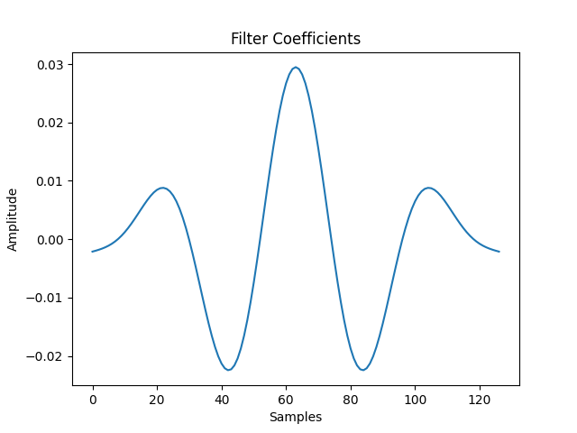
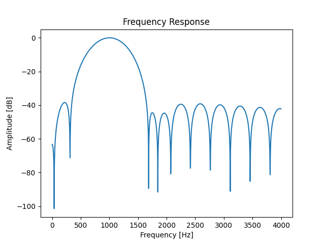
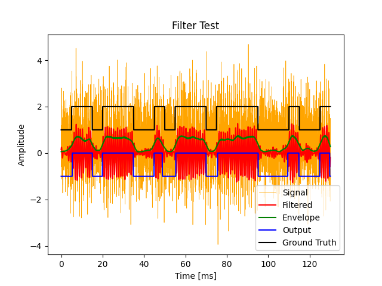

> This post was translated from Korean into English by AI.

I built a simple software modem as a fun project in my spare time.

<iframe width="560" height="315" src="https://www.youtube.com/embed/bQWD0ICCkIU?si=cqFzk62onM39hW6E" title="YouTube video player" frameborder="0" allow="accelerometer; autoplay; clipboard-write; encrypted-media; gyroscope; picture-in-picture; web-share" referrerpolicy="strict-origin-when-cross-origin" allowfullscreen></iframe>

The source code is available in the repository below.

- [https://github.com/unknownpgr/modem](https://github.com/unknownpgr/modem)

## Modem

The word modem is a portmanteau of modulator and demodulator. A modem is a device that modulates a digital signal into an analog signal or demodulates an analog signal into a digital signal. A single unit of a modulated analog signal is called a symbol. The number of possible symbols and the number of bits per symbol are related as follows.

$$
\text{bits per symbol} = \log_2(\text{number of symbols})
$$

The number of symbols transmitted per unit of time is called the baud rate. Baud rate is different from bit rate. For example, if one symbol is transmitted per second, the baud rate is 1; however, if that symbol consists of two bits, the bit rate is 2 bps.

## How a Modem Works Logically

There are many ways for a modem to modulate a digital signal into an analog signal.

The most intuitive approach is to allow no current to flow when the data is 0 and to allow current to flow when the data is 1. This effectively treats an analog channel as a digital channel. It is simple to implement, but it has several drawbacks.

- Because current flows in only one direction, a DC component is introduced.
  - A DC component increases power consumption.
  - Media that can transmit only AC components, such as voice communication channels or radio-based communication channels, cannot be used.
- It is extremely vulnerable to external noise.
- Only one communication link can use a given medium.

Consequently, this approach is suitable only for low-speed wired communication over a single line no more than a few dozen centimeters long.

To solve these problems, modems generally convert the information to be transmitted into a signal with a frequency higher than that of the information itself—usually by a factor of 10 to 40 or more—before transmitting it. In general, the terms modulation and demodulation refer to this approach by default.
The analog signal produced from the original information is called the baseband signal, while the signal created by modulating it for transmission is called the bandpass signal or carrier signal.

There are also several ways to modulate a signal. The most basic methods modulate one of the three properties that make up a sinusoid: amplitude, frequency, or phase.

- **Amplitude Shift Keying (ASK)**: amplitude modulation, which modulates the carrier amplitude according to the magnitude of the baseband signal
- **Frequency Shift Keying (FSK)**: frequency modulation, which modulates the carrier frequency according to the magnitude of the baseband signal
- **Phase Shift Keying (PSK)**: phase modulation, which modulates the carrier phase according to the magnitude of the baseband signal

These methods can also be combined. ASK and PSK are commonly used together in a technique called **Quadrature Amplitude Modulation (QAM)**. QAM schemes include 8-QAM, 16-QAM, and 64-QAM, which can transmit 3 bits, 4 bits, and 6 bits per symbol, respectively. As the number of bits that can be transmitted increases, the transmission speed rises, but so does sensitivity to noise.

## How a Modem Works Physically

Modulation is relatively simple because it only requires adjusting the carrier according to the input signal. For example, ASK can be implemented with a multiplier that multiplies the input signal by the carrier, while FSK can be implemented with a sine wave generator that generates the carrier.
Demodulation, however, is not this simple and requires a more elaborate process such as the following.

```text
Input signal ==> Amplifier ==> band-pass filter ==> envelope detector ==> threshold detector ==> decoder* ==> Demodulated signal
```

- **amplifier**: Amplifies the input signal to compensate for losses incurred while the signal is being transmitted.
- **band-pass filter**: Extracts only the signal at the desired frequency.
- **envelope detector**: Extracts the envelope of the input signal. With ASK, this is used to extract the amplitude of the input signal; with FSK, it is used to detect whether a signal at a particular frequency is present.
- **threshold detector**: Converts the output of the envelope detector into a binary signal. This determines whether the input signal is 0 or 1.
- **decoder**: This is a logical process that reconstructs the original data from the output of the threshold detector. It is explained later.

## Implementation

I used `Python` to implement FSK modulation and demodulation of data transmitted through sound. I used the commonly adopted sampling frequency of 44.1 kHz and only two symbols, 0 and 1. In this setup, the symbol representing 0 is generally called `space`, and the symbol representing 1 is called `mark`.

Initially, I assigned a frequency of 1 kHz to `space` and 2 kHz to `mark`. However, the error rate during demodulation was too high. Upon investigation, I found that mark and space exhibited different energy levels. (The energy at 2 kHz was usually higher.) I came up with the following hypotheses.

- The microphone or speaker has different sensitivities at different frequencies.
- At higher frequencies, an FIR filter has a higher Q-factor even when its order remains the same. This made the selectivity around 2 kHz higher.
- Because one frequency was twice the other, harmonics and other effects produced by various nonlinearities may have had an impact.

To solve this problem, I raised the two symbol frequencies to 7 kHz and 8 kHz. This kept the distance between them at 1 kHz, while reducing their ratio from a factor of two to just 8/7, which I expected would reduce differences caused by filter size or equipment characteristics. Furthermore, because 7 and 8 are coprime, their harmonics do not overlap below 56 kHz. According to the Nyquist theorem, this cannot be sampled at a sampling frequency of 44.1 kHz (if anti-aliasing is not taken into account). Experiments after changing the frequencies confirmed that the problem had indeed been resolved.

#### Amplifier

At first, I simply multiplied the input by a large constant, but this caused the subsequent stages to be heavily affected by the magnitude of the input signal. I solved this problem by dividing the input signal by its own magnitude.

I obtained the magnitude of the input signal by taking its absolute value and passing it through an IIR filter with an extremely low cutoff frequency of about 2 Hz. Although the resulting value is roughly proportional to the amplitude of the input signal, it is not the same value. However, because the purpose of this stage is to normalize the magnitude of the input signal, its absolute magnitude is irrelevant.

> A wavelet transform such as the Hilbert transform could also be used for envelope detection, but I did not use one because it would require more computation.

#### Band-pass Filter

A band-pass filter can be implemented in a variety of ways, including with a Fourier transform. However, the simplest and most efficient method is to use a Finite Impulse Response (FIR) filter. An FIR filter stores part of the input signal and uses it to calculate the output signal. This can be done in real time and is efficient because it performs only the necessary amount of computation.

An important consideration when implementing an FIR filter is its Q-factor. The Q-factor is a measure of filter selectivity and is defined by the ratio of the -3 dB bandwidth to the center frequency. A higher Q-factor makes it possible to isolate the desired frequency more precisely, but also requires more computation. An excessively high Q-factor can even remove part of the original modulated signal, so an appropriate Q-factor must be used.

I implemented the FIR filter using `scipy.signal.firwin` and obtained the following filter.



It has the following frequency response.



I then ran a simple modulation and demodulation test with this filter and obtained the following result.



> In practice, I used two band-pass filters to extract the space and mark frequencies separately.

#### Envelope Detector

As with the earlier calculation of signal magnitude, I took the absolute value and derived the envelope from it. However, because a box filter produced better results than an IIR filter in my experiments, I used a box filter.

#### Threshold Detector

The threshold detector converts the output of the envelope detector into a binary signal. To do so, it compares the energy at the space frequency with the energy at the mark frequency. If the energy at the space frequency is greater, the signal is interpreted as 0; if the energy at the mark frequency is greater, it is interpreted as 1.

#### Decoder

The decoder reconstructs the original data from the output of the threshold detector. The threshold detector's output has the following characteristics.

- A single symbol is recognized as multiple 0s or 1s.
- A single symbol is not necessarily recognized exclusively as either 0 or 1; noise can insert a signal with the opposite value in the middle.
- The length of a symbol may vary slightly due to transmission delays. (jitter)
- Noise may cause a signal to be detected even when no signal was actually transmitted.

To address these issues, I reconstructed the symbols in software by detecting symbol boundaries and adjusting the period of an internal timer using a method similar to a PLL. To ensure that the loop would converge when the first symbol was transmitted, I added sync data consisting of alternating 0s and 1s. I also added a preamble to distinguish the sync data from the actual data.

More specifically, I implemented a software counter and treated the point at which the counter reached a particular value as a symbol boundary. If an input bit boundary was detected within a period, I decreased the counter slightly when it was detected before the halfway point of the period, and increased the counter slightly when it was detected after the halfway point.

## Conclusion

I implemented a software modem with a transmission speed of approximately 1 kbps.
