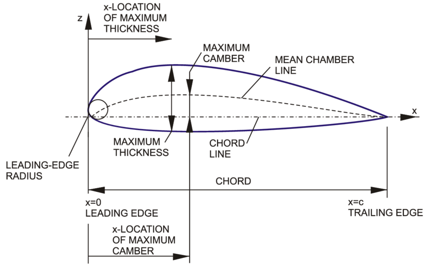

> This post was translated from Korean into English by AI.


I plan to try building an aircraft in the future. I expect the wings to be the most difficult part to make, so I wrote a program in advance that generates 3D wing models. The repository is below.

- [https://github.com/unknownpgr/naca-airfoil-generator](https://github.com/unknownpgr/naca-airfoil-generator)

## Airfoil

The most fundamental property of a wing is the shape of its cross-section. The shape of a wing cross-section is called an airfoil. An airfoil can, of course, have any shape, but it is generally determined by the following parameters.



- **chord length**: the length of the wing cross-section
- **thickness**: the thickness of the wing cross-section
  - **maximum thickness**: the maximum thickness of the wing cross-section
  - **maximum thickness position**: the position of the maximum thickness of the wing cross-section
- **mean camber line**: the centerline of the wing cross-section
  - **maximum camber**: the maximum curvature of the wing cross-section
  - **maximum camber position**: the position of the maximum curvature of the wing cross-section

One method of describing the shape of an airfoil is the NACA airfoil system. NACA stands for the National Advisory Committee for Aeronautics, and the NACA airfoil system is a method of describing airfoil shapes developed by NACA, a former U.S. aeronautical research agency.

According to this method, the thickness is first given as follows.

$$
t(x) = 5t(0.2969\sqrt{x} - 0.1260x - 0.3516x^2 + 0.2843x^3 - 0.1015x^4)
$$

- $x$ is the ratio of the distance along the x-axis to the chord and has a value between 0 and 1. In other words, $x=0$ represents the leading edge of the wing, while $x=1$ represents the trailing edge.
- $t$ is the ratio of the thickness of the wing cross-section to the chord.

The camber line is given as follows.

$$
y_c = \begin{cases}
  \frac{m}{p^2}(2px - x^2) & \text{if } 0 \leq x \leq p \\
  \frac{m}{(1-p)^2}((1-2p) + 2px - x^2) & \text{if } p \leq x \leq 1
\end{cases}
$$

- $m$ represents the maximum camber.
- $p$ represents the maximum camber position.

Here, however, thickness means thickness measured in the direction normal to the camber line. Accordingly, the upper and lower surfaces are given as follows.

$$
\begin{align*}
  x_u &= x - t(x)\sin(\theta) \\
  y_u &= y_c + t(x)\cos(\theta) \\
  x_l &= x + t(x)\sin(\theta) \\
  y_l &= y_c - t(x)\cos(\theta)
\end{align*}
$$

Therefore, a NACA airfoil is determined by three parameters: $m$, $p$, and $t$. These parameters can be inferred from the airfoil's name. NACA airfoils use four digits to represent these values, interpreted in order as $mptt$. For example, NACA 2412 represents $m=0.02$, $p=0.4$, and $t=0.12$.

> There are also five-digit designations, which are interpreted differently. See [Wikipedia](https://en.wikipedia.org/wiki/NACA_airfoil) for more information.

## Wing

Once the wing cross-section has been determined, the next step is to determine the overall shape of the wing. A wing's shape is determined by the following parameters.

- **span (length)**: the length of the wing
- **aspect ratio**: the ratio of the wing's length to its width
- **taper ratio**: the ratio of the wing's width at its root to its width at its tip
- **angle of attack**: the angle between the chord and the horizontal
- **dihedral angle**: the angle at which the wings tilt upward (or downward) when the aircraft is viewed from the front
- **sweepback angle**: the angle at which the wing is swept backward

> There may be various other shape parameters, such as twist and winglets, but I decided not to consider them for now because they would make the calculations too complicated.

These parameters can be used to determine the shape of the wing. This can be implemented easily by simply extending the airfoil along the span while applying rotation and changes in width.

## Model Generation

To generate a 3D model of the wing, we now need to generate a mesh from these equations. A mesh is a graph that divides a given surface into triangles and consists of points (vertices) and faces made up of three points. A denser mesh makes the model more accurate and smoother, but the amount of computation increases exponentially. A coarser mesh reduces the amount of computation, but the model may become inaccurate. With this in mind, I devised the following simple algorithm.

### Initial Algorithm

1. Express the surface of the wing as a parametric function $F(u, v)$. ($u\in[0,1]$, $v\in[0,1]$)
1. Initialize face = [ (0,0), (0,1), (1,0), (1,1) ] and repeat the following process.
   1. Transform each point of the face using $F(u, v)$.
   2. Check whether the face is sufficiently flat.
   3. If the face is sufficiently flat, add it to the mesh.
   4. If the face is not sufficiently flat, divide it into four parts. During division, five nodes are added: the midpoint of each edge and the center of the rectangle.
   5. Repeat step 1 for each subdivision.

### Problem

However, this approach causes the following problems.

1. It creates many duplicate nodes.
2. It loses information about edge containment relationships.

For example, suppose the following subdivision of faces is given in the domain.

```
┌───┬───┬───────┐
│   │   │       │
├───┼───┤   d   │
│   │ a │       │
├───┼───┼───────┤
│   │ b │       │
├───┼───┤       │
│   │ c │       │
└───┴───┴───────┘
```

- The lower-left node of `a` and the upper-left node of `b` are actually the same node. However, if the algorithm above is used as-is, these two nodes are treated as different nodes.
- The bottom node of `c` was originally a node contained in the bottom edge of the initial rectangle, but that information is lost. Information about the initial edges is essential when the model is a closed solid rather than a surface, or when combining two or more models.
- The upper-right node of `a` is contained in the left edge of `d`. However, this information is also lost. Consequently, the right edge of `a` and the left edge of `d` are not connected.

### Improved Algorithm

To solve these problems, I devised an approach that stores edges as trees. The approach works as follows.

1. An edge must point from left to right or from bottom to top. ($x_2\geq x_1 \land y_2\geq y_1$)
1. An edge has a start node and an end node. If the edge can be subdivided further, it has a left child and a right child. The left child is the edge connecting the edge's start node to its midpoint. The right child is the edge connecting the midpoint to the edge's end node.

Expressed in JSON format, it looks like this.

```js
// Edge without children
{
  "start": 1, // index of start node
  "end": 2, // index of end node
  "children": []
}

// Edge with children
{
  "start": 1,
  "end": 2,
  "children": [
    // Left child
    {
      "start": 1,
      "end": 3,
      "children": []
    },
    // Right child
    {
      "start": 3,
      "end": 2,
      "children": []
    }
  ]
}
```

Now, when an edge needs to be divided in half, the following algorithm is used.

1. If the edge has already been divided, return its left and right children as-is.
2. If the edge has not been divided:
   1. Create a new node at the midpoint.
   2. Create the left child (start, middle) and the right child (middle, end).
3. Return the left and right children.

In Python pseudocode, it looks like this.

```python
def divide_edge(edge):
    index_start, index_end, children = edge

    if len(children) == 2:
        return children

    start = points[index_start]
    end = points[index_end]
    middle = (start + end) / 2
    points.append(middle)
    index_middle = len(points) - 1

    child_start = [index_start, index_middle, []]
    child_end = [index_middle, index_end, []]
    children.append(child_start)
    children.append(child_end)

    return children
```

This approach prevents duplicate nodes and preserves information about edge containment relationships.

### Flatness Check

Next, we need to devise a way to check whether a face is sufficiently flat. For a face to be sufficiently flat, it must satisfy two conditions.

1. All points of the face must lie on approximately the same plane.
1. The face must be convex.

If only the first condition is checked, a rectangle in the domain could be judged flat even when it is transformed into a U-shape in the codomain, preventing further subdivision and causing a non-convex surface to be converted into a convex one. From this, I devised the following algorithm. First, suppose a face and vertices are given as follows.

```
a────b
│    │
│    │
c────d
```

Suitable sample points are provided inside the face. I used nine sample points as shown below.


First, to make the calculations easier, transform the face onto the $z=0$ plane.

1. Transform every point of the face, including the sample points, using $F(u, v)$. Let the transformed corner points be $a$, $b$, $c$, and $d$, respectively.
1. Calculate the cross product of $ad$ and $bc$, then normalize it to unit length. Assume this to be the normal vector of the face's plane.
   - If $a, b, c, d$ actually form a plane, this calculation is exact, but in general they do not.
1. Obtain a basis for the plane from its normal vector and the vector $ad$ using the Gram-Schmidt process.
1. Transform the plane so that its normal vector becomes the $z$-axis and $a$ becomes the origin.

Next, check whether this face is convex. However, the convexity of a closed curve is defined only in two dimensions, and the points transformed in the preceding process do not lie on a single plane. Therefore, before applying the method above, first project each point onto the plane and then check convexity. For the face to be convex, all of the following conditions must be satisfied.

- The test points inside the shape can be expressed as linear combinations of vector $ad$ and vector $ab$.
- All of the coefficients must be at least 0.
- All of the coefficients must be at most 1.

Next, check whether the face is sufficiently flat. Since a flat face means that the z-values of the sample points are nearly 0, the face is considered flat if the z-values of the sample points are sufficiently small.

The convexity-checking part of the algorithm above performs its calculations under the assumption that the face and sample points are planar, so it may produce an incorrect answer if the face is a surface with high curvature. However, even if the face passes the convexity check, flatness is checked at the end, so this problem can be avoided. The convexity check is performed before the flatness check because it imposes a stronger condition. Even if a face is sufficiently flat, it must not be judged flat if it is not convex. Conversely, a non-convex face can immediately be judged not flat, even if it is flat. The actual implementation is shown below.

```python
def __test_flatness(self, rect, func):
    """
    Test the flatness (linearity) of the given rect.
    """
    test_inputs = self.__test_weights @ rect
    test_outputs = func(test_inputs)

    """
    The transformed shape should be planar.
    It means that there exists a plane that contains all the points.

    A plane is determined by center point and normal vector.
    We can roughly assume that the center point is the average of the
    first four points, and the normal vector is the cross product of diagonals.
    """

    ps = test_outputs[:4]
    normal = np.cross(ps[0] - ps[3], ps[1] - ps[2])
    normal /= np.linalg.norm(normal)

    """
    Before calculating, for the ease of calculation, we can
    move the plane to be the z=0 plane.
    """

    test_outputs -= test_outputs[0]
    original_z = normal
    original_x = ps[0] - ps[3]
    original_x /= np.linalg.norm(original_x)
    original_y = np.cross(original_z, original_x)
    original_basis = np.vstack([original_x, original_y, original_z])
    original_basis_inv = np.linalg.inv(original_basis)
    test_outputs = test_outputs @ original_basis_inv

    """
    Before calculating the distance, we must check that the transformed shape is convex.
    It means that the other points can be represented as the convex combination of the first four points.
    we should flatten the points to the plane because the points are not on same plane in general.
    """

    flattened_points = test_outputs[:, :2]
    basis = flattened_points[1:3]
    test_points = flattened_points[4:]
    a = np.linalg.lstsq(basis.T, test_points.T, rcond=None)[0].T
    if np.any(a < 0) or np.any(a > 1):
        return np.inf

    """
    Because the plane is now the z=0 plane, the distance of the points to the plane
    is simply the z-coordinate of the points.
    """

    distances = test_outputs[:, 2]

    """
    The flatness of the shape is the maximum distance of the points to the plane.
    """

    return np.max(np.abs(distances))
```

### Weaving

To create a closed solid, two edges must be joined into one. Making the two edges coincide may make the shape look closed, but 3D modeling tools or 3D printer slicers may not recognize it as a closed solid. Faces must therefore be added between the two edges. Because the two edges may contain different numbers of nodes, they cannot simply be divided into triangles. I therefore used the following algorithm. This two-pointer algorithm adds faces between the two edges while minimizing twisting as much as possible.

```python
def weave_edges(self, edge1, edge2, reverse_face=False):
    vs1 = self.vertices[edge1]
    vs2 = self.vertices[edge2]

    new_faces = []
    i1 = 0
    i2 = 0

    norm = lambda v: np.linalg.norm(v)

    while i1 < len(vs1) - 1 or i2 < len(vs2) - 1:
        if i1 == len(vs1) - 1:
            new_faces.append([edge1[i1], edge2[i2], edge2[i2 + 1]])
            i2 += 1
            continue
        if i2 == len(vs2) - 1:
            new_faces.append([edge1[i1], edge2[i2], edge1[i1 + 1]])
            i1 += 1
            continue
        if norm(vs1[i1] - vs2[i2]) < norm(vs1[i1 + 1] - vs2[i2]):
            new_faces.append([edge1[i1], edge2[i2], edge2[i2 + 1]])
            i2 += 1
        else:
            new_faces.append([edge1[i1], edge2[i2], edge1[i1 + 1]])
            i1 += 1

    if reverse_face:
        new_faces = [f[::-1] for f in new_faces]

    self.faces = np.vstack([self.faces, new_faces])
```

### Triangulation

Finally, a face constructed in this way always consists of four or more nodes. If a face consists of four nodes, it is simply divided along a diagonal. If it consists of five or more nodes, triangulation is performed by adding a new node at the center of the face—the average of the edge nodes—and dividing the face around this node.

There are methods such as ear clipping that do not add new nodes, but I used the approach above for the following reasons.

- When faces are constructed using the method described in this post, many nodes often lie on the same straight line.
- In such cases, failing to add a new node creates sharp walls between faces.
- Because the face has already undergone a convexity check, the midpoint is guaranteed to lie inside the face.

## Result

Below is a 3D model generated using the algorithm above.


- The empty spaces visible throughout the model are rendering errors in matplotlib. They are not present in the actual model.

Below is the mesh used to construct the model above.


- Because the left and right sides of the model were closed, their lines overlap and appear darker.
- Because the upper and lower surfaces of the model were connected, lines running vertically across the model are visible.

## References

- [NACA airfoil - Wikipedia](https://en.wikipedia.org/wiki/NACA_airfoil)
- [De paula, Adson. (2016). The airfoil thickness effects on wavy leading edge phenomena at low Reynolds number regime. ](https://www.researchgate.net/figure/Main-geometric-parameters-of-an-aerodynamic-airfoil_fig22_305044784)
