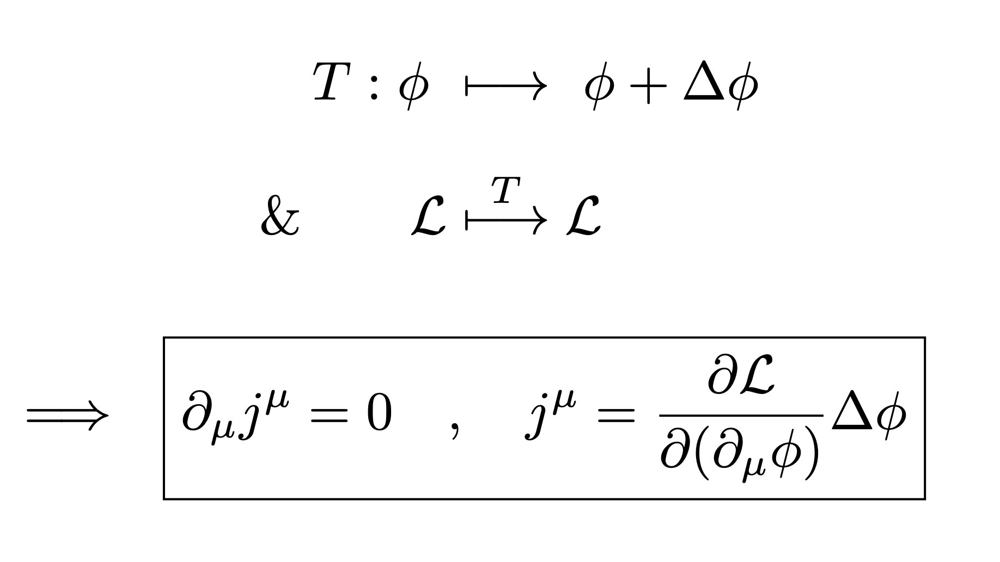

> This post was translated from Korean into English by AI.

Ever since I was young—that is, since I was in high school—I had always wondered how on earth Noether's Theorem works. Then, not long ago, I found a video that explains Noether's Theorem clearly, so I would like to summarize its contents here.

<iframe width="560" height="315" src="https://www.youtube.com/embed/78wz4KSzUvo" title="YouTube video player" frameborder="0" allow="accelerometer; autoplay; clipboard-write; encrypted-media; gyroscope; picture-in-picture" allowfullscreen></iframe>

# What Is Noether's Theorem?

First, let us take a look at Noether's Theorem. Noether's Theorem states that **if a system has a continuous symmetry, there exists a corresponding conserved physical quantity**. For example, spatial translation symmetry corresponds to the conservation of momentum, while rotational symmetry corresponds to the conservation of angular momentum.

But I simply could not understand this statement. To begin with, I could not grasp what continuous symmetry meant. I think this was probably because abstract explanations were too abstract to understand, while concrete explanations written out as formulas were too mathematical for their meaning to be clear.

# A Proof of Noether's Theorem

Disclaimer: Please take this section not as a mathematically rigorous proof, but rather as a mathematical illustration of why the statement above holds. I am not a math or physics major, after all... haha.

## Continuous Symmetry

To understand Noether's Theorem, we must first understand what continuous symmetry is. Of course, to do that, we must begin by understanding what symmetry itself is. In physics and mathematics, symmetry means that a system remains indistinguishable from its original state even after a particular transformation is applied to it.

For example, consider reflection symmetry. Think of the shape of a butterfly: even if we reverse it from left to right—that is, look at its mirror image—we cannot distinguish it at all from its original shape. Therefore, the shape of a butterfly has reflection symmetry.

However, a butterfly looks the same only in the specific case of being flipped from left to right. Flipping it by an angle of 45° or from top to bottom does not produce the same shape. Therefore, the reflection symmetry of a butterfly's shape is not continuous.

Likewise, when rotating the shape of a butterfly, we obtain its original shape only in the special cases of rotating it by 0° or 360°, so the rotational symmetry of a butterfly's shape is not continuous.

By contrast, a circle retains the same shape no matter what angle it is rotated through. Therefore, a circle's rotational symmetry is continuous.

## The Mathematical Expression of Continuous Symmetry

Mathematically, this kind of symmetry is represented by the concept of a *cyclic coordinate*. (At least, this is the case in physics.)

> Taken literally, the term *cyclic coordinate* means exactly that: a “cyclic coordinate.” It is not clear why this concept was given this name. From a quick search, it seems to be because such variables usually correspond to rotational degrees of freedom. (There were also answers that gave other reasons.)
>
> Source: https://physics.stackexchange.com/questions/66640/why-are-they-called-cyclic-coordinates

Here, *coordinate* refers to a generalized coordinate in the Hamiltonian. Since the Hamiltonian and Lagrangian are similar concepts, it seems fine to think in terms of the Lagrangian as well. (I previously discussed generalized coordinates and Lagrangian mechanics in the [Lagrangian Mechanics series](/posts/lagrangian-1).)

For example, consider a particle moving through an infinitely large space with neither gravity nor air resistance. This particle has kinetic energy $\frac{mv^2}{2}$ and no potential energy. Since the Lagrangian is given by $L=T-V$, in this case $L=T=\frac{mv^2}{2}$. The particle's position does not appear in its Lagrangian. Therefore, the particle's position coordinates $x, y$ are cyclic coordinates for this system.

## Cyclic Coordinates and Symmetry

According to Lagrangian mechanics, a system—or more specifically, the way the system changes over time—depends only on the Lagrangian. Therefore, a cyclic coordinate that does not appear in the Lagrangian cannot have any effect on the system. In other words, changing a cyclic coordinate has no effect whatsoever on the system, and thus a cyclic coordinate signifies a symmetry. To put it more concretely: “The system is indistinguishable before and after a cyclic coordinate is changed.”

In the example above, the coordinates were cyclic coordinates, which corresponds to spatial symmetry (translational symmetry).

## Symmetry and Conservation Laws

Now let us connect symmetry to conservation laws. First, the Euler–Lagrange equation is as follows.

$$
\frac{\partial L}{\partial q}-\frac{d}{dt}\left(\frac{\partial L}{\partial \dot q}\right)=0
$$

For the generalized coordinate $q$ to be a cyclic coordinate means that $L$ is independent of $q$. Therefore, the first term becomes zero, and we obtain the following result.

$$
\frac{d}{dt}\left(\frac{\partial L}{\partial \dot q}\right)=0
$$

This means that the change over time $\left(\frac{d}{dt}\right)$ of a physical quantity $\left(\frac{\partial L}{\partial \dot q}\right)$ is zero—in other words, that the physical quantity remains constant. This is precisely a conservation law.

> Note that even if $\frac{\partial L}{\partial q}=0$, it is still possible for $\frac{\partial L}{\partial \dot q}\neq 0$.

## Example

Let us derive a conservation law using a simple system.

On a horizontal plane, there is a particle constrained to a circle of radius $r>0$ centered at the origin. To use Lagrangian mechanics, let us define the generalized coordinate $q$ as the angle between the particle's position vector and the $x$-axis. The particle's speed is then $r\dot q$, so its kinetic energy is $\frac{mr^2\dot q^2}{2}$. Since we have assumed a horizontal plane, its potential energy is constant. Let us simply denote it by $E_p$. (The symbol used for potential energy has no particular significance. In fact, we could just as well set it to 0 instead of using an arbitrary constant.)

Therefore, the generalized coordinate $q$ appears in neither the kinetic energy nor the potential energy.

> Note that in Lagrangian mechanics, $q$ and $\dot q$ are treated as independent of one another.

Therefore, this generalized coordinate—the angle—is a cyclic coordinate, and the system consequently has continuous rotational symmetry. Expanding the Euler–Lagrange equation accordingly gives the following.

$$
\frac{d}{dt}\frac{\partial \frac{mr^2\dot q^2}{2}-E_p}{\partial \dot q}
           -\frac{\partial \frac{mr^2\dot q^2}{2}-E_p}{\partial q}=0\\
\leftrightarrow \frac{d}{dt}\frac{\partial \frac{mr^2\dot q^2}{2}-E_p}{\partial \dot q}=0\\
\leftrightarrow \frac{d}{dt}\frac{\partial \frac{mr^2\dot q^2}{2}}{\partial \dot q}=0\\
\leftrightarrow \frac{d}{dt}mr^2\dot q=0\\
\leftrightarrow \frac{d}{dt}mrv=0
$$

But $mrv$ is precisely the angular momentum. Therefore, the equation above means that angular momentum remains constant over time in this system, which is the law of conservation of angular momentum.
