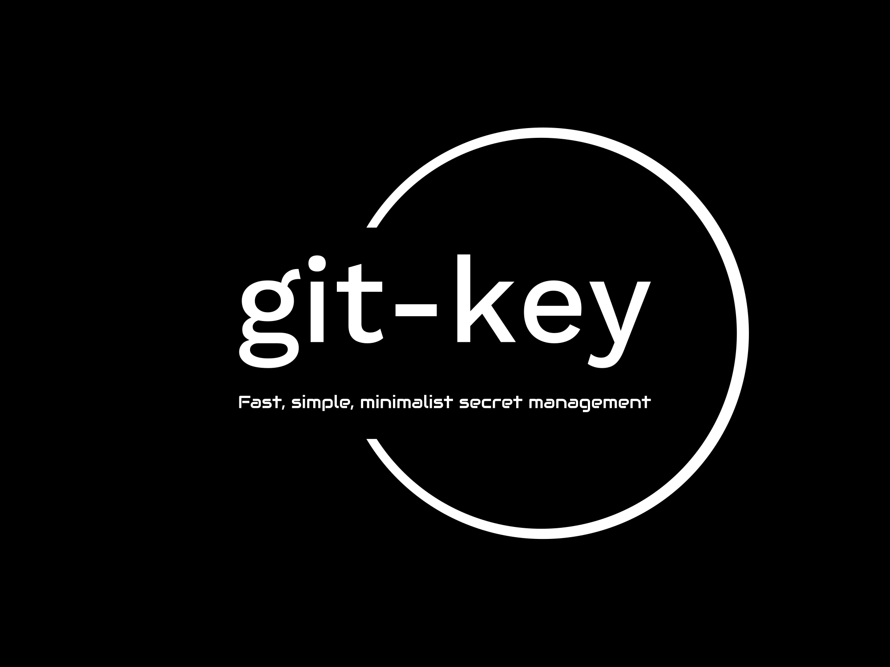

> This post was translated from Korean into English by AI.

I built a CLI solution that lets you track and manage secrets in Git, and released it as open source.

[https://www.npmjs.com/package/@unknownpgr/git-key](https://www.npmjs.com/package/@unknownpgr/git-key)

# Motivation

One day, while working on a project, I realized that managing secrets was quite cumbersome.

The project's backend consists of roughly three on-premises services: an `api server`, a `database`, and `redis`. Of these, the `api server` depends on the database and Redis, as well as AWS S3. They run in a Kubernetes environment on my personal server. Operating this service therefore requires supplying these three services with various settings, such as accounts, credentials, and ports, through environment variables, config files, or other means. The `api server`, which connects to all of these services, requires more than ten environment variables in particular.

However, all of these values are secrets that must not be exposed publicly. For security reasons, they cannot be included in a Docker image or tracked in Git, even when using a private repository. In other words, every one of these values has to be supplied through configuration. When builds or tests run through GitHub Actions, these values must be configured in GitHub's settings, and when several people collaborate on a project, the secrets must also be shared among them.

Some secrets, in particular, changed frequently during development. New secrets were added, old ones removed, and even their format often changed—for example, from environment variables to a JSON file. As a result, managing secrets took a considerable amount of time.

# Solutions

To resolve these inconveniences, I researched solutions that met the following requirements.

- Secrets must be trackable securely through Git.
- Installation and usage must be extremely simple.
- It must not depend on the operating system or Git.
- It must be free.
- It must not have dependencies outside the project.

However, none of the solutions I found met these requirements. The one I liked best was Git-Secret, but I learned that Git-Secret

- uses GPG, which makes it complicated to use,
- depends on Git, and
- may behave differently depending on the operating system version.

I therefore decided to develop a solution that met my requirements.

# Decisions

First, I decided what form the solution would take.

- A binary would not have been a bad choice, but because I mainly use Node.js, I chose to make it a Node.js package that could easily be installed through npm.
- Since this solution works independently of the execution of any program, I implemented it as a CLI tool.
- However, with future extensibility in mind, I structured it so that it could also be imported and used in a program.

Next, I decided how the package would work.

- I could create a separate encrypted file for each secret file, or bundle all secret files into one.
- I could use asymmetric encryption like GPG, or symmetric encryption like AES.
- I could have the password supplied manually, or generate it automatically.

To make it as simple as possible to use, I implemented it so that it

- bundles all secret files into a single file,
- uses the AES-256 symmetric-key algorithm, and
- generates the master password automatically.

I also considered the following points.

- I used only the Node.js standard library to minimize dependencies.
- I used TypeScript to reduce errors as much as possible.

Bundling secret files into a single file has the advantage that secrets for development and production environments can be encrypted into separate files and used as needed. I also anticipated that if users entered the master password themselves, some would choose passwords that were far too simple, such as `password`, so I implemented the tool to generate a master password with a random value.

> However, this creates the inconvenience of generating a different master password every time encryption is performed, so I am considering an update that would allow users to supply one later.

The implementation is simple: list the secret files to encrypt, such as `.env`, in a `.secrets` file, and the tool bundles them into a single `.secrets.encrypted` file.

# Coding

During development, I used a VSCode dev container and wrote tests using `mock-fs` and `jest`. Because this solution accesses the file system and I had never written this kind of test code before, I ran into some difficulty. At first, I did not know that a convenient library like `mock-fs` existed, so I wrote tests using the actual file system. They did not work as expected, which caused me considerable trouble.

# Open Source Publish

I then published it on NPM so I could use it in various projects. After publishing it, I thought it would be nice if others used the package as well, and decided that I should try creating a proper open source project.

When I actually set out to release it, I did not have a suitable project name or logo. I therefore used a website that automatically generates product names and logos to come up with the name Git-Key and its logo. I then added appropriate documentation and published it on npm.

# Conclusion

I created an open source package called Git-Key to help manage secrets and published it on npm. This was my first proper open source project, and I enjoyed it in many ways.
