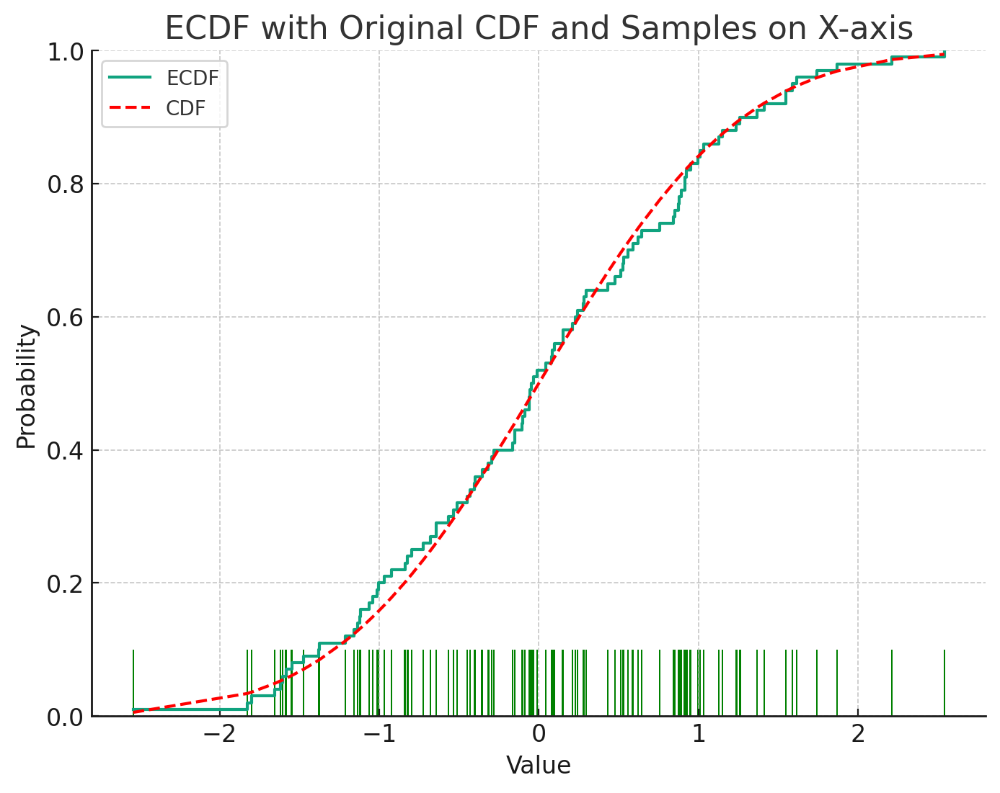
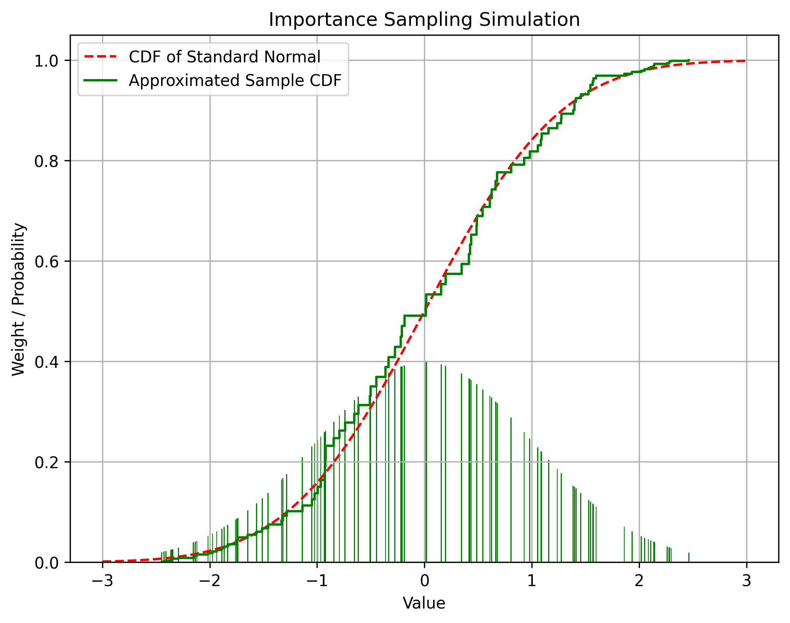
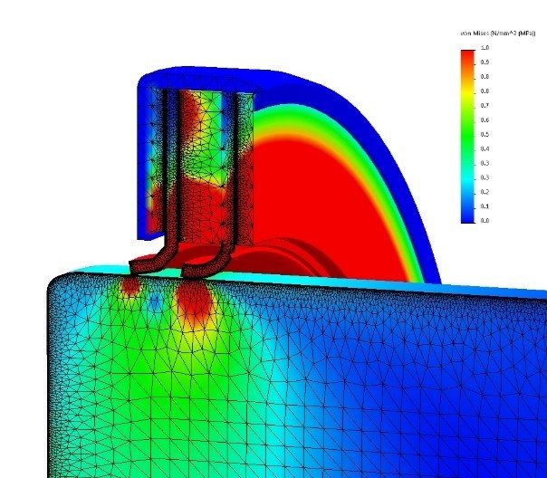

> This post was translated from Korean into English by AI.

This time, I studied particle filters, a topic I had been putting off. The purpose of this post is to explain the principles behind particle filters in enough detail for anyone to understand.

There are countless articles and papers online that explain particle filters in detail. However, the more accessible explanations tend to cover important concepts only through abstract analogies, without proofs. That may make the code easy to implement, but it makes it difficult to understand why it does or does not work, or whether a modified version of the algorithm is still mathematically optimal.

Conversely, most rigorous explanations, such as academic papers, skip over what they consider the easy parts. Yet those “easy parts” often require several complicated theorems to prove, rather than mere algebraic manipulation or factorization, which can make the overall reasoning difficult to follow. Furthermore, many sources, including Wikipedia and academic papers, use a variety of notation without explanation, making it difficult even to interpret the equations correctly in the first place.

I will therefore explain particle filters in a way that someone with only a high-school-level knowledge of mathematics can understand, while still including not only abstract concepts but also rigorous mathematical proofs.

More specifically, the following background knowledge is required:

- High-school-level probability theory (conditional probability, joint probability, and Bayes' theorem)
- The concept of integration

Because this post is long, I will use a formal style.

# Filter

To understand particle filters and other kinds of filters, it is essential to begin with the concept of a filter itself. In signal processing and control engineering, a filter is a device or mathematical structure that passes only a desired signal from a signal in which several signals are superimposed.

Filters are necessary because signals inevitably contain noise. From the perspective of control or signal processing, every signal is treated as the sum of a desired signal and noise. A filter would be unnecessary in an ideal environment where signals were transmitted without loss, but in reality, signals contain noise from various sources, including measurement uncertainty, so filters are needed.

The operation of a filter can fundamentally be divided into the process of obtaining a signal value and the process of inferring the true value from it. Obtaining a signal value is called a **measurement** or **observation**, while inferring the true value from it is called an **estimate** or **prediction**.

Filters are implemented in various ways depending on the characteristics of the signal. In electronics, for example, the signal and the noise generally occupy different frequencies. A filter can therefore be implemented by attenuating frequencies outside the desired band. The simplest such method is the moving average. A moving average estimates the current true value from the (weighted) average of previous measurements; in the frequency domain, this can be viewed as attenuating high-frequency signals.

In some cases, however, the system is so complex or nonlinear that it is difficult to distinguish the signal from the noise in this way. A probability-based filter can then be used. Rather than estimating a single true value for the signal, a probabilistic filter finds the signal's probability distribution. Mathematically, this is expressed as the conditional probability distribution of the true value given all measurements up to the current time:

$$
p(x_t | z_t, z_{t-1}, \cdots, z_0)
$$

> A comma `,` inside a probability distribution denotes a joint probability distribution ($a\cap b$). The equation above should therefore be interpreted as follows:
>
> $$
> \begin{align*}
> p(x_t | z_t, z_{t-1}, \cdots, z_0) &= p(x_t | z_t \cap z_{t-1} \cap \cdots \cap z_0)\\
> &= p(x_t \cap z_t \cap z_{t-1} \cap \cdots \cap z_0) / p(z_t \cap z_{t-1} \cap \cdots \cap z_0)
> \end{align*}
> $$

# Bayes Filter

A Bayes filter is a method of expressing the probability distribution above by combining other probability distributions that are already known. This is necessary because the equation above is merely a mathematical expression of the statement “the probability distribution of the true value given the measurements”; it says nothing about how to calculate that distribution.

A Bayes filter assumes that the following two probability distributions are already known:

- $p(z_t | x_t)$: the probability distribution of the measurement given the true value
- $p(x_t | x_{t-1})$: the probability distribution of the true value given the previous true value

These two probability distributions are called the **measurement model** and the **system model**, respectively. Using them, the probability distribution of the true value can be calculated recursively as follows:

$$
p(x_t | z_{t-1}, z_{t-2}, \cdots, z_0) = \int p(x_t | x_{t-1}) p(x_{t-1} | z_{t-1}, z_{t-2}, \cdots, z_0) dx_{t-1}
$$

$$
p(x_t | z_t, z_{t-1}, \cdots, z_0) = \frac{p(z_t | x_t) p(x_t | z_{t-1}, z_{t-2}, \cdots, z_0)}{\int p(z_t | x_t) p(x_t | z_{t-1}, z_{t-2}, \cdots, z_0) dx_t}
$$

The following sections explain the other concepts needed to derive the Bayes filter, and then use them to perform the derivation.

## Conditional Independence

Because conditional independence is used extensively in deriving the Bayes filter, it is important to understand the concept. Conditional independence means that events $B$ and $C$ are independent **given some event $A$**. The following are different, equivalent expressions of conditional independence:

- $p(B, C|A) = p(B|A)p(C|A)$: Given $A$, the joint probability distribution of $B$ and $C$ equals the product of the probability distributions of $B$ and $C$.
- $p(A \cap B \cap C) = p(A \cap B) p(A \cap C) / P(A)$: The equation above expanded according to the definition of conditional probability.
- $p(B|A, C) = p(B|A)$: Given $A$, the probability distribution of $B$ is not affected by $C$.
- $p(C|A, B) = p(C|A)$: Given $A$, the probability distribution of $C$ is not affected by $B$.

The important point is that $B$ and $C$ are independent only when $A$ is given. In other words, if $B$ and $C$ are conditionally independent given $A$, then $B$ and $C$ are generally not independent.

Furthermore, if two variables $A, B$ are conditionally independent given another variable $C$, the following important property holds:

$$
p(A | B) = \int p (A |C) p(C|B) dC
$$

This equation is called the Chapman–Kolmogorov Equation (CKE). More precisely, the CKE refers to a more general equation involving multiple random variables; the equation above can be regarded as a special case of the CKE involving three random variables.

The proof is as follows.

> Because $A$ and $B$ are conditionally independent given $C$,
>
> $$
> p(A | C) = p(A | B, C)
> $$
>
> Substituting this into the equation above gives
>
> $$
> p(A | B) = \int p(A | B, C) p(C | B) dC
> $$
>
> Expanding the right-hand side according to the definition of conditional probability gives
>
> $$
> = \int \frac{p(A \cap B \cap C)}{p(B \cap C)} \frac{p(C \cap B)}{p(B)} dC\\
> $$
>
> $$
> = \int \frac{p(A \cap B \cap C)}{p(B)} dC
> $$
>
> By the law of total probability,
>
> $$
> = \frac{p(A \cap B)}{p(B)}
> $$
>
> By the definition of conditional probability,
>
> $$
> = p(A | B)
> $$

## Markov Chain

A system is called a **Markov chain** if it satisfies the following property:

$$
p(x_t | x_{t-1}, x_{t-2}, \cdots, x_0) = p(x_t | x_{t-1})
$$

This means that the system's current state depends only on the immediately preceding state and not on any other past states. Many systems, including real-world physical phenomena, satisfy this property.

A Markov chain can be interpreted in terms of conditional independence. That is, given $x_{t-1}$, the probability distribution of $x_t$ is conditionally independent of $x_{t-2}, \cdots, x_0$.

## Hidden Markov Chain

In general, however, it is impossible to measure the complete state of a system directly; only part of the system can be measured indirectly. Such a Markov chain is called a **hidden Markov chain**.

$$
\begin{array}{cccccccccc}
X_{0} & \to & X_{1} & \to & X_{2} & \to & X_{3} & \to & \cdots & \text{signal} \\
\downarrow & & \downarrow & & \downarrow & & \downarrow & & \cdots & \\
Z_{0} & & Z_{1} & & Z_{2} & & Z_{3} & & \cdots & \text{observation}
\end{array}
$$

In the diagram above, $X$, connected by arrows, represents the state and cannot be measured directly. $Z$ represents the observed values obtained through measurement. An arrow $A\to B$ means that the random variable $B$ depends only on $A$. This can also be interpreted as saying that, for any random variable $C$ other than $A$, $B$ and $C$ are conditionally independent given $A$.

## Bayes' Theorem

Bayes' theorem states that the following relationship holds for conditional probabilities:

$$
p(A|B) = \frac{p(B|A)p(A)}{p(B)}
$$

Bayes' theorem can be interpreted in the following two ways:

- Inverse probability problem: finding $P(A|B)$ when $P(B|A)$ is given
  - Example: given the probability of testing positive when a person has a disease, finding the probability that a person has the disease when they test positive
- Posterior probability estimation: updating the prior probability $P(A)$ to a more accurate probability using measurement $B$
  - Example: knowing the general probability of having a disease, then recalculating that probability after learning the result of a test

A Bayes filter uses Bayes' theorem from the perspective of posterior probability estimation. In other words, it repeatedly updates an existing probability distribution to a more accurate one by incorporating measurements.

## Derivation of the Bayes Filter

Recall that the probability distribution we want to find is:

$$
p(x_t | z_t, z_{t-1}, \cdots, z_0)
$$

We assume that the following two probability distributions are known in order to calculate it:

- $p(x_t | x_{t-1})$: the system model
- $p(z_t | x_t)$: the measurement model

From these, we derive the Bayes filter by applying Bayes' theorem as follows.

First, applying Bayes' theorem directly to the expression we want to find gives

$$
p(x_t | z_t, z_{t-1}, \cdots, z_0) = \frac{p(z_t, z_{t-1}, \cdots, z_0 | x_t) p(x_t)}{p(z_t, z_{t-1}, \cdots, z_0)}
$$

Under the hidden Markov chain assumption, $z_t$ depends only on $x_t$, so it is conditionally independent of any random variable $k$ other than $x_t$. In other words, the following holds:

$$
\forall k \neq x_t, p(z_t, k | x_t) = p(z_t | x_t) p(k | x_t)
$$

Setting $k=z_{t-1}, z_{t-2}, \cdots, z_0$ therefore gives

$$
p(z_t, z_{t-1}, \cdots, z_0 | x_t) = p(z_t | x_t) p(z_{t-1}, z_{t-2}, \cdots, z_0 | x_t)
$$

Applying this to Bayes' theorem again gives

$$
= \frac{p(z_t | x_t) p(z_{t-1}, z_{t-2}, \cdots, z_0 | x_t) p(x_t)}{p(z_t, z_{t-1}, \cdots, z_0)}
$$

By the definition of conditional probability, $p(z_{t-1}, z_{t-2}, \cdots, z_0 | x_t) p(x_t) = p(z_{t-1}, z_{t-2}, \cdots, z_0, x_t)$, so

$$
= \frac{p(z_t | x_t) p(z_{t-1}, z_{t-2}, \cdots, z_0, x_t)}{p(z_t, z_{t-1}, \cdots, z_0)}
$$

Dividing both the numerator and denominator by $p(z_{t-1}, z_{t-2}, \cdots, z_0)$ gives

$$
= \frac{p(z_t | x_t) p(x_t | z_{t-1}, z_{t-2}, \cdots, z_0)}{p(z_t | z_{t-1}, z_{t-2}, \cdots, z_0)}
$$

Here, the denominator $p(z_t | z_{t-1}, z_{t-2}, \cdots, z_0)$ can be decomposed using the CKE discussed earlier in the section on conditional independence:

$$
p(z_t | z_{t-1}, z_{t-2}, \cdots, z_0) = \int p(z_t | x_t) p(x_t | z_{t-1}, z_{t-2}, \cdots, z_0) dx_t
$$

Substituting this back into the equation gives:

$$
p(x_t | z_t, z_{t-1}, \cdots, z_0) = \frac{p(z_t | x_t) p(x_t | z_{t-1}, z_{t-2}, \cdots, z_0)}{\int p(z_t | x_t) p(x_t | z_{t-1}, z_{t-2}, \cdots, z_0) dx_t}
$$

The unknown part of this equation is $p(x_t | z_{t-1}, z_{t-2}, \cdots, z_0)$. Under the Markov model assumption, $x_t$ depends only on $x_{t-1}$, so $x_t$ is conditionally independent of $z_{t-1}, z_{t-2}, \cdots, z_0$. The CKE can therefore be used to decompose it in the same way:

$$
p(x_t | z_{t-1}, z_{t-2}, \cdots, z_0) = \int p(x_t | x_{t-1}) p(x_{t-1} | z_{t-1}, z_{t-2}, \cdots, z_0) dx_{t-1}
$$

The unknown term in this equation, $p(x_{t-1} | z_{t-1}, z_{t-2}, \cdots, z_0)$, has the same form as the original expression we wanted to find, $p(x_t | z_t, z_{t-1}, \cdots, z_0)$, but with every index reduced by one. This allows the following recursive estimation procedure:

1. Assume that $p(x_{t-1} | z_{t-1}, z_{t-2}, \cdots, z_0)$ is known.
1. Use it to calculate $p(x_t | z_{t-1}, z_{t-2}, \cdots, z_0)$. Because this calculates the probability distribution of the true value at time $t$ based on information through time $t-1$, the process is called **estimation** or **prediction**.
1. Use this to calculate $p(x_t | z_t, z_{t-1}, \cdots, z_0)$. Because this recalculates the probability distribution of the true value by incorporating a new measurement into the estimate, the process is called an **update**.

An initial estimate $p(x_0)$ is required when beginning the calculation. Because $p(x_0)$ is the probability distribution in the absence of any information, a uniform or normal distribution can be used. A more precise initial estimate will make subsequent estimates more accurate.

The method of estimating the probability distribution of the true value in this way is called a **Bayes filter**, and it forms the theoretical basis of all probabilistic filtering.

However, a Bayes filter requires integration during the prediction step, and integrating nonlinear or numerically defined functions is extremely difficult and sometimes impossible. A Bayes filter therefore generally cannot be applied directly to real-world problems, and various methods have been proposed to approximate it.

Methods for approximating an arbitrary probability distribution can be broadly divided into **parametric methods** and **nonparametric methods**. A parametric method assumes that the probability distribution belongs to a particular family and estimates the parameters of that model. It can be used when there is a theoretical basis for the assumed probability distribution. A nonparametric method, by contrast, makes no assumptions about the probability distribution and approximates it using measurements.

The **Kalman filter** is a parametric approximation of the Bayes filter. It assumes that each model is linear and that its errors are normally distributed, allowing the integrals to be solved analytically.
The Kalman filter is not computationally expensive and provides very accurate estimates when the linearity and normal-distribution assumptions hold.
However, the filter can diverge when important assumptions such as linearity are not satisfied.

The **particle filter**, which we will discuss next, is a nonparametric approximation of the Bayes filter that uses Monte Carlo sampling.
A particle filter makes no assumptions about the model and can therefore be used even when assumptions such as linearity are not satisfied.
However, because it relies on sampling for approximation, it has the disadvantages of potentially high computational cost and low accuracy.

# Particle Filter

As discussed earlier, a Bayes filter estimates the probability distribution of the true value by repeating the following two steps:

- Prediction
  $$p(x_t | z_{t-1}, z_{t-2}, \cdots, z_0) = \int p(x_t | x_{t-1}) p(x_{t-1} | z_{t-1}, z_{t-2}, \cdots, z_0) dx_{t-1}$$
- Update
  $$p(x_t | z_t, z_{t-1}, \cdots, z_0) = \frac{p(z_t | x_t) p(x_t | z_{t-1}, z_{t-2}, \cdots, z_0)}{\int p(z_t | x_t) p(x_t | z_{t-1}, z_{t-2}, \cdots, z_0) dx_t}$$

In general, however, a system is a vector of two or more dimensions, and its system model is given as a matrix equation. The integral in the prediction step is therefore a multiple integral in a high-dimensional space, and the region of integration can also become extremely complicated.

## Empirical Distribution Function

In such cases, integration can be approximated using an empirical distribution function. When it is difficult to calculate the values of a probability distribution directly but easy to sample from it, an empirical distribution function approximates the probability distribution using those samples. As the number of samples becomes sufficiently large, the distribution of the samples converges to the original probability distribution. Mathematically, this can be expressed as follows:

$$
\hat p(x) := \frac{1}{n} \sum_{i=1}^n \delta(x - x_i) \approx p(x)
$$

Here, $x_i$ is a value sampled from the probability distribution $p(x)$, and $\delta(x - x_i)$ is the Dirac delta function, for which $\delta(0) = \infty$ and $\delta(x) = 0$ ($x \neq 0$). The integral of the Dirac delta function is 1. Alternatively, the equation above can be integrated and expressed in the form of a cumulative distribution function:

$$
\hat F(x) = \frac{1}{n} \sum_{i=1}^n \bold{1}_{x_i \leq x}\approx F(x)
$$

Here, $\bold{1}_{x_i \leq x}$ is a function that equals 1 when $x_i \leq x$ and 0 otherwise.

The figure below shows an empirical distribution function calculated from samples drawn from a normal distribution.


## Importance Sampling

There is a problem, however: to obtain an empirical distribution function through simulation rather than a real-world experiment, the original probability distribution must already be known. In other words, we intended to use empirical sampling to find the probability distribution, only to encounter the paradoxical requirement that the original probability distribution must already be known.

Even when sampling from the original probability distribution is impossible, importance sampling can be used to approximate the distribution through sampling. As shown below, importance sampling is a method for approximating the expected value under $p(x)$ using samples from another probability distribution $q(x)$, even when the probability distribution $p(x)$ is unknown.

$$
E_p[f(x)] = \int f(x) p(x) dx = \int f(x) \frac{p(x)}{q(x)} q(x) dx \approx \frac{1}{n} \sum_{i=1}^n f(x_i) \frac{p(x_i)}{q(x_i)}
$$

The figure below shows the cumulative distribution function of a normal distribution approximated through importance sampling from a uniform probability distribution.



The probability distribution $q(x)$ from which samples are drawn is called the importance distribution or proposal distribution. The proposal distribution may be any probability distribution that is nonzero wherever the probability density of the original distribution is greater than zero, but the approximation becomes more accurate as the proposal distribution becomes more similar to the original distribution. A normal or uniform distribution, which is easy to sample from, is generally used as the proposal distribution.

It should be noted, however, that although the mean of the probability distribution obtained through importance sampling converges to that of the original probability distribution, its variance differs from that of the original distribution.

## Sequential Importance Sampling

As mentioned earlier, a particle filter approximates the Bayes filter using importance sampling. This is called Sequential Importance Sampling (SIS). The proof of SIS is somewhat involved. We will first find the probability distribution of each particle's entire trajectory when the particle moves according to a particular probability distribution over time, and then show that this distribution is also equal to the particle's probability distribution.

> In other explanations, all proposal probability distributions in this calculation are generally denoted by the single symbol $q$. To avoid confusion, however, this post assigns different symbols to different probability distributions. The symbol $p$ denotes the probability distribution of some random variable in general, while the other symbols denote particular probability distributions. They must not be confused.

### Probability Distribution of Particle Trajectories

First, draw $n$ samples $x_0^{(1)}, x_0^{(2)}, \cdots, x_0^{(n)}$ from an initial probability distribution $q_0(x)$. Clearly, $p(x_0) = q_0(x)$.

Now suppose that each particle $x_0^{(i)}$ moves over time according to a probability distribution $r_t^{(i)}(x^{(i)}_{t+1})$.

> A particle's position at the next instant generally depends on its position at the previous instant. Thus, although it is not shown explicitly, $r_t^{(i)}(x^{(i)}_{t+1})$ generally depends on $x^{(i)}_t$.

Then, for each particle $x^{(i)}$, the probability that the particle is initially at $x_0^{(i)}$ and is at $x_1^{(i)}$ at the next instant is:

$$
p(x_1^{(i)}, x_0^{(i)}) = q_0(x_0^{(i)}) r_0^{(i)}(x_1^{(i)})
$$

Extending this, the probability that each particle moves along the trajectory $x_0^{(i)}, x_1^{(i)}, \cdots, x_t^{(i)}$ over time is:

$$
p(x_t^{(i)}, x_{t-1}^{(i)}, \cdots, x_0^{(i)}) = q_0(x_0^{(i)}) r_0^{(i)}(x_1^{(i)}) r_1^{(i)}(x_2^{(i)}) \cdots r_{t-1}^{(i)}(x_t^{(i)})
$$

Let the probability distribution of particle trajectories at time $t$ be $q_t$. Then $q_t$ can be expressed as follows:

$$
q_t(x_0^{(i)}, x_1^{(i)}, \cdots, x_t^{(i)}) = q_0(x_0^{(i)}) r_0^{(i)}(x_1^{(i)}) r_1^{(i)}(x_2^{(i)}) \cdots r_{t-1}^{(i)}(x_t^{(i)})
$$

Expressed as a recurrence relation, this becomes:

$$
q_t(x_0^{(i)}, x_1^{(i)}, \cdots, x_t^{(i)}) = q_{t-1}(x_0^{(i)}, x_1^{(i)}, \cdots, x_{t-1}^{(i)}) r_{t-1}^{(i)}(x_t^{(i)})
\tag{1}
$$

This is the probability distribution for each particle following a particular trajectory over time.

### Probability Distribution of State Trajectories

Next, the probability distribution of the original states that we want to obtain is:

$$
p(x_0, x_1, \cdots, x_t | z_0, z_1, \cdots, z_t)
$$

This differs slightly from the probability distributions discussed earlier. Previously, we considered the probability distribution of the current state given the observations up to the current time. This distribution, however, includes the probability distributions of all previous states given the observations up to the current time.

Suppose there are suitable weights $w_t^{(i)}$ such that, according to the principle of importance sampling, the particle distribution approximates the probability distribution we want to find. In other words, suppose the following condition is satisfied:

$$
p(x_0, x_1, \cdots, x_t | z_0, z_1, \cdots, z_t) \approx \sum_{i=1}^n w_t^{(i)} \delta(x_0, x_1, \cdots, x_t - x_0^{(i)}, x_1^{(i)}, \cdots, x_t^{(i)})
$$

Our goal is to find these $w_t^{(i)}$. According to importance sampling, $w_t^{(i)}$ must be:

$$
w_t^{(i)} = \frac{p(x_0^{(i)}, x_1^{(i)}, \cdots, x_t^{(i)} | z_0, z_1, \cdots, z_t)}{q_t(x_0^{(i)}, x_1^{(i)}, \cdots, x_t^{(i)})}
$$

Because the equations become lengthy, from this point onward we will abbreviate $x_0^{(i)}, x_1^{(i)}, \cdots, x_t^{(i)}$ as $x_{0:t}^{(i)}$. Using this notation, the equation above can be expressed more simply as:

$$
w_t^{(i)} = \frac{p(x_{0:t}^{(i)} | z_{0:t})}{q_t(x_{0:t}^{(i)})}
\tag{2}
$$

We will now decompose the numerator on the right-hand side using Bayes' theorem. First, expanding this equation directly according to the definition of conditional probability gives

$$
p(x_{0:t}^{(i)} | z_{0:t}) = \frac{p(x_{0:t}^{(i)}, z_{0:t})}{p(z_{0:t})}
$$

Separating out only $z_{t}$ according to the definition of conditional probability gives

$$
= \frac{p(z_t | x_{0:t}^{(i)}, z_{0:t-1}) p(x_{0:t}^{(i)}, z_{0:t-1})}{p(z_{0:t})}
$$

Separating out only $x_{t}^{(i)}$, again according to the definition of conditional probability, gives

$$
= \frac{p(z_t | x_{0:t}^{(i)}, z_{0:t-1}) p(x_{t}^{(i)} | x_{0:t-1}^{(i)}, z_{0:t-1}) p(x_{0:t-1}^{(i)}, z_{0:t-1})}{p(z_{0:t})}
$$

Dividing both the numerator and denominator by $p(z_{0:t-1})$ gives

$$
= \frac{p(z_t | x_{0:t}^{(i)}, z_{0:t-1}) p(x_{t}^{(i)} | x_{0:t-1}^{(i)}, z_{0:t-1}) p(x_{0:t-1}^{(i)}, z_{0:t-1}) / p(z_{0:t-1})}{p(z_{0:t}) / p(z_{0:t-1})}
$$

By the definition of conditional probability,

$$
= \frac{p(z_t | x_{0:t}^{(i)}, z_{0:t-1}) p(x_{t}^{(i)} | x_{0:t-1}^{(i)}, z_{0:t-1}) p(x_{0:t-1}^{(i)} | z_{0:t-1})}{p(z_t | z_{0:t-1})}
$$

The denominator of this equation is a constant and can therefore be omitted. We are currently finding the numerator of $w_t^{(i)}$, and because $\sum_{i=1}^n w_t^{(i)} = 1$, only the relative magnitudes of the individual $w_t^{(i)}$ matter. Therefore,

$$
p(x_{0:t}^{(i)} | z_{0:t}) \propto p(z_t | x_{0:t}^{(i)}, z_{0:t-1}) p(x_{t}^{(i)} | x_{0:t-1}^{(i)}, z_{0:t-1}) p(x_{0:t-1}^{(i)} | z_{0:t-1})
$$

Eliminating the variables that can be ignored under the Markov chain assumption gives the following result:

$$
p(x_{0:t}^{(i)} | z_{0:t}) \propto p(z_t | x_{t}^{(i)}) p(x_{t}^{(i)} | x_{t-1}^{(i)}) p(x_{0:t-1}^{(i)} | z_{0:t-1})
\tag{3}
$$

This is the probability distribution for the state following a particular trajectory given the observations.

### Importance Weight Update

Next, we use this result to derive the importance weight update equation. Substituting equation (3) into equation (2) gives

$$
w_t^{(i)} \propto \frac{p(z_t | x_{t}^{(i)}) p(x_{t}^{(i)} | x_{t-1}^{(i)}) p(x_{0:t-1}^{(i)} | z_{0:t-1})}{q_t(x_{0:t}^{(i)})}
\tag{4}
$$

Substituting equation (1) into equation (4) gives

$$
w_t^{(i)} \propto \frac{p(z_t | x_{t}^{(i)}) p(x_{t}^{(i)} | x_{t-1}^{(i)}) p(x_{0:t-1}^{(i)} | z_{0:t-1})}{q_{t-1}(x_{0:t-1}^{(i)}) r_{t-1}^{(i)}(x_t^{(i)})}
$$

Grouping the terms at time $t-1$ gives

$$
w_t^{(i)} \propto  \frac{p(z_t | x_{t}^{(i)}) p(x_{t}^{(i)} | x_{t-1}^{(i)})}{r_{t-1}^{(i)}(x_t^{(i)})}\frac{p(x_{0:t-1}^{(i)} | z_{0:t-1})}{q_{t-1}(x_{0:t-1}^{(i)})}
$$

By the definition of $w_t^{(i)}$,

$$
w_t^{(i)} \propto \frac{p(z_t | x_{t}^{(i)}) p(x_{t}^{(i)} | x_{t-1}^{(i)})}{r_{t-1}^{(i)}(x_t^{(i)})} w_{t-1}^{(i)}
$$

This is the most basic update formula for a particle filter, and it is called Sequential Importance Sampling (SIS).

To reduce computational cost, $r_t^{(i)}(x_t^{(i)})$ is generally chosen appropriately as $p(x_t^{(i)} | x_{t-1}^{(i)})$. The equation then simplifies to:

$$
w_t^{(i)} \propto p(z_t | x_{t}^{(i)}) w_{t-1}^{(i)}
$$

The complete logic of an SIS-based particle filter can be expressed in pseudocode as follows:

```python
xs = sample_from_prior()
ws = [1.0] * n_particles

for t in range(1, T):
    # Observation
    z = observe()

    for i in range(n_particles):
        # Prediction
        xs[i] = transition(xs[i])
        # Update
        ws[i] *= likelihood(z, xs[i])

    # Normalize
    ws_sum = sum(ws)
    for i in range(n_particles):
        ws[i] /= ws_sum
```

## Resampling

If the method above is used as-is, after only a few steps the particles with low importance weights continue to lose weight and converge to zero, while all of the weight becomes concentrated on a single particle. This is called degeneracy. When degeneracy occurs, not only is most of the computation wasted on unnecessary calculations where the probability density is almost zero, but the particles also fail to approximate the entire probability distribution and instead represent only a single point, greatly reducing the filter's performance.

Accordingly, when the filter has degenerated, resampling is needed to duplicate particles with high importance weights and remove those with low weights. This can be interpreted as reducing the number of samples in insignificant regions near zero in the probability distribution and sampling important regions more densely. From another perspective, resampling is equivalent to performing empirical sampling from the probability distribution represented by importance sampling. It therefore does not change the probability distribution being represented.

> 
>
> The image above shows the construction of a mesh in Finite Element Analysis. The mesh is allocated densely in important regions that bear large forces and sparsely in less important regions. This is similar to the concept of resampling.

The following resampling methods are commonly used:

- Multinomial Resampling: randomly sampling particles in proportion to their importance weights
- Systematic Resampling: sampling at uniform intervals based on the importance weights
- Stratified Resampling: dividing the importance weights into strata and sampling uniformly within each stratum
- Residual Resampling: sampling in proportion to the weights, then using the remaining weights to perform additional sampling

There are various resampling methods, but it is known that no single method always outperforms the others. Multinomial resampling is commonly used because it is simple to implement.

Because resampling directly duplicates particles with high importance weights, several identical particles exist immediately after resampling. In the very next step, however, importance sampling in the prediction stage (the `transition` function in the pseudocode above) is stochastic, so the particles become different from one another as they pass through it.

Resampling can also be performed at different times. The simplest approach is to resample at every step, and this is indeed common. However, doing so not only increases the computational cost, but may also concentrate all particles in high-probability regions and reduce the expressive power of the filter. Resampling is therefore performed at specific intervals rather than at every step. A common method is to resample once the filter has degenerated beyond a certain level.

Effective sample size is most commonly used to determine the degree of filter degeneracy.

$$
N_{\text{eff}} = \frac{1}{\sum_{i=1}^n (w_t^{(i)})^2}
$$

This formula is actually derived using the difference in variance from ideal Monte Carlo sampling. Intuitively, however, if only one sample has any weight and all the others have zero weight, this value is 1. Conversely, if every sample has a weight of $1/n$, the value is $n$. The filter can therefore be considered degenerate when this value falls below a particular threshold $N_{\text{th}}$.

Revising the pseudocode to incorporate resampling based on effective sample size gives:

```python
xs = sample_from_prior()
ws = [1.0] * n_particles

for t in range(1, T):
    # Observation
    z = observe()

    for i in range(n_particles):
        # Prediction
        xs[i] = transition(xs[i])
        # Update
        ws[i] *= likelihood(z, xs[i])

    # Normalize
    ws_sum = sum(ws)
    for i in range(n_particles):
        ws[i] /= ws_sum

    # Resampling
    if effective_sample_size(ws) < N_th:
        xs, ws = resample(xs, ws)
```

This is a typical particle filter implementation.

## Implementation

Below is a simulation of a simple particle filter implemented to track the mouse position.

<iframe height="900px" src="./assets/particle-filter.html"></iframe>

In the simulation above, the red dot represents the current mouse position, and the black dots represent landmarks with known positions. The simulation space is a square measuring 10 m on each side. At every time step, the distance from the current mouse position to each landmark is measured. These measurements include normally distributed noise with a 95% confidence interval of 1 m. The particle filter uses 100 particles to estimate the mouse position from these measurements. The estimate is shown as a white dot. Multinomial resampling is used, and resampling is performed when $N_\text{eff} < N_{\text{th}}=0.5N$. A suitable normal distribution was used for the system model. The time step uses `requestAnimationFrame`, so it may vary depending on the viewer's environment.

This example is intended to visualize how a particle filter works, so it uses values that are far worse than those used in practical applications. In general, more than 1,000 particles are used, with many more landmarks and much lower sensor error. The system model is also far more sophisticated, incorporating user input and the current state, such as velocity.

## References

- Elfring J, Torta E, van de Molengraft R. Particle Filters: A Hands-On Tutorial. Sensors (Basel). 2021 Jan 9;21(2):438. doi: 10.3390/s21020438. PMID: 33435468; PMCID: PMC7826670.
- https://en.wikipedia.org/wiki/Particle_filter
- M. S. Arulampalam, S. Maskell, N. Gordon and T. Clapp, "A tutorial on particle filters for online nonlinear/non-Gaussian Bayesian tracking," in IEEE Transactions on Signal Processing, vol. 50, no. 2, pp. 174-188, Feb. 2002, doi: 10.1109/78.978374.
- Doucet, Arnaud, Simon Godsill, and Christophe Andrieu, 'On Sequential Monte Carlo Sampling Methods for Bayesian Filtering', in Andrew C Harvey, and Tommaso Proietti (eds), Readings In Unobserved Components Models (Oxford, 2005; online edn, Oxford Academic, 31 Oct. 2023), https://doi.org/10.1093/oso/9780199278657.003.0022, accessed 14 Feb. 2024.
- https://en.wikipedia.org/wiki/Importance_sampling
- Bergman, N. (1999). Recursive Bayesian Estimation : Navigation and Tracking Applications (PhD dissertation, Linköping University). Retrieved from https://urn.kb.se/resolve?urn=urn:nbn:se:liu:diva-98184
