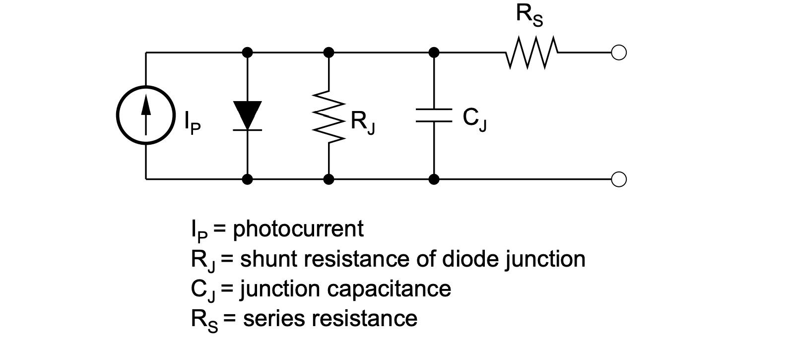
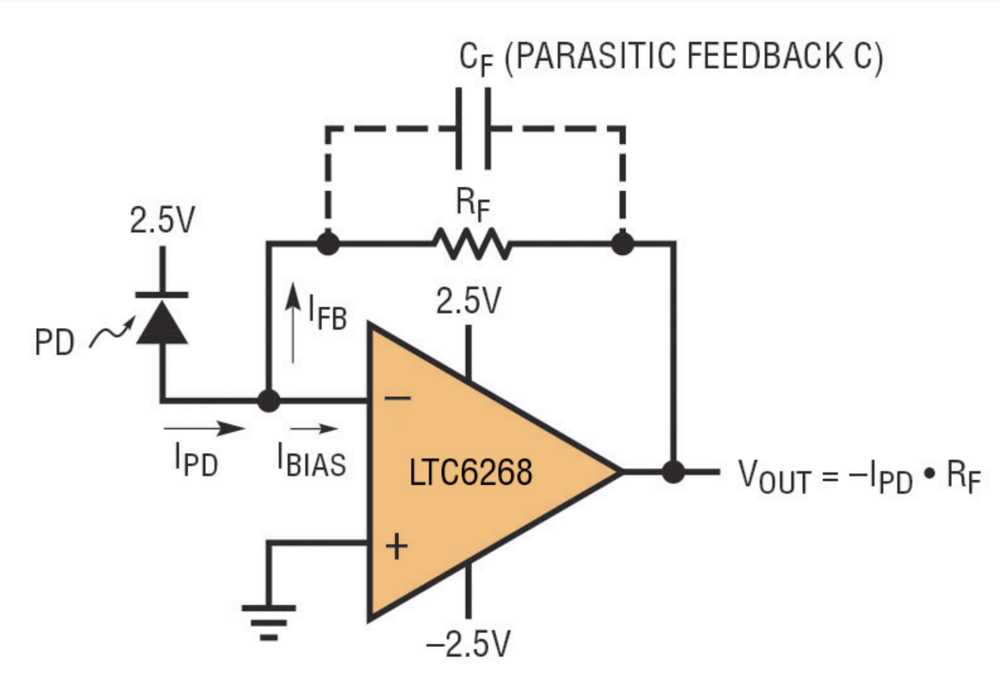
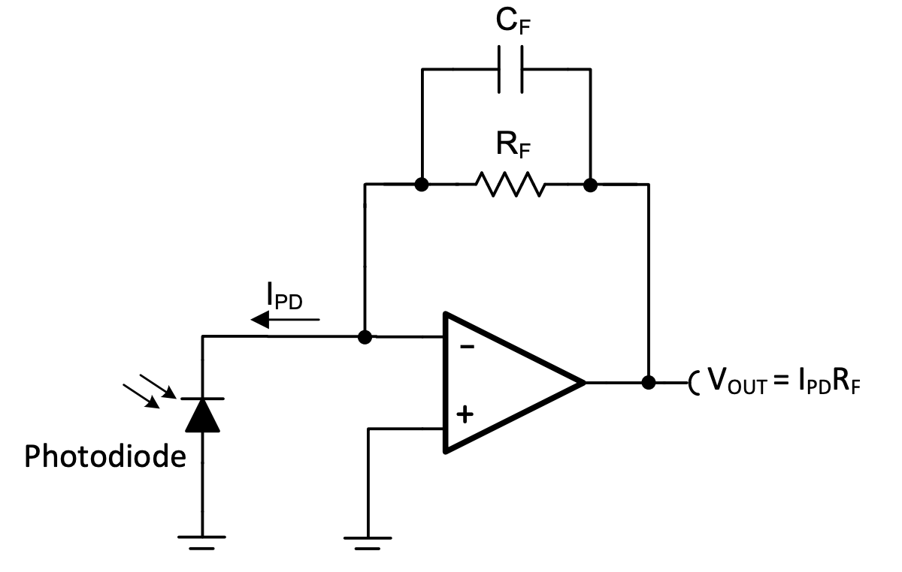

> This post was translated from Korean into English by AI.

I recently worked on a project that required using multiple photodiodes at high speed. In the process, I studied how to design photodiode circuits, and I have summarized what I learned here.

## Photodiode

A photodiode is a semiconductor device that generates current when exposed to light. The equivalent circuit of a photodiode is shown below.

Here, $R_j$ is extremely large (kΩ~GΩ), while $R_s$ is extremely small (Ω~mΩ). These can generally be ignored. However, although $C_j$ typically has a small capacitance of only a few pF, it affects the time constant in high-speed applications and therefore cannot be ignored. This is discussed below.

### Photoconductive Mode vs. Photovoltaic Mode

Photodiodes can operate in two main modes: Photoconductive Mode and Photovoltaic Mode.

#### Photoconductive Mode

Photoconductive Mode operates with a reverse bias applied. Applying a reverse bias increases the photodiode's internal electric field, causing electron-hole pairs to separate more quickly and thus improving response speed. In this mode, the photocurrent varies linearly with light intensity, and the fast signal response makes it particularly suitable for high-speed sensors and optical communication systems.

#### Photovoltaic Mode

Photovoltaic Mode operates without an external bias, naturally generating a voltage when exposed to light. It works on the same principle as a solar cell and is generally used in low-power sensors. This mode has almost no dark current and produces little noise, but its response speed is relatively slow.

> The difference in response speed is modeled by $C_j$ in the equivalent circuit above.

Most high-speed applications use Photoconductive Mode, while Photovoltaic Mode is chosen for slower applications in which stability is important.

## Photodiode Circuit

I had previously used phototransistors. Although phototransistors look similar to photodiodes, they effectively combine a photodiode and a transistor, so they inherently generate much larger currents (tens of mA or more). As a result, when measuring their output with an analog to digital converter (ADC) or a similar device, they were fairly easy to use as long as the pull-down resistor and a simple filter were properly designed.

#### Trans-impedance Amplifier

Photodiodes, however, produce much smaller currents, so current amplification is necessary to measure them. I therefore asked my friend Mr. Bean, who majored in electrical engineering, for help and learned that the following trans-impedance amplifier (TIA) circuit could be used. A TIA is a circuit that converts current into voltage and is one of the most commonly used circuits for photodiodes.

The circuit above uses the photodiode in photoconductive mode. Its gain is $-R_F$, and it is an inverting amplifier.

The circuit above uses the photodiode in photovoltaic mode. Its gain is $R_F$, and because it is a non-inverting amplifier, it has the advantage of allowing the use of a single-supply op-amp.

In this case, however, if $I_\text{PD}$ is 0, $V_\text{OUT}$ should also be exactly 0. In practice, a single-supply op-amp saturates at a value close to 0 instead. To avoid this, a voltage divider can be used to set the non-inverting input slightly above 0V (to about 2% of VCC).

For this project, using a negative voltage would be difficult, and accurately measuring light intensity is important, so I decided to use photovoltaic mode.

#### Sampling Rate

In a TIA circuit, increasing $R_F$ provides higher gain. However, as mentioned earlier, the photodiode's equivalent circuit contains capacitance, which forms an RC low-pass filter. Depending on the value of $R_F$, the circuit may therefore be unable to achieve the desired sampling rate, so this must be checked.

For example, suppose the photodiode has $C_j=5\text{pF}$ and typically produces a current of about $I_\text{PD}=10\mu\text{A}$ at maximum light intensity. To obtain a voltage of about 5V under maximum illumination, the feedback resistor must be set to approximately $R_F=5\text{V}/10\mu\text{A}=500\text{k}\Omega$.

The time constant is then $\tau=R_FC_j=500\text{k}\Omega\times5\text{pF}=2.5\mu\text{s}$. Sampling an analog value requires about five time constants, so the sampling time must be set to approximately 12.5µs. (99.3%) This means that the circuit can only be used at sampling rates of up to approximately 80kHz.

#### Actual Circuit Design

The characteristics of the components that will actually be used are as follows.

- $C_j=4\text{pF}$
- $I_\text{PD}=17\mu\text{A}$
- $V_\text{OUT}=4.5\text{V}$ at maximum light intensity

The maximum voltage of 4.5V was chosen because the op-amp operates at 5V, allowing about 90% of its range—the typical linear region—to be used.

Therefore, the feedback resistor should be set to approximately $R_F=4.5\text{V}/17\mu\text{A}=265\text{k}\Omega$. The time constant is then $\tau=265\text{k}\Omega\times4\text{pF}=1.06\mu\text{s}$, giving a sampling time of approximately $5\tau=5.3µs$. The circuit therefore has a maximum sampling rate of approximately 188kHz.

#### Additional Considerations

When using a photodiode in practice, it is necessary to consider not only the characteristics of the photodiode itself but also surrounding circuit elements such as the ADC, multiplexer (MUX), and op-amp. In high-speed systems in particular, the response speed and settling time of each element affect the overall sampling rate.

For this project, I plan to use an ADC with a maximum sampling rate of 200kHz and designed the system to operate at half that rate, or 100kHz. The photodiode and TIA circuits must therefore support at least this speed.

In addition, because 16 photodiodes are multiplexed through a MUX, the MUX switching time and the op-amp's slew rate and settling time must also be considered. According to the datasheets, the switching time and propagation delay of the MUX used are extremely short—on the order of nanoseconds—and can be ignored. However, the op-amp's 0.1% settling time is approximately 7µs, making it the main limiting factor for the overall sampling rate. This corresponds to a maximum sampling rate of approximately 143kHz, which is more than sufficient to meet the design target of 100kHz.

Finally, the ADC's Track & Hold (sampling) time is also an important factor. The ADC used operates at a clock speed of 3.2MHz and has a Track Time of three cycles, requiring approximately 1µs of additional sampling time. Taking this into account, the total sampling time is approximately 8µs, yielding a theoretical sampling rate of 125kHz. This confirms that the final design can comfortably maintain a sampling rate of 100kHz.

## Conclusion

I studied and summarized how to design a circuit using a photodiode and the considerations involved.

## References

#### Technical Notes

- https://www.ti.com/lit/an/sboa061/sboa061.pdf
- https://www.analog.com/media/en/technical-documentation/technical-articles/s54_en-circuits.pdf
- https://www.ti.com/lit/ug/tidu535/tidu535.pdf

#### Datasheets of Components

- [Photodiode(VEMD2020X01)](https://www.lcsc.com/datasheet/lcsc_datasheet_2410121811_Vishay-Intertech-VEMD2020X01_C3210968.pdf)
- [Op-amp(OPA378)](https://www.ti.com/lit/ds/symlink/opa378.pdf)
- [Mux(74HC4067)](https://www.ti.com/lit/ds/symlink/cd74hc4067.pdf)
- [ADC(ADC124S021)](https://www.ti.com/lit/ds/symlink/adc124s021.pdf)
