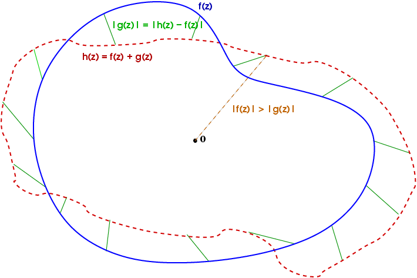

> This post was translated from Korean into English by AI.

Yesterday, while watching YouTube, I came across the fascinating video below. It explains how to use Rouché's Theorem to find the number of zeros of a complex function within a given region.

<iframe width="560" height="315" src="https://www.youtube.com/embed/L7qC5pm2tmA" title="YouTube video player" frameborder="0" allow="accelerometer; autoplay; clipboard-write; encrypted-media; gyroscope; picture-in-picture" allowfullscreen></iframe>

# Definition

In simple terms, Rouché's Theorem as explained in this video says the following.

**"If $|f(z)|>|g(z)|$ holds everywhere on the boundary $\partial D$ of a region $D$, then $f(z)$ and $f(z)+g(z)$ have the same number of zeros inside $D$."**

When $|f|>|g|$ holds everywhere, we say that $f$ is dominant over $g$.

Using this theorem, if we want to find the number of zeros of a complicated polynomial $h(z)$ within some region $D$, we can make the problem easier by splitting $h(z)$ into a simple, dominant term $f$ and the remaining terms $g$.

# Example

Let us follow the example from the video. We want to find the number of zeros of $h(z)=z^5+3z^2+1$ in $D = \set{z|1<|z|<2}$.

To do so, we divide the region into $D_1 = \{z | |z| <1\}, D_2 = \{z ||z|<2\}$, then subtract the number of zeros in $D_1$ and on $\partial D_1$ from the number of zeros in $D_2$.

First, to determine the number of zeros inside each region, note that on $\partial D_1$, $|z|=1$, so $|z^5|=1$ and $|3z^2|=3$. Therefore, $|z^5+1|\leq|z^5|+1=2<|3z^2|$.

Thus, we can split $h$ into $f(z)=3z^2$ and $g(z)=z^5+1$.

It follows that the number of zeros of $h(z)$ inside $D_1$ is 2, the same as the number of zeros of $f(z)$. (A double zero at $z=0$)

> Note that only the number of zeros is the same; the zeros themselves are not necessarily identical. Therefore, (in general) $h$ does not have a zero at $z=0$.

Similarly, on $\partial D_2 = \{ z| |z|=2\}$, we have $|z^5|=32>|3z^2|+1=4>|3z^2+1|$, so we can split $h$ into $f(z)=z^5$ and $g(z)=3z^2+1$.

Therefore, the number of zeros of $h(z)$ inside $D_2$ is 5, the same as the number of zeros of $f(z)$.

Finally, we need to show that $h$ has no zeros on $\partial D_1 = \{z||z|=1\}$.

The video also demonstrates this in a very simple way, as follows.

If a zero with $|z|=1$ existed, then

$$
z^5+3z^2+1=0\\
\therefore 3z^2=-z^5-1\\
\therefore |3z^2| = |z^5+1|\\
\therefore 3 = |z^5+1| < |z^5| + 1 = 2\\
\therefore 3<2
$$

would have to hold. This is clearly false, so there is no $|z|=1$ satisfying $z^5+3z^2+1=0$.

> This is actually inevitable because $f(z)$ is dominant over $g(z)$ on $\partial D_1$. If a zero existed on the boundary, then $h=f+g = 0$, so $f=-g$ and hence $|f|=|g|$, which would mean that $f$ is not dominant.

Therefore, the number of zeros inside $D_2$ - the number of zeros on $\partial D_1$ - the number of zeros inside $D_1$ = $5-0-2= 3$.
