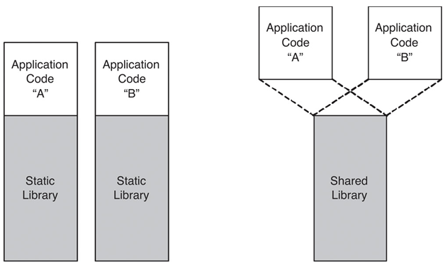

> This post was translated from Korean into English by AI.

While working on a recent personal project, I ran into an issue related to distributing a shared library package. To understand the problem accurately, I revisited shared objects and summarized what I learned here.



## Libraries

Libraries are generally divided into static libraries and shared libraries. Shared libraries are also called dynamic libraries; the former term is used on Unix-like operating systems, while the latter is used on Windows. Since this post deals with Linux, I will use the term “shared library” throughout.

#### Static Libraries

A static library is the most straightforward kind of library: it is copied into and included in the target binary at compile time. Static libraries use the `.a` extension, which stands for archive.

#### Shared Libraries

A shared library is loaded at runtime and can be used by multiple programs. Shared libraries use the shared object file format, with the `.so` extension.

#### Advantages and Disadvantages of Static and Shared Libraries

- Because a static library is included in the program itself, its version is clearly defined and the program depends less on its runtime environment.
- By contrast, a program using a shared library may behave differently depending on which version is installed in the environment where it runs. If the required library is not installed, the program cannot run at all.
- If multiple programs require the same static library, unnecessary duplication increases their total size and may consume a great deal of memory at runtime.
- Shared libraries, on the other hand, can reduce these problems.

These tradeoffs become even clearer when libraries reference many other libraries and form complex relationships. If only static libraries are used, binaries can become extremely large. With shared libraries, however, multiple versions may coexist, making dependency and version management very difficult.

## Building a Program That Uses Shared Libraries

> The program build process varies depending on the executable file format. This post explains it in terms of the Executable and Linkable Format (ELF).

The program build process can be divided into the following stages:

- Preprocessing
- Compilation
- Assembly
- Linking

Typically, a utility such as `gcc` is used to build a binary directly from source code. In reality, however, `gcc` is a frontend that uses separate programs such as `cpp` (the preprocessor), `cc` (the compiler), `as` (the assembler), and `ld` (the linker). The actual work is performed through a combination of these individual stages.

#### Compilation and Assembly

The compiler converts code written in C into assembly language, and the assembler converts the assembly language into machine code. At this point, the locations of symbols such as functions and global variables cannot be determined during compilation or assembly. This is because the compiler and assembler operate on individual source files and know nothing about other object files or libraries. The compiler therefore inserts stubs rather than actual addresses into instructions that use functions or global variables.

These stubs are later replaced with actual memory addresses during linking, a process called relocation. The locations of instructions that require relocation are recorded in relocation entries. These are stored in the `.rel` or `.rela` section of an ELF file; specifically, they record the offset of each instruction requiring relocation and the symbol that must be relocated. The following is an example of a relocation table.

```text
Relocation section '.rela.text' at offset 0x2e0 contains 4 entries:
  Offset          Info           Type           Sym. Value    Sym. Name + Addend
00000000000a  000a00000002 R_X86_64_PC32     0000000000000000 global_var - 4
000000000032  000b00000004 R_X86_64_PLT32    0000000000000000 print_global_var - 4
... omitted
```

For this relocation to take place, information about the symbols contained in the object file is also required. This information is stored in the symbol table, in the `.symtab` section of the ELF file. The symbol table includes each symbol’s name, type, data size, and the memory address at which it will be loaded. Before linking is complete, however, memory addresses cannot be determined, so the symbol’s relative location within the object file is recorded and then replaced during linking. The following is an example of a symbol table before linking.

```text
Symbol table '.symtab' contains 15 entries:
   Num:    Value          Size Type    Bind   Vis      Ndx Name
    ... omitted
    10: 0000000000000000     4 OBJECT  GLOBAL DEFAULT    4 global_var
    11: 0000000000000000    36 FUNC    GLOBAL DEFAULT    1 print_global_var
    ... omitted
    13: 0000000000000000     0 NOTYPE  GLOBAL DEFAULT  UND printf
    14: 0000000000000024    25 FUNC    GLOBAL DEFAULT    1 main
```

Here, the `Ndx` field indicates the section to which the symbol belongs. The `UND` value for `printf` means that this symbol is defined externally.

#### Linking

The linker combines the object files produced in this way. To do so, it first resolves their symbol tables. During this process, the linker determines the absolute address of each symbol and updates the relative addresses recorded in the symbol tables to absolute addresses. It then reads the relocation entries and relocates the symbols referenced by the instructions.

When object files are linked during the build or a static library is used, the linker replaces relocation entries with actual memory addresses. Because a shared library is loaded at runtime, however, the locations of its symbols cannot be determined at compile time. In this case, mechanisms called the Procedure Linkage Table (PLT) and Global Offset Table (GOT) are used; they are explained in the next section. Once linking is complete, the symbol table is no longer needed. Symbols defined in shared libraries must be retained, however, so they remain in the `.dynsym` section.

> By default, shared libraries and executable files include symbol tables that are unnecessary except for debugging. If size is critically important, the `strip` utility can be used to remove unnecessary symbols.

## The Dynamic Linker

The dynamic linker is a program that enables a program to use shared libraries at runtime. When the program starts, the dynamic linker reads the `.dynamic` section of the ELF header and loads the required shared libraries into memory. When a shared library is referenced during execution, it handles the reference using the PLT and GOT mechanisms mentioned above.

During linking, instructions that use symbols from a shared library are replaced so that they jump to PLT entries instead of referring to absolute addresses. The PLT is constructed from the `.dynsym` section when the program starts, and each PLT entry consists of a few simple instructions that invoke the function in the corresponding GOT entry. Initially, GOT entries point to the dynamic linker rather than to addresses in the actual library. The dynamic linker finds the appropriate symbol in the shared library, updates the GOT to point to that symbol, and then invokes the function. Thus, the dynamic linker is called the first time a shared-library symbol is referenced, but subsequent references go directly to the symbol in the shared library.

The dynamic linker is itself a shared library. This creates a problem: loading the dynamic linker would seem to require the dynamic linker. To solve it, the `.interp` section of the ELF file contains the location of the dynamic linker, and the program’s entry-point code includes code that loads the dynamic linker into memory. As a result, linking the dynamic linker does not itself require the dynamic linker. This also means that the dynamic linker must have a predetermined location, standardized as `/lib/ld.so`, `/lib/ld-linux.so`, or `/lib64/ld-linux-x86-64.so`.

> It is also possible to modify the ELF header to use a different dynamic linker. The program would then be unable to run on other systems, however.

The dynamic linker may itself depend on external shared libraries. It therefore includes an initialization process that resolves its own dependencies first.

## How the Linker Searches for Shared Libraries

Shared libraries are not included in the program. Nevertheless, the linker must be able to reference them at compile time in order to link the program correctly, because it must search shared libraries for any undefined symbols.

It is possible to configure every undefined symbol to be looked up in shared libraries at runtime. In general, however, this should not be done: if a developer accidentally fails to define a symbol, there would be no way to catch the mistake at compile time.

> A definition and a declaration are different. Regardless of whether a definition exists, compilation will always fail if there is no declaration.

The linker searches for shared libraries in the following order:

1. Paths specified with the compilation option (`-L`)
1. Standard GCC library paths such as `/lib` and `/usr/local/lib`
1. The `LD_LIBRARY_PATH` environment variable
1. Paths specified by `rpath` and `runpath` (explained in the section below)
1. Other locations

The `-L` option can be supplied more than once, and specifying the same path multiple times does not cause a problem. The linker selects the first library it finds when searching in the order above and ignores any later library with the same name.

## How the Dynamic Linker Searches for Shared Libraries

The dynamic linker searches for shared libraries in the following order:

1. Paths set in the ELF header’s `RPATH` (only if `RUNPATH` is not set)
1. Paths specified by `LD_LIBRARY_PATH`
1. Paths set in the ELF header’s `RUNPATH`
1. Paths specified in the cache file `/etc/ld.so.cache`
1. The runtime linking configuration file `/etc/ld.so.conf`
1. Default system library paths such as `/lib` and `/usr/local/lib`

> RPATH is a legacy setting that is no longer used because it takes precedence over the `LD_LIBRARY_PATH` environment variable. Furthermore, `LD_LIBRARY_PATH` is intended for debugging or testing; packages should not depend on this path or modify it when distributed.

## Managing Shared Libraries

A system needs a well-designed versioning policy for managing shared libraries. Shared libraries may exist in multiple versions after updates, and different programs may depend on different versions. A library may even be updated while a program is running. To address these issues, Linux manages shared-library versions through library filenames and symbolic links.

Every library on Linux has at least two names:

- `real name`: The name of the actual library file, including a detailed version number, such as `libmylib.so.1.2.3`.
- `soname`: A special name that indicates library compatibility and follows these rules:
  - It begins with the `lib` prefix. As a special exception, the lowest-level C library does not begin with the `lib` prefix.
  - It consists of `.so` plus the major version number. Here, a major version denotes updates that do not change the library’s Application Binary Interface (ABI). In other words, libraries with the same major version are compatible at the code level even if their internal behavior differs.
- General name: This is optional and used for development. It is simply the library name followed by the `.so` extension, as in `libmylib.so`.

For example, `libmylib.so.1` is a valid soname.

> `soname` is pronounced either _so-name_ or _S-O-name_.

On Linux, a symbolic link bearing this soname is created for the actual library file. Programs should refer to the soname, not the real name. This allows programs to remain compatible when an installed library has a different minor version. Likewise, developers must update the major version whenever the ABI changes before distributing the library.

Accordingly, a shared library has the following symbolic-link structure:

```text
libmylib.so.1 -> libmylib.so.1.2.3 (symbolic link, referenced by the dynamic linker)
libmylib.so.1.2.3 (actual library file)
```

The symbolic link bearing the soname is created by the `ldconfig` utility. The `ldconfig` utility creates a symbolic link with the appropriate soname and registers it in `/etc/ld.so.conf`, caching it so the dynamic linker can find it quickly. In a typical Debian package, these steps are performed by a post-installation script after installation, so the user does not need to run this utility.

## Developing with Shared Libraries

To develop with a shared library, you need the shared-library binary, a symbolic link bearing the general name, and header files. The symbolic link with the general name is used only for development and normally points to the latest soname symbolic link, since the latest library is usually desired. If necessary, however, it may instead point to the soname of an older version.

When a shared library is needed only at runtime, neither the symbolic link with the general name nor the header files are necessary. They are therefore usually omitted from the main package. Instead, a separate development library package is distributed containing the shared library together with the general symbolic link and header files. These development libraries usually have the `-dev` suffix.

After installing the development package, the symbolic-link structure is therefore as follows:

```
libmylib.so -> libmylib.so.1 (symbolic link, used during compilation, not required)
libmylib.so.1 -> libmylib.so.1.2.3 (symbolic link, referenced by the dynamic linker)
libmylib.so.1.2.3 (actual library file)
```

## Conclusion

This post covered how programs that use shared libraries are built, how shared libraries are dynamically linked when programs run, and how shared libraries are managed.

## References

- https://ko.wikipedia.org/wiki/%EC%A0%95%EC%A0%81_%EB%9D%BC%EC%9D%B4%EB%B8%8C%EB%9F%AC%EB%A6%AC
- https://tldp.org/HOWTO/Program-Library-HOWTO/static-libraries.html
- https://en.wikipedia.org/wiki/Shared_library
- https://en.wikipedia.org/wiki/Global_Offset_Table
- https://en.wikipedia.org/wiki/Linker_(computing)
- https://octo.org.uk/posts/shared-object-names/
- https://aimlesslygoingforward.com/blog/2014/01/19/bundling-shared-libraries-on-linux/
- https://tldp.org/HOWTO/Program-Library-HOWTO/shared-libraries.html
- https://www.bogotobogo.com/cplusplus/libraries.php
