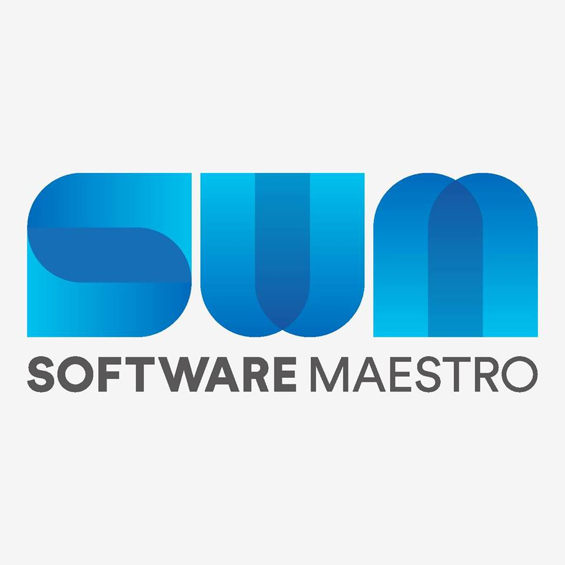

> This post was translated from Korean into English by AI.

Last year, throughout 2021, I took part in the Software Maestro program.

So many things happened, and now the entire program is over. I am writing this retrospective to organize and share my experience.

# What Is Software Maestro?

Software Maestro is a government program that fosters entrepreneurs in the software field.

Recruitment usually begins in March. The program consists of a preliminary program from April through May and a main program from June through November. During the preliminary program, there are usually a few official events such as an orientation and a hackathon; aside from those, participants can freely sign up for lectures given by mentors. Attendance at official events is generally mandatory, but they do not happen very often. There is a minimum number of lecture hours you must complete, but it does not take long to meet the requirement.

> I signed up for a great many lectures and attended one almost every day, although many people did not take very many.
>
> In my experience, the quality and content of the lectures varied enormously depending on the mentor. With some mentors, it was obvious that they were merely filling the allotted time, while others left me wishing there had been more time because they clearly had more they wanted to explain. Some lectures consisted of reading directly from PowerPoint slides—and were unbelievably boring—while others were engaging and hands-on.
>
> In my view, lectures during the preliminary program are almost the only way to find good mentors. The most reliable information comes from trainees in earlier cohorts, but if you do not know anyone from a previous cohort, I recommend attending lectures by a different mentor each time. In particular, there are mentors who are like reclusive masters: they post almost no lectures in the first half of the program, then occasionally offer one later on. Many of them seem to be excellent mentors.

In the main program—at least for the 12th cohort—a team consists of three trainees who recruit three mentors. Unlike other programs, Software Maestro has no fixed curriculum.

- You are free to decide everything: which project to pursue, which technology stack to use, and which development methodology to follow.
- You can even carry out the project under a mentor's direction, or have the team members make every decision while the mentors simply offer advice.
- While working on the project, you can rent an office and commute, work entirely remotely, or rent a studio apartment or similar place and live together while you work.

As a result, every team approaches its project differently during the main program.

> One of our team members had come to Seoul from another region, so when he looked for a place to live, he chose a roomy apartment from the outset. We lived and worked on the project there about three to five days a week.

During the main program, there are three evaluations: the project proposal review, the midterm evaluation, and the final evaluation. All three assess matters such as whether the project is feasible, whether it has commercial or technical value, and whether it is socially beneficial. The resulting score is the project score, which every member of a team receives equally. The score from the project proposal review does not count toward the final score; only the midterm and final evaluation scores do. The final evaluation carries a particularly heavy weight, so that score is important.

Around the time of the final evaluation, trainees also take an exam called TOPCIT. An individual's final score is determined by combining the TOPCIT score, the score each mentor gives that trainee, and the project score mentioned above.

The top 10% of trainees based on these scores can earn certification, and certified trainees are given the opportunity to take part in an overseas training program. I was fortunate enough to just barely make it into the top 10%, so I was able to go abroad as well.

# What Are the Benefits of the Software Maestro Program?

The greatest benefit is the network. Software Maestro brings together people with a truly wide range of technologies and backgrounds. That applies to the mentors as well as the trainees. Building a strong network here can become a tremendously valuable asset later on. I believe the value of a network extends beyond simply helping with employment or starting a business. There will be many times in life when you have to make plans and decisions, and merely knowing what decisions other people made in similar situations—and how those decisions turned out—can be enormously helpful.

The next benefit is experience. I see it this way: if I know that I do not know something, I can study it, but if I do not even _know that I do not know it_, that is a problem. So what should you do when you do not even know whether you know something? You have to try something you have never done before. Software Maestro is extremely helpful in that respect. For example, what kinds of problems can arise when working on a team project, especially a long-term project lasting more than six months rather than a short one? If you start a company later, how should equity issues be resolved? If you sell a product, what is an appropriate price? How do you determine the right business model for your product? What is the best way to coordinate things when there are too many development requirements? What if conflict arises between team members? While taking part in Software Maestro, I was able to broaden my perspective by confronting problems like these—problems whose existence I had not even been aware of—making appropriate decisions, and observing the results.

In particular, when you join a company or work on a project at school, you are usually solving an assigned task. The problem to solve has already been chosen, so your focus is on finding the solution. At Software Maestro, however, you have to identify the problem yourself. I am convinced that this, too, is an extremely valuable experience. Moreover, decisions like these in the real world always involve financial and social risks. But when working on a Software Maestro project, there are no bosses or subordinates, and there is no financial burden because the program provides project funding. It is therefore an excellent opportunity to make all kinds of decisions without risk.

The final benefit is what you receive if you earn certification. Before this program, I had never visited the United States in my life. The United States is a much larger market than Korea, and if I entered that market, I would be able to achieve greater growth. Even so, I knew nothing about how to prepare for going to the United States or what life there was like. Through this overseas training program, however, I was able to visit the country, travel to various places, and have a great many experiences. In particular, the trainees had to pay almost nothing for this trip because it was funded entirely by the government, allowing us to enjoy a wide range of experiences without a financial burden.

During the trip, I had many opportunities to meet people working in Silicon Valley. This gave me a chance to learn how people work there, which technology stacks they use, how they evaluate performance, and how they motivate people.

I would also add that if your Software Maestro project is successful and you want to launch a startup based on it, a great deal of support is available. In particular, several startup support programs are open exclusively to Software Maestro trainees, which should make them highly useful for anyone who wants to start a business.

# What Should You Prepare?

Many people prepare for Software Maestro and gather all kinds of information. Some say algorithms are important, while others say the interview is important. But what I most want to emphasize is the importance of having a goal for what you want to learn at Software Maestro. Of course, as mine did, that goal will continue to change. Once you actually begin the program, you may find that it is different from what you expected. As I mentioned earlier, however, Software Maestro only provides an overall direction and various forms of support; it does not provide trainees with a detailed curriculum. It is up to each trainee to make the most of those resources and decide what they will gain from the program.

At first, I planned an expensive, hardware-based project that would have been difficult to pursue on my own, using the mentors' technical support and Software Maestro's financial support. I kept that goal consistent throughout my personal statement and interview preparation, and I was accepted. Once I actually joined the program, I realized that although technology was important, business mattered more than I had expected, and that I had a great deal to learn in that area. So I revised my goal and decided instead to experience the full product life cycle: defining the problem, building a PoC and an MVP, developing the product in an agile way based on customer feedback, creating a business model, maintaining it, and so on.

My team members and I all shared this goal, so we used it as the basis for our decisions. There were many twists and turns, but the project went well. We received feedback from many customers and continuously improved the product by incorporating it. I am confident this experience will continue to help me no matter what I do in the future.

> Of course...if your algorithm, SQL, or web skills are severely lacking, it will be difficult to get accepted in the first place, so you will need to study. My SQL skills were a little weak, and the site below helped me a great deal.
>
> - [https://www.w3schools.com/sql/](https://www.w3schools.com/sql/)

# So, How Was It?

I learned how to start and carry out a project, how to collaborate, how to prioritize development work, how to handle conflict, how to market a product, how to refactor code, how to design database architecture, how to write secure code, how to build a reliable development pipeline, how to operate and deploy Kubernetes-based services, how to perform load balancing, how to find a suitable business model, what to prepare before seeking investment, and what happens after receiving it. Above all, I gained the relationships I built with my teammates and the other Software Maestro trainees.

I took a leave of absence for the first semester to begin Software Maestro, then extended it through the second semester. Since I had not yet completed my military service, I would enter the military much later than others and consequently graduate later as well. Despite that, I gained so much from the experience, and I do not regret it in the slightest.

> Of course, I might feel a little differently if I get to the military and find out I am the oldest one there...
