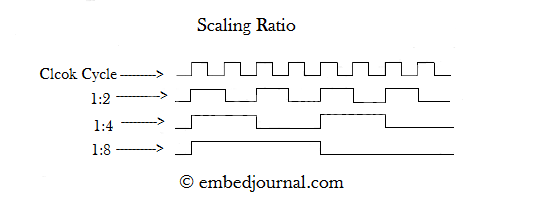

> This post was translated from Korean into English by AI.

# What Is a Timer?

Timers are indispensable devices in the ARM architecture. ARM timers can be connected to a variety of other peripherals. This allows them to be used for countless purposes beyond simply generating interrupts after a certain amount of time or at regular intervals, including PWM generation and encoder counting. In this post, I would like to organize some of the key ideas behind these timers.

# Timer Structure

As mentioned above, ARM timers can be used for many purposes, but this post will cover only the use of timers to generate interrupts at regular intervals.

To control a timer correctly, you need to understand the following four concepts.

- Counter
- Auto Reload Register (ARR)
- Prescaler
- Preload

## Counter

The counter is, quite literally, a counter whose numeric value increases, implemented as a single register (usually 16 bits). Every timer has its own counter register. When you start a timer, the value in this counter register continuously increases by 1 per clock cycle. When the register overflows and returns to 0, a timer interrupt is generated.

## Auto Reload Register (ARR)

The ARR is a register of the same size as the counter, and its role is to determine when the counter overflows. Of course, the counter would inevitably overflow when it reached the largest value the register could hold, but that would make the counter operate at only one fixed period, which would not be very useful. More specifically, the counter overflows and returns to 0 on the clock cycle immediately after it reaches the value in the ARR. For example, if ARR = 3, the counter behaves as follows.

**0** > 1 > 2 > 3 > **0** > 1 > 2 > 3 > **0** > 1 > 2 > 3 > ....

Therefore, the timer generates an interrupt once every ARR **+1** clock cycles. Expressed as a formula, if the clock supplied to the timer is $f$Hz and the timer's $ARR$ value is $a$, timer interrupts occur at $f/(a+1)$Hz. Thus, if $a=0$, a timer interrupt occurs on every clock cycle (although, of course, the CPU would not be able to operate properly), and if $a=65535$, an interrupt occurs once every 6553**6** clock cycles.

In most cases, of course, the ARR is set to a large value in the hundreds or tens of thousands, so a small difference of around 1 does not matter very much. In precision control applications where timing is critical, however, errors like this can accumulate and cause major problems.

## Prescaler

The term *prescaler* is not easy to translate into Korean. It is usually translated as something along the lines of *frequency divider*. The Korean term literally means splitting a period, which might make it sound as though the period becomes shorter and the timer operates faster, **but in reality, the opposite is true.** A prescaler is a device that slows down the clock supplied to the counter. When the clock is divided, multiple clock cycles supplied to the timer are combined into one, causing the timer to operate more slowly. The ratio that determines how many clock cycles are combined into one is called the **division ratio**. The figure below shows the divided clocks for division ratios of 2, 4, and 8 relative to the supplied clock.

Intuitively, you can think of a prescaler as a device that, like a timer, has an internal counter. This counter increases on each clock edge, then overflows and inverts its output when it reaches the division-ratio value.

The important point here is that **the prescaler value is not the division ratio**. Instead, it is the value that determines when the prescaler's internal counter overflows. **Just as with the ARR**, if the clock input to the prescaler is $f$Hz and the prescaler value is $p$, the prescaler's output clock is **not** $f/p$, but $f/(p+1)$. In fact, many resources you can find online (especially Korean ones) overlook this fact.

Unlike the ARR, the prescaler is often set to a small value such as 5 or 10. In such cases, if you mistake the prescaler value for the division ratio when configuring it, you can end up with a large error of around 10–20%. Therefore, whenever you use a prescaler, you must remember that its division ratio is the configured value plus 1.

To summarize, given

- a clock of $f_c$Hz supplied to the timer,
- an ARR value of $a$, and
- a prescaler value of $p$,

the frequency $f_i$ at which timer interrupts occur can be calculated as follows.
$$
f_i=\frac{f_c}{(a+1)(p+1)}
$$
In actual development, because there are not many situations where you need to control frequencies across an extremely wide range, the prescaler value is usually calculated and fixed in advance, while the timer period is controlled by adjusting the ARR.

## Preload

Unlike the previous three concepts, preload is not a numeric value, but a setting that determines when a change to the ARR takes effect.

- If preload is enabled, changing the ARR does not update it immediately. Instead, the new value is temporarily stored in a place called the preload register, and the ARR is updated when the counter overflows.
- If preload is disabled, changing the ARR updates it immediately.

But why is this setting necessary?

Consider changing the ARR from 500 to 490 while preload is disabled. Under ordinary circumstances—for example, when the counter value is 123 or 321—there is no problem. The counter continues to increase, and when it reaches 490 instead of 500, it overflows and returns to 0. But what happens if, **at the exact moment the ARR is changed from 500 to 490, the counter value happens to be 495?**

In this case, the ARR should limit the counter value, but it fails to do so, leaving the counter greater than the ARR. In ARM, however, the counter is designed to overflow when it becomes **equal to** the ARR value, so no overflow occurs in this situation. The counter does not return to 0 until it has increased all the way to the largest value it can hold (65535 for a 16-bit counter). In other words, the interval between interrupt calls suddenly becomes extremely long.

Preload is a setting designed to solve this problem. If preload had been enabled, changing the ARR to 490 while the counter was at 495 would leave the actual ARR fixed at 500. Only after the counter reached 500 and overflowed would the ARR be set to 490, preventing the problem.

Another way to solve this problem is to use a down-counter instead of an up-counter. Unlike an up-counter, a down-counter continuously decreases its value. When it reaches 0, an underflow occurs and the counter value is changed to the ARR. In this case, the problem described above does not occur regardless of whether preload is enabled.

### TMI

I have actually run into this problem myself. (It is also what prompted me to write this post.) When I drove a stepper motor without enabling preload, it seemed to run properly at first, but then its timing would suddenly go out of sync. Stepper motors are extremely sensitive to timing, so even a slight mismatch can cause them to lose steps or make an unpleasant noise. It was not something I could simply leave unresolved... and I had a very hard time tracking down the cause.

What makes matters worse is that this problem occurs only when the counter value lies between the old ARR and the new ARR. As a result, if the ARR is decreased very slowly, the problem can be difficult to detect. In other words, everything may appear fine during testing, only for the problem to emerge after the system has been in actual use for quite some time.
