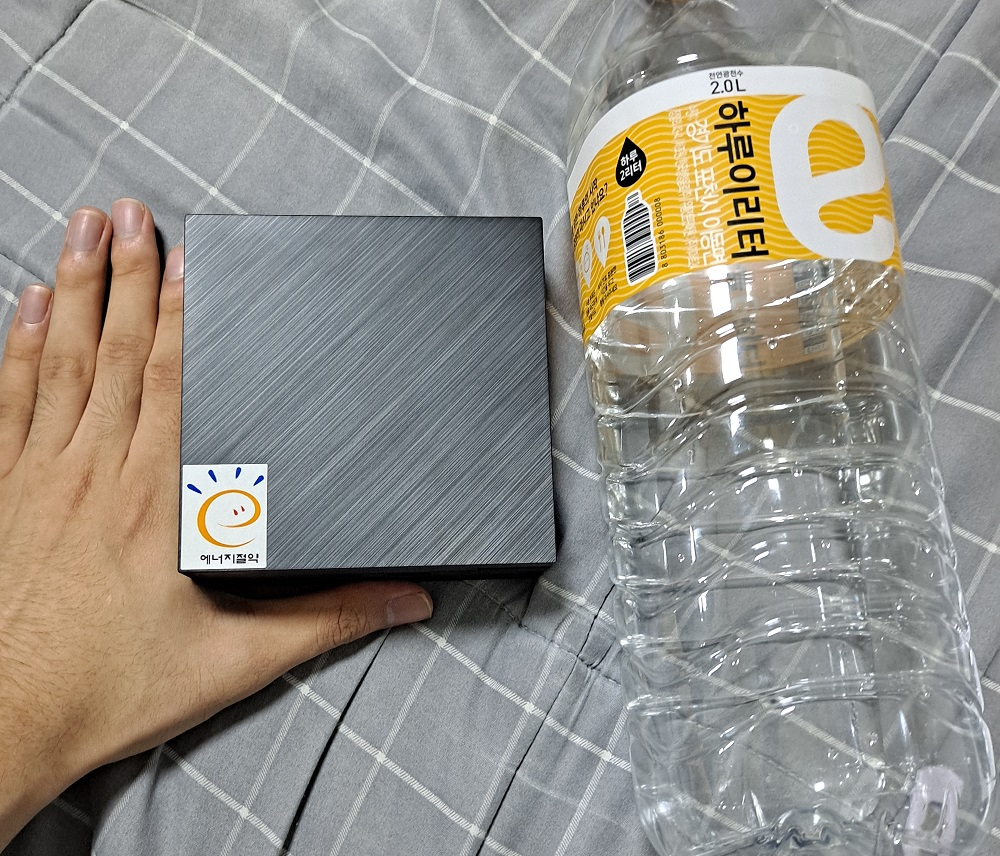
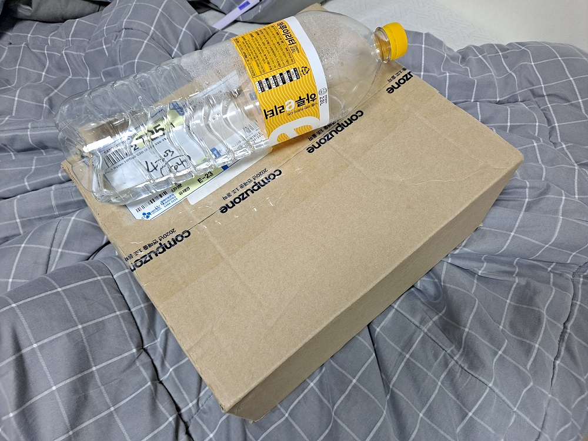
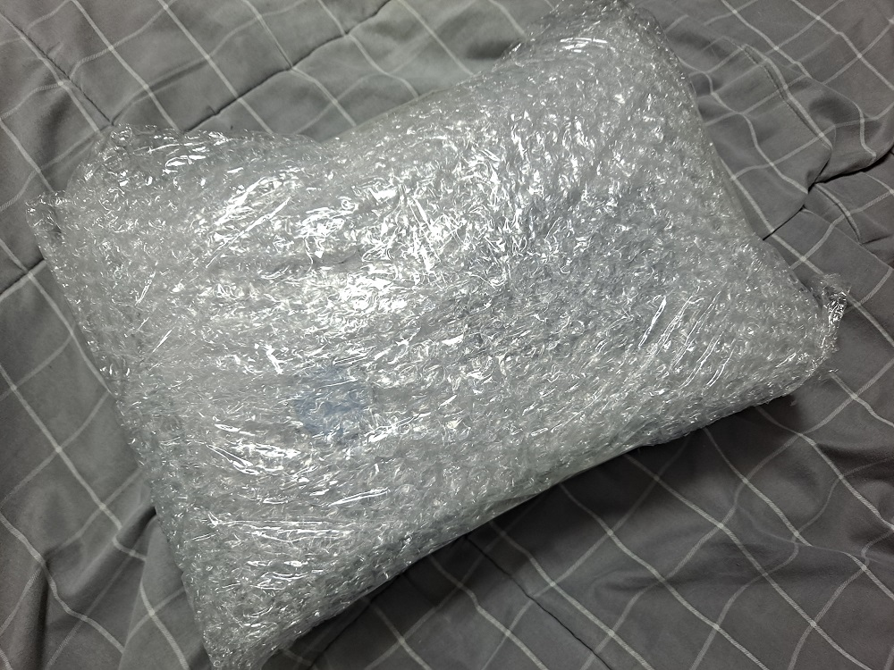
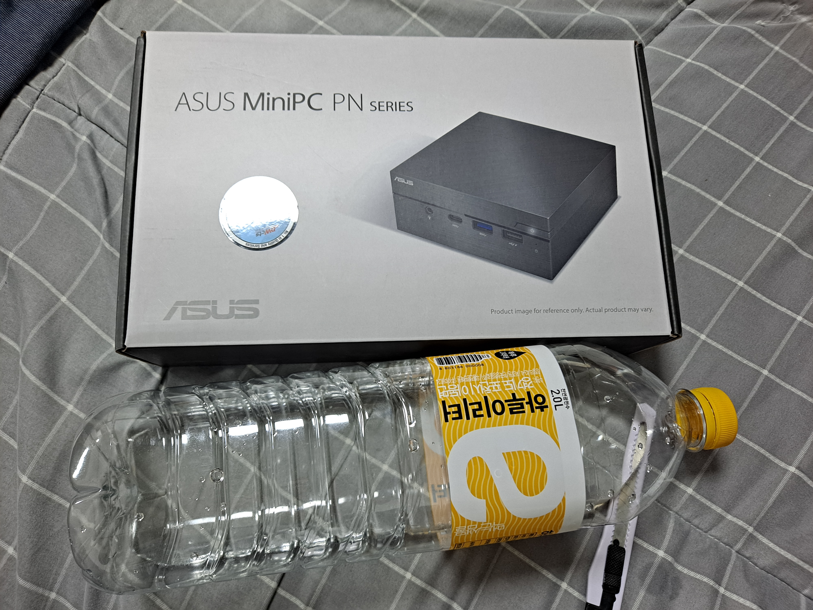
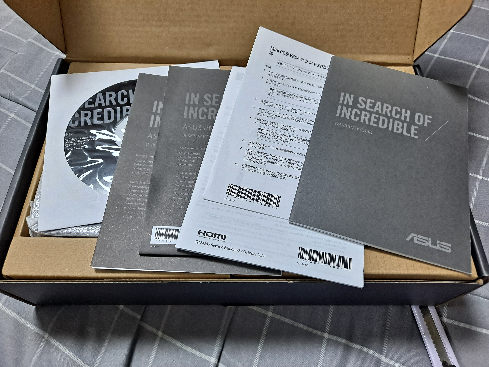
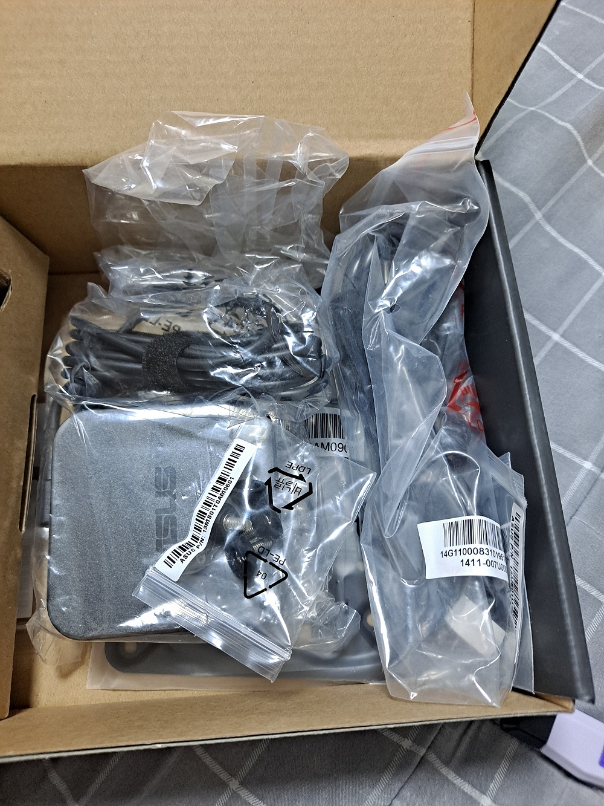
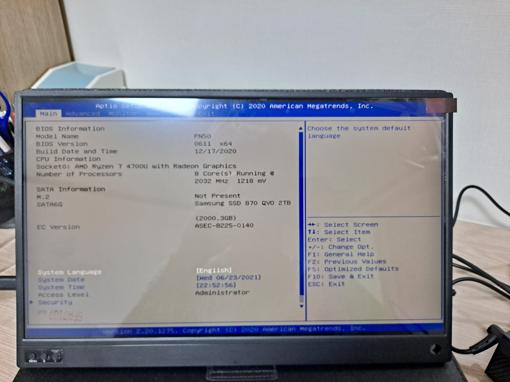

> This post was translated from Korean into English by AI.

Now that my Software Maestro activities have begun in earnest, I have become eligible for a device allowance of KRW 2 million. I used it to purchase a MacBook Air and a test server, and I would like to share my experience with the test server as well as unbox it. Of course, since I was not paying for it with my own money, I did not worry about value for money and bought the highest-spec configuration available within the budget. As a result, others may feel that it is not particularly cost-effective.

To get straight to the point, I am very satisfied with it.

> Just in caaaase, let me emphasize this again: I purchased this device with the device allowance provided as part of the Software Maestro program. I received absolutely no support from the manufacturer or distributor.

# Product Description

The product I purchased was the [ASUS MiniPC PN50 Ryzen 7 4700U M2 (32GB, M2 2TB)](http://c7n.co.kr/product/productView.php?nProdCode=12471500), with the following specifications:

- Ryzen 7 4700U CPU (8 Core)
- 32GB DDR4 RAM
- 2TB SSD
- USB 3.0
- USB 3.2 Gen1
- USB Type-C
- No OS

> It was KRW 1.05 million if paid in cash when I bought it, but the price has already gone up.

# Unboxing

First, it was delivered in packaging that was very large and impressive compared to the actual size of the product.

Inside was a box practically suffocating in bubble wrap.

There was only one product box inside the bubble wrap.

When I opened the box, I found a huge number of manuals and a CD. After removing them, the main unit was wrapped in plastic on the left, while the compartment on the right was covered. I have no idea what the CD contained and never had any reason to use it, and all the manuals covered simple things. For example, they explained how to connect a keyboard, mouse, monitor, adapter, and so on, and how to turn the device on. I suppose they must have had a lot of customers complain that it did not work without making even the basic connections.

The user manual included a few precautions, but most of them were obvious: do not spill water on it, use a genuine coin-cell battery, make sure the coin-cell battery is inserted in the correct direction... These, too, gave me a sense of the hardships faced by the customer support team.

When I removed the cover over the compartment on the right, I found the power adapter along with a mount for attaching the unit to a wall. I planned to use it on top of my desk, so I did not use the mount.

This is roughly how large the product is once unboxed. The energy-saving logo looks a little out of place. But since I bought this to use as a server, where power consumption matters, I actually liked it. It was also smaller than I had imagined.

Since I purchased it without an operating system installed, the only thing that appeared when I turned it on was the BIOS screen. I installed Ubuntu Server 20.04, and for security, I plan to run it inside a virtual machine set up with Vagrant.

# Impressions

To be honest, I have not done much with it yet, so there is not a great deal to say about using it. One extremely compelling advantage, though, is that it is **incredibly quiet**. To begin with, there are no physically moving parts inside other than the fan, and perhaps because it is a Ryzen system and does not generate much heat, the fan barely spins. Even when it does, it is not particularly loud. It is far quieter than the 2-bay external hard drive next to it, the refrigerator, or the air conditioner.
